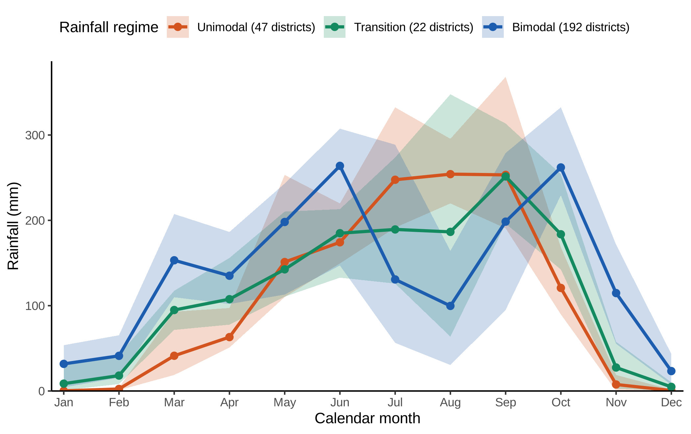
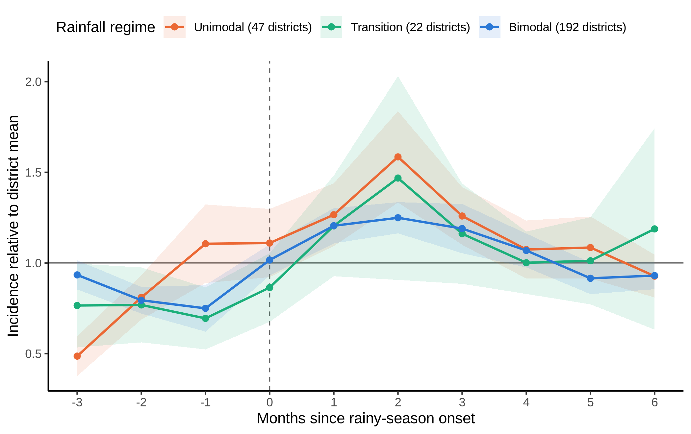
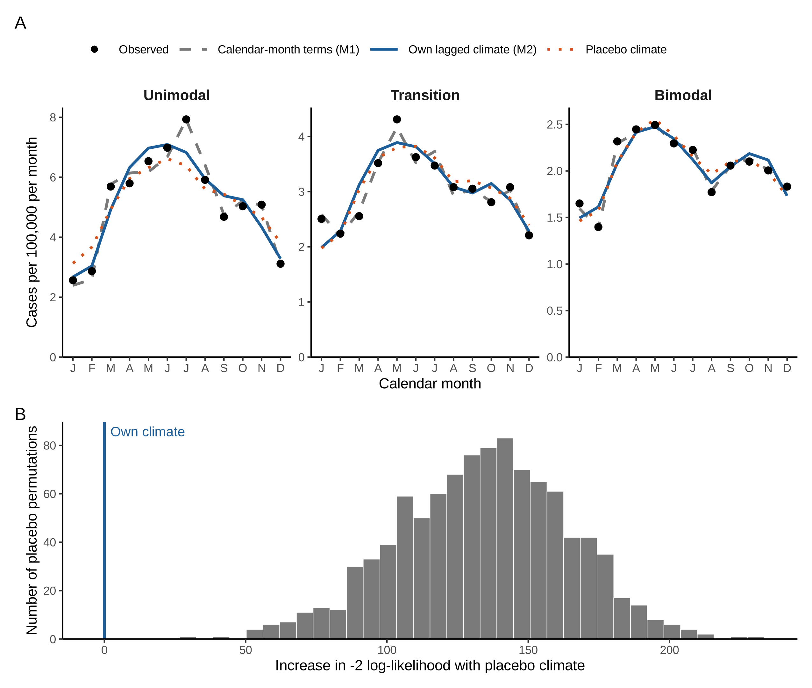
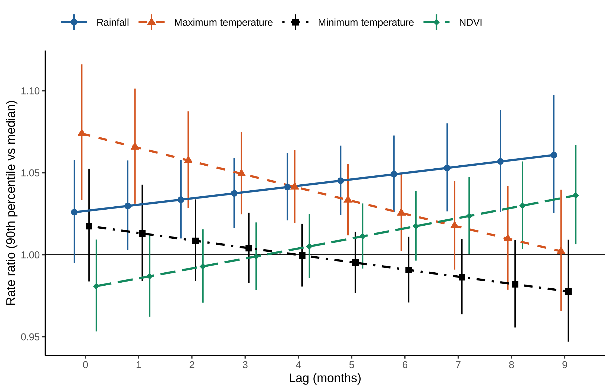
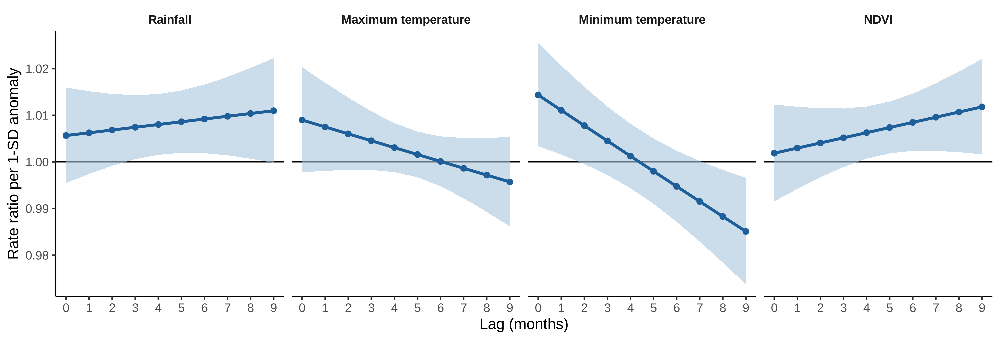
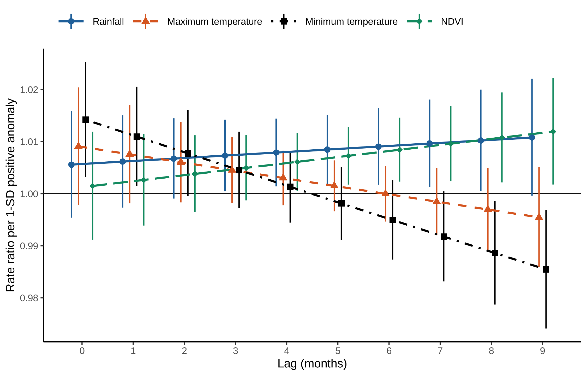
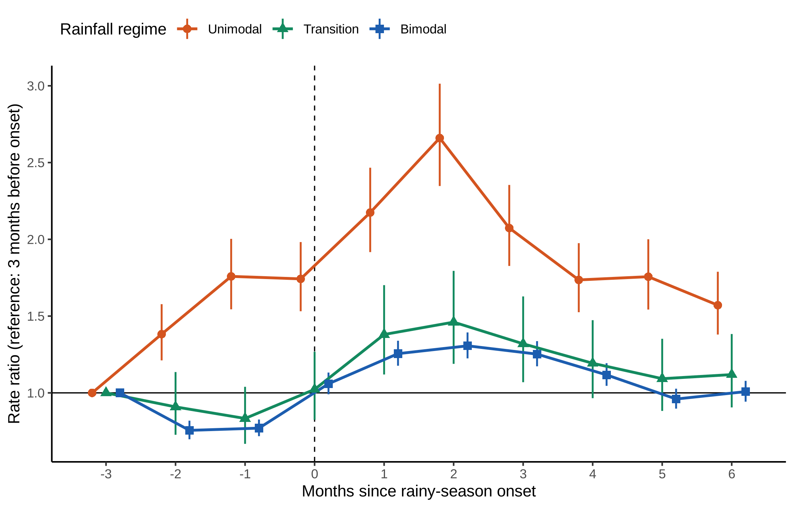
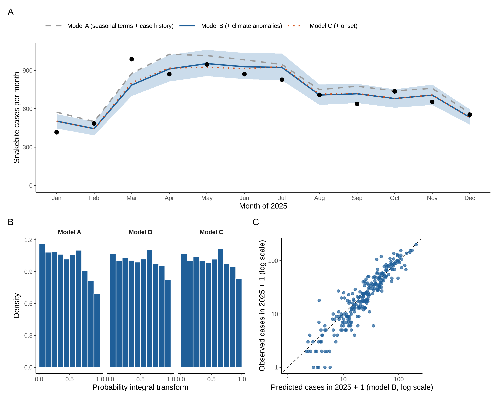
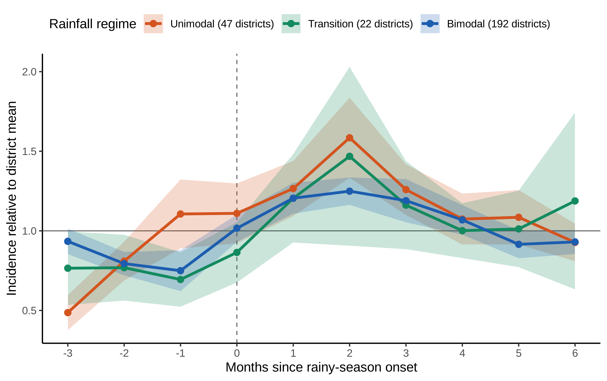
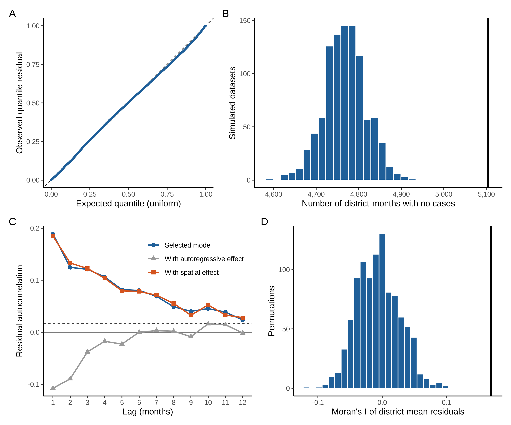

# MANUSCRIPT DRAFT


## Title

**Is snakebite seasonality climate? Lagged local climate explains the seasonal cycle of snakebite across 261 districts of Ghana, 2020–2025**

*Alternative:* Seasonality is not a confounder: lagged climate, rainfall regime and the seasonal cycle of snakebite in Ghana — a nationwide distributed-lag mixed-model study

> **Central gap (v0.2).** The two most recent analyses of snakebite and climate treated seasonality as something separate from climate, adjusting for it with month terms, harmonics or temporal random effects:
> * India: "seasonality rather than precipitation or temperature" drives deaths [12].
> * Ghana: no rainfall effect [13].
>
> If the seasonal cycle is *itself* produced by lagged climate, that adjustment absorbs the climate effect (over-adjustment), and "seasonality not climate" becomes a modelling artefact. No study has tested whether snakebite seasonality is explained by lagged local climate.
>
> **A screening analysis supports the hypothesis.** Lagged local climate reproduced the full seasonal signal of zone-specific month terms. It outperformed all 100 placebo climate series taken from districts in a different rainfall regime (permutation p ≈ 0.01). About 11% of the seasonal signal remained unexplained by climate (`analysis/seasonality_climate_placebo.py`).

**Running title:** Lagged climate effects on snakebite in Ghana

**Authors:** Pascal Antwi¹, [AUTHOR: co-authors] · ¹[AUTHOR: affiliation] · Corresponding author: [AUTHOR: email]

---

## Abstract

**Background.**
* Snakebite envenoming is a climate-sensitive neglected tropical disease. Sub-Saharan Africa bears nearly half of its global burden.
* Snakebite is consistently seasonal. Yet recent studies in India and Ghana concluded that seasonality, rather than rainfall or temperature, drives risk.
* Those models adjusted for seasonality separately from climate. If the seasonal cycle is itself generated by lagged climate, such adjustment removes the climate effect.
* Whether snakebite seasonality *is* lagged climate has never been tested.

**Methodology.**
* We analysed 61,625 snakebite cases reported through Ghana's District Health Information Management System (DHIMS-2) from 261 districts, January 2020 – December 2025.
* Climate inputs were monthly district-level rainfall, relative humidity and temperature (NASA POWER) and vegetation (NDVI).
* Model: negative-binomial generalized linear mixed models with a population offset and district-within-region random effects.
* Distributed-lag non-linear models estimated exposure–lag–response associations over 0–[RESULT: L] months, with a pre-specified lag-selection strategy.
* We tested whether lagged local climate reproduces the seasonal cycle captured by month terms, using a placebo test: climate series reassigned from districts in a different rainfall regime, 100 permutations.
* We separated each climate variable into its seasonal climatology and its anomaly.
* We compared unimodal, transition and bimodal districts, classified from each district's own rainfall.
* We estimated climate-attributable cases and evaluated out-of-sample predictive skill for 2025.

**Principal findings.**
* The crude incidence was 31.1 per 100,000 per year: 63.0 in unimodal districts, 35.2 in the transition zone and 24.5 in bimodal districts.
* Lagged local climate reproduced [RESULT: ≈100%] of the seasonal signal and outperformed every placebo climate series (p [RESULT: <0.01]). Only [RESULT: ≈11%] of seasonal variation was unexplained by climate.
* Rainfall was associated with risk only after a delay, peaking at lag [RESULT] months in unimodal districts and lag [RESULT] in bimodal districts (cumulative RR [RESULT]).
* Humidity and minimum temperature acted within 0–1 months (RR [RESULT]). High maximum temperatures were associated with lower same-month risk.
* Incidence peaked 1–2 months after rainy-season onset, at [RESULT]% above baseline in unimodal and transition districts.
* An estimated [RESULT]% of cases were attributable to non-optimal climate.
* Adding lagged climate improved one-month-ahead prediction (CRPS reduced by [RESULT]%).

**Conclusions/Significance.**
* The seasonality of snakebite in Ghana is largely lagged local climate. Treating seasonality as a confounder hides the climate effect.
* Climate acts with measurable, regime-specific delays of one to three months.
* These delays provide usable lead time for climate-informed antivenom pre-positioning and community alerts in Ghana and similar West African settings.

**Keywords:** snakebite envenoming; climate; distributed lag non-linear model; generalized linear mixed model; rainfall onset; early warning; Ghana; West Africa

---

## Author summary

Snakebite kills and disables tens of thousands of people in Africa every year, mostly poor farmers in rural areas. People often say bites rise "in the rainy season". However, nobody had measured *how long after* rain, humidity or heat the risk goes up. That delay matters, because it tells health services how much warning they have to move antivenom to where it will be needed.

We used six years of monthly snakebite reports from every district in Ghana together with satellite climate data. Earlier studies concluded that snakebite follows "the season" rather than the weather. We show that, in Ghana, the season largely *is* the weather of previous months: each district's own past climate reproduced its snakebite season, while climate borrowed from the other half of the country could not. Rain does not raise snakebite risk in the same month. Risk rises one to three months later, and the delay is longer in the dry savanna north than in the wetter south. Bites surged in the one to two months after the rains started, when farmers clear and plant their fields. Humid and warm nights were linked to more bites almost immediately, while very hot days were linked to fewer. Using past climate improved forecasts of the next month's snakebite cases.

These findings could help Ghana and neighbouring countries plan antivenom supplies and warn communities ahead of high-risk periods.

---

## 1. Introduction

Snakebite envenoming is one of the most neglected causes of death and disability in the tropics. Recent geostatistical estimates suggest that at least 2.1 million, and possibly up to 7 million, envenomings occur each year. After adjustment for under-reporting, these cause between 274,000 and 513,000 deaths, and sub-Saharan Africa accounts for about 45% of both [[1](https://journals.plos.org/plosmedicine/article?id=10.1371/journal.pmed.1005201)]. These figures are far higher than the earlier global estimate of at least 421,000 envenomings and 20,000 deaths per year [[2](https://doi.org/10.1371/journal.pmed.0050218)]. In 2017 the World Health Organization re-listed snakebite as a category A neglected tropical disease. Its 2019 strategy aims to halve snakebite deaths and disability by 2030, a goal that depends on getting antivenom, trained staff and community awareness to the right places at the right times [[3](https://www.who.int/publications/i/item/9789241515641)]. In Ghana, snakebites are recorded through the District Health Information Management System (DHIMS-2) of public health facilities, and analyses of these data have shown that outbreaks can go undetected [[4](https://doi.org/10.11604/pamj.2021.40.131.28217)]. Across West Africa, many victims turn first to traditional medicine, so facility-based figures underestimate the true burden [[5](https://doi.org/10.1155/2024/8357312)]. In the savanna north, the West African carpet viper (*Echis ocellatus*) causes most severe envenoming, and bites occur mostly on farmland among men of working age [[6](https://doi.org/10.1371/journal.pntd.0007221)].

Snakebite is widely described as seasonal, and there are good biological and social reasons to expect its seasonality to be driven by climate. Snakes are ectotherms whose surface activity, foraging and dispersal depend on ambient temperature and moisture. Rainfall triggers vegetation growth, followed over weeks to months by pulses of seeds, insects and rodents, the principal prey of many medically important vipers [[7](https://doi.org/10.1007/s13364-018-0377-x)]. Human exposure follows the same clock. In rain-fed farming systems, land clearing, planting and weeding begin with the onset of the rains and bring barefoot or poorly protected farmers into contact with snakes [[5](https://doi.org/10.1155/2024/8357312),[6](https://doi.org/10.1371/journal.pntd.0007221)]. Heavy rain and humidity extremes may also drive snakes into houses and compounds. Each of these pathways implies a different delay between a climatic event and a bite, ranging from days for snake activity to months for prey dynamics, and the pathways may act in opposite directions at different lags. Any analysis that relates snakebite only to same-month climate is therefore likely to miss, or even reverse the sign of, real climatic effects.

The empirical evidence is limited and inconsistent. A 2025 systematic review of 35 spatial and temporal analyses found that temperature and humidity were mostly positively associated with snakebite risk and drought negatively. Some studies reported negative associations, however, and very few came from sub-Saharan Africa [[8](https://doi.org/10.1093/trstmh/trae131)]. Delayed effects have been examined only occasionally. In Costa Rica, incidence rose by about 24% per degree Celsius above average temperature. It was positively associated with temperature one month earlier and negatively with rainfall eleven months earlier, and it increased during both phases of the El Niño–Southern Oscillation [[9](https://doi.org/10.1126/sciadv.1500249)]. In California, bites declined after drought and increased after wet 18-month periods [[10](https://doi.org/10.1080/15563650.2018.1508690)]. In Colombia, rainfall drove incidence only where the dry season was marked [[11](https://doi.org/10.1371/journal.pntd.0010270)]. Most recently, a spatial case-crossover analysis of lagged precipitation and temperature in India concluded that snakebite deaths were "primarily influenced by seasonality rather than precipitation or temperature" [[12](https://doi.org/10.1016/j.sste.2025.100738)].

These studies share an important design choice. Seasonality is treated as a confounder: it is removed through calendar-month terms, harmonic functions, case-crossover time strata or temporal random effects, and only then is the effect of climate assessed. This is appropriate when seasonal variation in snakebite arises from causes unrelated to climate. In a rain-fed, ectotherm-driven system, however, the seasonal cycle of snakebite may itself be generated by lagged climate, directly through snake ecology and indirectly through the rain-timed agricultural calendar. Adjusting for seasonality then removes most of the effect it is meant to isolate, and estimates of climate effects are biased towards the null by over-adjustment. On this view, a conclusion that snakebite is driven by "seasonality rather than climate" may describe the model rather than the disease. To our knowledge, no study has tested whether the seasonality of snakebite is itself explained by lagged local climate.

Ghana illustrates the problem and offers an unusually good setting to test it. Regional analyses of surveillance and community data show that bites peak in the rainy and farming seasons [[4](https://doi.org/10.11604/pamj.2021.40.131.28217),[6](https://doi.org/10.1371/journal.pntd.0007221)]. Yet a recent nationwide Bayesian spatio-temporal analysis of district-level surveillance data for 2020–2025 included temporal and space–time random effects. It found humidity and temperature, but not rainfall, to be associated with risk [[13](https://www.medrxiv.org/content/10.64898/2026.07.12.26357875v1.full)]. A strongly rain-seasonal disease with no detectable rainfall effect is consistent with over-adjustment. Ghana also contains contrasting rainfall regimes within a single national surveillance system. The Guinea and Sudan savanna of the north has one rainy season followed by a long dry season, whereas the forest and coastal zones of the south have two rainy seasons, with a transition belt between them [[14](https://ugspace.ug.edu.gh/items/88e8caf1-cdc8-4d5d-9135-697dd61c6932)]. If snakebite seasonality is climatic, each district's seasonal cycle should be reproduced by its own lagged climate but not by the climate of a district in a different regime, and this contrast provides a natural falsification test.

In this study we used 72 months of surveillance data, from January 2020 to December 2025, from all 261 districts of Ghana for two purposes: to test whether the seasonality of snakebite is explained by lagged local climate, and to quantify the delayed and non-linear effects of rainfall, humidity, temperature and vegetation. Using negative-binomial generalized linear mixed models with a population offset, adjusted for district poverty, our primary aim was to test whether lagged local climate reproduces the seasonal cycle captured by conventional calendar-month adjustment. We used climate reassigned from a different rainfall regime as a placebo, and quantified the share of seasonality that is climatic. We further estimated exposure–lag–response associations with distributed-lag non-linear models and separated the effects of normal seasonal climate from those of unusual weather. We estimated the adjusted associations of sex, district poverty, rainfall regime and year with incidence, compared lag structures between unimodal, transition and bimodal districts, and estimated the number of snakebites attributable to climate. Finally, we evaluated whether lagged climate improves out-of-sample prediction and so provides lead time for antivenom planning.

---

## 2. Methods

### 2.1 Study setting

Ghana, with a population of about 34 million in 2025, is divided into 16 regions and 261 metropolitan, municipal and district assemblies. Ghana's rainfall changes from two rainy seasons in the south to one in the north [[14](https://ugspace.ug.edu.gh/items/88e8caf1-cdc8-4d5d-9135-697dd61c6932)]. The Guinea and Sudan savanna of the north has a single rainy season, mainly from May to October, followed by a long dry season during which the dry Harmattan wind blows. The forest and coastal zones of the south have a major and a minor rainy season. Because this change is gradual and does not follow administrative boundaries, we classified each district by its own rainfall rather than by its region. For each year from 2020 to 2024, we counted a district as having two rainy seasons when its lowest monthly rainfall in July–August fell below 80% of both its first peak (April–June) and its second peak (September–October). We classed districts with two rainy seasons in four or five of the five years as bimodal (192 districts), those with two seasons in no more than one year as unimodal (47 districts), and those with two seasons in two or three years as a transition zone (22 districts), because their pattern varies from year to year. To test the stability of this classification, we changed the 80% threshold to 75% and 90%, which reclassified 15 and 6 districts, respectively. Unimodal districts lie in the Upper East, Upper West, North East and most of the Northern Region; the transition zone runs through the Savannah, northern Bono East and Oti Regions, with a few districts in Northern, Volta and Bono; and bimodal districts make up the rest of the south. In bimodal districts the major season peaks around June and the minor season around October ([Fig 3](#fig3)). The West African carpet viper (*Echis ocellatus*) causes most severe envenoming in the northern savanna [[6](https://doi.org/10.1371/journal.pntd.0007221)]. A national compendium describes the other medically important snakes of Ghana, their venom activity and the clinical presentations they cause. It also notes that health-facility records rarely characterise the venom or the species responsible [[15](https://doi.org/10.1371/journal.pntd.0011050)]. [Fig 1](#fig1) shows the study area, with the districts shaded by rainfall regime, the 16 regions named and the location of Ghana in West Africa. We took district boundaries from the geoBoundaries database [[16](https://doi.org/10.1371/journal.pone.0231866)], whose Ghana file, sourced from the Ghana Statistical Service, contains 260 districts. We matched the boundaries to the surveillance districts by name, reconciling 30 spellings by hand, and deposited the crosswalk in the public repository. We drew the maps in Python with the matplotlib library [[17](https://doi.org/10.1109/MCSE.2007.55)] and the shapely geometry package (https://shapely.readthedocs.io), using the script `analysis/fig1_map.py`.

<a name="fig1"></a>


**Fig 1. Study area and rainfall regimes of Ghana.** The 261 districts are shaded by rainfall regime, classified from each district's own monthly rainfall in 2020–2024 (Section 2.1): unimodal, one rainy season (47 districts); transition, one or two rainy seasons depending on the year (22 districts); and bimodal, two rainy seasons (192 districts). Thin white lines mark district boundaries and black lines the 16 named regions. The inset shows the location of Ghana in West Africa. Rainfall is NASA POWER precipitation [[18](https://power.larc.nasa.gov/docs/methodology/meteorology/)]. District and regional boundaries are from geoBoundaries (gbOpen, Ghana ADM2 and ADM1; source USAID Ghana HPNO and Ghana Statistical Service; CC BY 4.0) [[16](https://doi.org/10.1371/journal.pone.0231866)]. Country outlines are from Natural Earth at 1:50 million scale (public domain; https://www.naturalearthdata.com). Map drawn in Python with matplotlib [[17](https://doi.org/10.1109/MCSE.2007.55)] and shapely (`analysis/fig1_map.py`).

### 2.2 Study design and data

We conducted a nationwide ecological panel study, with a time-series cross-sectional design, of monthly snakebite counts in every district of Ghana from January 2020 to December 2025, a period of 72 complete months.

**Health data.** We obtained snakebite cases from the District Health Information Management System (DHIMS-2) of the Ghana Health Service, the national electronic database through which health facilities report routine service data in aggregated form. Earlier regional analyses have also used it [[4](https://doi.org/10.11604/pamj.2021.40.131.28217),[19](https://doi.org/10.1093/trstmh/trae113)]. Within DHIMS-2, new outpatient snakebite cases are entered through the monthly outpatient department (OPD) morbidity form. Admitted cases are reported through the in-patient morbidity and mortality form, and snakebite deaths are held in a separate cause-of-death database [[19](https://doi.org/10.1093/trstmh/trae113)]. We extracted the monthly number of snakebite cases in each of the 261 districts, by sex, from January 2020 to December 2025, following the 2018 district boundaries [AUTHOR: confirm whether the extraction combined the OPD and in-patient forms or used the OPD form alone, and give the DHIMS-2 reporting rate for 2020–2025]. We defined a case as a new attendance at a reporting health facility that was recorded as snakebite. Because the data are aggregated, they carry no individual identifiers and record neither the snake species nor the presence or severity of envenoming [[15](https://doi.org/10.1371/journal.pntd.0011050)]. Bites treated only by traditional healers, or at facilities that do not report to DHIMS-2, are not captured [[5](https://doi.org/10.1155/2024/8357312)].

**Population data.** The offset used annual district populations for 2020–2025, so that the models describe incidence rates rather than counts. We took these from the constrained gridded population estimates that WorldPop produces for individual countries, at a resolution of about 1 km [[20](https://www.worldpop.org)]. In the constrained version, each country's population is allocated only to grid cells that contain built settlement, rather than spread over uninhabited land. The population of a district in a given year was the sum of the grid cells lying within its boundary. For the sex-specific models, we divided each district's population between males and females using the national shares of the 2021 Population and Housing Census, 49.3% male and 50.7% female [[21](https://3news.com/wp-content/uploads/2021/09/2021-PHC-Provisional-Results-Press-Release_210921-1.pdf)].

**Climate and vegetation data.** We obtained monthly climate for each district from the NASA Prediction of Worldwide Energy Resources (POWER) project [[18](https://power.larc.nasa.gov/docs/methodology/meteorology/)], whose meteorological fields derive from the MERRA-2 reanalysis [[22](https://doi.org/10.1175/JCLI-D-16-0758.1)] on a grid of about 0.5° × 0.625°. We extracted precipitation (monthly mean, mm/day), relative humidity at 2 m (%), and mean, maximum and minimum air temperature at 2 m (°C) for January 2020 to November 2025 [AUTHOR: state whether values were extracted at district centroids or area-weighted]. Because the series begin in January 2020, models with a maximum lag of $`L`$ months use outcomes from month $`L+1`$ onwards (Section 2.4.3). Climate for December 2025 was not available, so we estimated it from each district's own December record for 2020–2024. Vegetation greenness came from the normalized difference vegetation index (NDVI) of the MODIS MOD13Q1 product, which supplies 16-day composites at 250 m resolution [[23](https://doi.org/10.5067/MODIS/MOD13Q1.061)]. We calculated the mean over each district's area in Google Earth Engine [[24](https://doi.org/10.1016/j.rse.2017.06.031)], summarised the composites by calendar month, and multiplied the stored integer values by the product's scale factor of 0.0001, which returns NDVI to its physical range of −1 to 1.

**Poverty data.** Information on poverty came from the multidimensional poverty index (MPI) tables of the 2021 Population and Housing Census, which the Ghana Statistical Service publishes for every district through its online StatsBank [[25](https://statsbank.statsghana.gov.gh/pxweb/en/Search%20Bar/-/MPI_by_locality.px/)]. The index classes a person as poor when the weighted deprivations they experience across 13 indicators, spanning education, health and living standards and including housing, drinking water, electricity, cooking fuel, sanitation and employment, pass a set threshold. The tables we retrieved give poverty by the sex, education and industry of the household head and the contribution of each indicator, but not the overall incidence for the district. As the district measure we therefore took the share of people in male-headed households who were multidimensionally poor, a group that makes up most of each district's population. The corresponding shares for female-headed households and for households whose head had no schooling or worked in agriculture, and the indicator contributions, were kept as additional variables [AUTHOR: replace with the overall district incidence when the StatsBank table of incidence, intensity and MPI by district is added; the analysis code uses it automatically]. GSS district names were linked to the 261 districts of the case data within each region. Poverty was measured once, in 2021, and we held it fixed across the study period.

### 2.3 Derived exposures

We derived several exposures from the monthly climate data to separate the regular seasonal cycle from unusual weather, to describe the timing of the rains and to capture the combined effect of heat and moisture.

For each climate variable $`x`$ in district $`i`$ and month $`t`$, with calendar month $`m(t)`$, we defined the climatology $`\bar{x}_{i,m(t)}`$ as the mean of that variable in that district and calendar month over the study period. It describes the conditions a district normally experiences at that time of year, and therefore carries both the seasonal cycle and the differences in climate between districts. We then calculated the anomaly, $`a_{it} = (x_{it} - \bar{x}_{i,m(t)})/s_x`$, where $`s_x`$ is the standard deviation of $`x_{it} - \bar{x}_{i,m(t)}`$ across all district-months, which measures how much wetter, more humid or hotter a given month was than usual for that district. Because the anomalies are centred within each district and calendar month, they are free of the seasonal cycle by construction. By comparing the effects of climatology and anomaly, we therefore distinguished the influence of the normal season from that of unusual weather.

We defined the onset of the rainy season, for each district and year, as the first month from February onwards in which mean rainfall reached at least 2 mm/day, roughly 60 mm in the month. We used February as the starting point so that rain falling late in the previous rainy season was not counted as a new onset. Because any threshold is to some extent arbitrary, we also defined onset with thresholds of 1.5 and 3 mm/day and, as a cumulative criterion, as the first month by which rainfall accumulated from 1 February reached 120 mm, in sensitivity analyses. We recorded a false start when onset was followed within two months by a month with less than 1 mm/day of rain, a pattern that can disrupt planting and prolong land preparation. We then indexed each district-month by the number of months since onset in that district and year, from three months before onset to six months after, so that we could align snakebite incidence to the start of the rains rather than to the calendar.

We derived two further variables for secondary analyses. The diurnal temperature range, the difference between the monthly mean maximum and minimum temperatures, describes how much a district cools at night relative to the heat of the day, which affects the hours during which snakes are active. The vapour-pressure deficit summarises the drying power of the air by combining temperature and humidity. We calculated it as $`\mathrm{VPD} = e_s(T)\,(1 - \mathrm{RH}/100)`$, where $`T`$ is the monthly mean temperature in °C, $`\mathrm{RH}`$ the relative humidity in per cent and $`e_s(T) = 0.6108\,\exp\lbrace 17.27\,T/(T + 237.3)\rbrace`$ the saturation vapour pressure in kPa [[26](https://www.fao.org/4/x0490e/x0490e00.htm)]. The vapour-pressure deficit also offers a single measure of heat and moisture, which is useful because relative humidity and maximum temperature are strongly correlated in these data and are difficult to separate in the same model.

### 2.4 Statistical analysis

#### 2.4.1 Descriptive analysis

We described the seasonal profiles of snakebite and climate separately for unimodal, transition and bimodal districts. For each rainfall regime, we summed the reported cases in each calendar month across districts and years and plotted them alongside the mean monthly rainfall, relative humidity and temperature of the same districts. This shows when snakebite peaks relative to the rainy seasons and whether the timing differs between regimes. To relate the snakebite season to the start of the rains rather than to the calendar, we also plotted incidence by months since rainy-season onset, expressed relative to each district's mean.

We examined the distribution of monthly counts to choose the count model. We calculated the mean and variance of district-month counts and their ratio. A ratio well above 1 indicates overdispersion, meaning more variation than a Poisson model allows, and supports a negative-binomial model. We also calculated the proportion of district-months with no reported cases, overall and for each district. A larger share of zeros than the negative-binomial model predicts would point to a zero-inflated or hurdle model, and we assessed these alternatives in the sensitivity analyses.

#### 2.4.2 Base model

We modelled the monthly number of snakebite cases $`Y_{it}`$ in district $`i`$ and month $`t`$ with a negative-binomial generalized linear mixed model with a log link:

```math
Y_{it} \sim \mathrm{NB}(\mu_{it}, \theta), \qquad \mathrm{Var}(Y_{it}) = \mu_{it} + \mu_{it}^2/\theta,
```

```math
\log \mu_{it} = \log(\text{Pop}_{it}) + \beta_0 + s_{g(i)}(m_t) + \gamma_{y(t)} + \delta_p\,\text{pov}_i + u_{r(i)} + v_i, \qquad u_r \sim N(0,\sigma_u^2), \quad v_i \sim N(0,\sigma_v^2).
```

We chose each component both for what the data showed and for its statistical properties.

*Negative-binomial distribution.* The counts were strongly overdispersed, with a variance 8.8 times the mean (Section 3.1). A Poisson model assumes that the variance equals the mean, and under overdispersion it understates standard errors and overstates the significance of every effect [[27](https://cameron.econ.ucdavis.edu/racd2/)]. The negative binomial arises as a Poisson model whose rate varies between observations according to a gamma distribution. This adds the term $`\mu_{it}^2/\theta`$ to the variance, and the model reduces to the Poisson as $`\theta \to \infty`$ [[27](https://cameron.econ.ucdavis.edu/racd2/)]. We preferred it to the quasi-Poisson model because it has a full likelihood, which we needed to compare models by AIC and to select lags. Its variance also grows with the square of the mean, which suits data in which large counts are rare but highly variable [[28](https://pubmed.ncbi.nlm.nih.gov/18051645/)]. Although 31% of district-months recorded no cases, the negative binomial already predicts many zeros at low means, $`P(Y_{it}=0) = \lbrace \theta/(\theta+\mu_{it})\rbrace^{\theta}`$, so zeros alone do not require a different model. We tested overdispersion formally by fitting the selected model (Section 2.4.4) both as a Poisson and as a negative-binomial mixed model and comparing them with a likelihood-ratio test. Because the Poisson model lies on the boundary of the parameter space ($`\theta \to \infty`$), we halved the $`\chi^2_1`$ p-value. We also report the Pearson dispersion statistic, the sum of squared Pearson residuals divided by the residual degrees of freedom, which is close to 1 when the variance is correctly specified. We fitted zero-inflated [[29](https://doi.org/10.2307/1269547)], hurdle [[27](https://cameron.econ.ucdavis.edu/racd2/)] and NB1 alternatives in sensitivity analyses, and compared the observed zeros with zeros simulated from the fitted model [[30](https://CRAN.R-project.org/package=DHARMa)].

*Population offset.* District populations differed 16-fold, so we entered $`\log(\text{Pop}_{it})`$ as an offset. Then $`\mu_{it}/\text{Pop}_{it} = \exp(\eta_{it})`$, where $`\eta_{it}`$ is the rest of the linear predictor. The model therefore describes incidence rates, and $`\exp(\beta)`$ is the incidence rate ratio for a covariate with coefficient $`\beta`$ [[27](https://cameron.econ.ucdavis.edu/racd2/)].

*Seasonality and year effects.* Unimodal districts peaked in July, whereas bimodal districts peaked in May with a second rise in September–October (Section 3.2), so we allowed the calendar-month effects $`s_{g(i)}(m_t)`$ to differ by rainfall regime. This is the conventional adjustment for seasonality in time-series studies of environment and health [[31](https://doi.org/10.1093/ije/dyt092)]. We also used it as the reference against which the primary analysis tests whether lagged climate can reproduce the seasonal cycle (Section 2.4.5). We included year effects $`\gamma_{y(t)}`$ to absorb national changes in reporting, care-seeking and long-term trends that could otherwise be confounded with climate [[31](https://doi.org/10.1093/ije/dyt092)]. These include the disruption of 2020, when outpatient attendance in Ghana fell during the COVID-19 pandemic [[32](https://doi.org/10.1136/bmjopen-2022-061608)].

*District and region random intercepts.* District incidence ranged from 0 to 262.1 per 100,000 per year and regional incidence from 5.0 to 107.4 (Section 3.1). These differences reflect persistent, unmeasured characteristics such as snake fauna, land use, access to care and completeness of reporting. We included district and region random intercepts to account for these differences and for the repeated measurement of each district [[33](https://experts.mcmaster.ca/scholarly-works/1146888)], and they borrow strength across districts so that districts with few cases are not estimated in isolation [[34](https://assets.cambridge.org/97805218/67061/copyright/9780521867061_copyright_info.pdf)]. With 72 months per district, the climate effects are identified mainly from changes over time within districts, which protects them against confounding by stable district characteristics [[35](https://eprints.ncrm.ac.uk/id/eprint/3317/)].

*Autocorrelation.* After removing each district's mean, monthly counts in consecutive months were correlated (lag-1 correlation 0.20). To assess whether autocorrelation remained after the climate and seasonal terms, we refitted the selected model with a district-level first-order autoregressive term (Section 2.4.11), with $`\mathrm{Corr}(\varepsilon_{it}, \varepsilon_{i,t+k}) = \rho^{|k|}`$ [[36](https://doi.org/10.32614/RJ-2017-066)]. We examined spatial correlation in the residuals and addressed it in a sensitivity analysis with a spatially structured district effect (Section 2.4.11).

*District poverty.* Poverty shapes exposure to snakes, through farm work, housing and walking at night, and access to treatment, so poorer districts may report more bites. We therefore added the standardized district poverty incidence, $`\text{pov}_i`$ (Section 2.2), as a fixed effect to every model. Because it is measured once per district, it is identified from differences between districts and does not compete with the climate terms for the variation over time within districts.

*Sex.* Males accounted for 58% of cases, consistent with greater exposure during farm work [[6](https://doi.org/10.1371/journal.pntd.0007221)]. For the analyses by sex, we arranged the data with one row per district, month and sex $`k`$ and extended the model to

```math
\log \mu_{ikt} = \log(\text{Pop}_{ikt}) + \beta_0 + \delta\,\text{male}_k + s_{g(i)}(m_t) + \gamma_{y(t)} + u_{r(i)} + v_i,
```

so that $`\exp(\delta)`$ is the male-to-female incidence rate ratio. To estimate the adjusted association of every covariate with incidence, we fitted this model with sex, district poverty (per 10 percentage points), calendar-month effects by regime with sum-to-zero month contrasts, so that the regime effects are averages over the year, year effects and the climate cross-bases together. We added interactions between sex and the climate terms, and between district poverty and the climate terms, to test whether climate effects differ between the sexes and with poverty.

*Data and estimation.* We fitted the models to 18,636 district-months, after excluding district-months in which reporting appeared to have failed rather than cases to have been absent. We excluded one district with no reports in any month, one with no reports after 2023 and five district-years with no reports in districts that otherwise averaged at least 10 cases a year. We estimated the parameters by maximum likelihood, integrating out the random effects with the Laplace approximation [[33](https://experts.mcmaster.ca/scholarly-works/1146888),[36](https://doi.org/10.32614/RJ-2017-066)].

#### 2.4.3 Distributed-lag non-linear models

To estimate how snakebite risk depends on climate in the current and preceding months, we added each climate variable to the base model as a cross-basis, the core of a distributed-lag non-linear model (DLNM) [[37](https://www.ncbi.nlm.nih.gov/pmc/articles/PMC2998707/)]. We chose this approach for two reasons. *Descriptive:* snakebite rose one to two months after the onset of the rains and returned to its usual level four to five months after onset (Section 3.2), so the effect of rainfall is spread over several months rather than confined to one. *Theoretical:* the mechanisms linking climate to snakebite act over different delays, from days for snake activity to weeks for land clearing and planting [[5](https://doi.org/10.1155/2024/8357312),[6](https://doi.org/10.1371/journal.pntd.0007221)] and months for vegetation and rodent prey [[7](https://doi.org/10.1007/s13364-018-0377-x)]. A model of same-month climate, or of a single chosen lag, would miss or misplace such effects. A DLNM estimates the whole pattern of effects across lags at once, and it also allows the effect to be non-linear in the size of the exposure [[37](https://www.ncbi.nlm.nih.gov/pmc/articles/PMC2998707/)].

For an exposure $`x`$, the DLNM describes the contribution of $`x`$ measured $`\ell`$ months earlier through a bi-dimensional function $`f\cdot w(x,\ell)`$, built as the tensor product of a basis for the exposure, $`b_j(x)`$, and a basis for the lag, $`c_k(\ell)`$ [[37](https://www.ncbi.nlm.nih.gov/pmc/articles/PMC2998707/)]:

```math
f\cdot w(x,\ell) = \sum_{j=1}^{v_x}\sum_{k=1}^{v_\ell} b_j(x)\,c_k(\ell)\,\eta_{jk}, \qquad \sum_{\ell=0}^{L} f\cdot w(x_{i,t-\ell},\ell) = \mathbf{w}_{it}^{\top}\mathbf{h},
```

where $`\mathbf{w}_{it}`$ is the vector of cross-basis variables computed from the district's climate history and $`\mathbf{h}`$ the vector of coefficients $`\eta_{jk}`$ estimated with the rest of the model. For $`b_j(x)`$ we used a natural cubic spline, which can capture curved relationships but is linear beyond the extreme knots, avoiding implausible behaviour at rare extreme values. A curved relationship is plausible for both rainfall, whose association with snakebite was hump-shaped in northern Ghana [[6](https://doi.org/10.1371/journal.pntd.0007221)], and temperature, since snake activity falls when conditions exceed the species' optimum [[8](https://doi.org/10.1093/trstmh/trae131)]. For $`c_k(\ell)`$ we used a natural cubic spline. In the primary analysis its knot was placed on the logarithmic scale, which allows more flexibility at short lags, where effects are expected to change fastest, and smoother curves at long lags [[37](https://www.ncbi.nlm.nih.gov/pmc/articles/PMC2998707/)]; in the lag-selection grid and the selected model, the knots followed from the degrees of freedom and were placed at equally spaced quantiles of the lag range. We computed lags within each district and across year boundaries. The climate series available to us begin in January 2020, so a model with a maximum lag of $`L`$ months uses outcomes from month $`L+1`$ onwards: July 2020 to December 2025 for the primary analysis, with $`L`$ = 6, October 2020 to December 2025 for the selected model, with $`L`$ = 9, and January 2021 to December 2025 for all candidates in the lag-selection grid, so that they are fitted to the same observations.

From the fitted cross-basis we report the relative risk (RR) at exposure $`x`$ and lag $`\ell`$ compared with a reference value $`x_0`$, and the cumulative RR over all lags:

```math
\mathrm{RR}(x,\ell) = \exp\lbrace f\cdot w(x,\ell) - f\cdot w(x_0,\ell)\rbrace, \qquad \mathrm{RR}_{\text{cum}}(x) = \exp\Big\lbrace \sum_{\ell=0}^{L} \big[f\cdot w(x,\ell) - f\cdot w(x_0,\ell)\big]\Big\rbrace.
```

We set $`x_0`$ to the median of each exposure, or to the value of minimum risk where the exposure–response curve had a clear minimum, and report RRs at the 90th and 99th percentiles together with the full exposure–lag–response surface.

The climate variables were correlated. *Descriptive:* relative humidity and maximum temperature had a correlation of −0.80, and rainfall and humidity 0.59, while the other pairs were weaker. *Theoretical:* strongly correlated exposures entered together inflate the variance of their coefficients and make their separate effects difficult to interpret. We therefore included rainfall, maximum and minimum temperature and NDVI in the main model and assessed relative humidity in an alternative model in which it replaced maximum temperature, and we report variance inflation factors. Lagged values of the same variable are also correlated, which is why a distributed-lag model constrains the lag curve with a spline rather than estimating each lag freely [[37](https://www.ncbi.nlm.nih.gov/pmc/articles/PMC2998707/)]. We quantified this by the correlations between lags and by the variance inflation factors that an unconstrained model with each lag as a separate term would have, and we assessed the fitted design with generalized variance inflation factors for each block of terms (a cross-basis, the year effects, the seasonal terms), adjusted for the number of columns of the block, $`\mathrm{GVIF}^{1/(2\,\mathrm{df})}`$ [AUTHOR: cite Fox J, Monette G. Generalized collinearity diagnostics. J Am Stat Assoc. 1992;87:178–183, with a verified link]. In the primary analysis of seasonality (Section 2.4.5), where the aim is to reproduce the seasonal cycle jointly rather than to separate the effects of single variables, all five variables were entered together.

#### 2.4.4 Lag selection strategy (pre-specified)

We pre-specified how the maximum lag and the flexibility of the cross-basis would be chosen. *Theoretical:* climate and snakebite share a strong seasonal cycle, so the correlation between snakebite and climate several months earlier partly reflects the season itself. Choosing lags by cross-correlation, or by testing many single lags and keeping the significant ones, would therefore select lags that mirror the seasonal cycle and would inflate false-positive findings through multiple testing [[31](https://doi.org/10.1093/ije/dyt092)].

We set the main maximum lag at $`L = 6`$ months from the mechanisms above, which act within zero to four months. *Descriptive:* the post-onset rise in snakebite had subsided by five months after onset (Section 3.2). Because longer delays have been reported elsewhere, with rainfall effects at 11 months in Costa Rica [[9](https://doi.org/10.1126/sciadv.1500249)] and 18 months in California [[10](https://doi.org/10.1080/15563650.2018.1508690)], we repeated the analysis with $`L`$ = 3, 9 and 12 months.

We estimated all lags jointly in the cross-basis and chose $`L`$ and the degrees of freedom of the exposure and lag splines from a pre-specified grid: $`L \in \lbrace 3, 6, 9, 12\rbrace`$, with 2, 3 or 4 degrees of freedom for each spline (36 candidate models). We compared the candidates with two criteria. The first was the Akaike information criterion, $`\mathrm{AIC} = -2\log \hat{L} + 2p`$, where $`\hat{L}`$ is the maximised likelihood and $`p`$ the number of parameters; all candidates were fitted to the same observations so that their AIC values are comparable. The second was predictive performance in leave-one-year-out cross-validation. Leaving out whole years rather than random months keeps the temporal dependence of the data out of the validation set, which random cross-validation would ignore and so overstate performance [[38](https://doi.org/10.1111/ecog.02881)]. We scored the held-out predictions with two strictly proper scoring rules, the logarithmic score and the continuous ranked probability score [[39](https://doi.org/10.1198/016214506000001437)]:

```math
\mathrm{LogS} = -\log p(y_{it} \mid \hat{\psi}_{-y}), \qquad \mathrm{CRPS}(F_{it}, y_{it}) = \sum_{k=0}^{\infty} \big\lbrace F_{it}(k) - \mathbf{1}(y_{it} \le k)\big\rbrace^2,
```

where $`p`$ and $`F_{it}`$ are the predictive probability and cumulative distribution function from the model fitted without year $`y`$, with parameters $`\hat{\psi}_{-y}`$. Lower values of both scores indicate better predictions. We retained the most parsimonious model within 2 AIC units of the best, or within one standard error of the best cross-validated log score, and ranked candidates with the same number of parameters by their cross-validated log score.

As a check on the lag shape that does not depend on the grid, we fitted a penalized DLNM with $`L`$ = 12, in which a smoothing penalty estimated by restricted maximum likelihood shrinks unsupported lags towards zero [[40](https://doi.org/10.1111/biom.12645)]. We applied the same $`L`$ and degrees of freedom to all climate variables and rainfall regimes, so that their lag curves are directly comparable. Finally, as a falsification test, we added future climate (lags of −1 and −2 months) to the final model. Climate in the following month cannot cause snakebite in the current month, so any association with future climate would indicate residual seasonal confounding; such future exposures serve as negative control exposures [[41](https://doi.org/10.1097/EDE.0b013e3181d61eeb)]. We repeated this test with calendar-month effects for each region instead of each rainfall regime, a finer adjustment for the seasonal cycle. We report the full lag curves and cumulative effects rather than a single selected lag. The selected specification was used in all later analyses (Sections 2.4.6–2.4.11), whereas the primary analysis of seasonality kept the pre-specified $`L`$ = 6.

#### 2.4.5 Primary analysis: is seasonality lagged climate?

The primary analysis tested whether the seasonal cycle of snakebite is itself explained by lagged local climate. *Theoretical:* when an exposure generates the seasonal pattern of an outcome, adjusting for season removes part of the exposure's effect. The same holds when the pathway runs through behaviour timed by the exposure, such as rain-fed farming [[5](https://doi.org/10.1155/2024/8357312),[6](https://doi.org/10.1371/journal.pntd.0007221)]. This is over-adjustment, which biases the estimated effect towards the null [[42](https://doi.org/10.1097/EDE.0b013e3181a819a1)], and it may explain why recent analyses that adjusted for season found weak or null effects of rainfall and temperature [[12](https://doi.org/10.1016/j.sste.2025.100738),[13](https://www.medrxiv.org/content/10.64898/2026.07.12.26357875v1.full)]. *Descriptive:* snakebite and climate shared a strong seasonal cycle, whose shape differed between rainfall regimes (Section 3.2). This made it possible to test whether each district's season follows its own climate.

We fitted four nested negative-binomial mixed models to the same observations, each with the district and region random intercepts, year effects, rainfall-regime effect, district poverty and population offset of the base model. Model M0 had no seasonal terms. M1 added the calendar-month effects by rainfall regime, the conventional adjustment [[31](https://doi.org/10.1093/ije/dyt092)]. M2 replaced them with cross-bases of the district's own lagged rainfall, relative humidity, maximum and minimum temperature and NDVI. M3 contained both. With $`D_k`$ the deviance of model $`k`$, we measured the share of the seasonal signal reproduced by climate, $`S_{\text{clim}}`$, and the share of seasonality not explained by climate, $`S_{\text{res}}`$:

```math
S_{\text{clim}} = \frac{D_{M0} - D_{M2}}{D_{M0} - D_{M1}}, \qquad S_{\text{res}} = \frac{D_{M2} - D_{M3}}{D_{M0} - D_{M1}}.
```

$`S_{\text{res}}`$ captures seasonal influences unrelated to climate, such as school holidays, market and harvest events and reporting cycles. Because M1 and M2 differ in their number of parameters, we also compared them with AIC and leave-one-year-out cross-validated scores [[38](https://doi.org/10.1111/ecog.02881),[39](https://doi.org/10.1198/016214506000001437)].

A good fit of M2 could arise simply because any smooth seasonal series resembles the snakebite season. To exclude this, we used a placebo test. We replaced each district's climate series with that of a randomly chosen district from a different rainfall regime, keeping calendar months aligned, refitted M2, and repeated this $`m`$ = 1,000 times. Because each fit of the mixed model took about a minute, we computed the statistic for each permutation, and for the district's own climate, from a negative-binomial model with the same climate cross-bases and year effects, district intercepts as fixed effects and the dispersion fixed at its estimate from M2; we refitted 20 permutations with the full mixed model to check that both statistics ranked the placebo and own-climate fits in the same way. If climate explains snakebite only through its general seasonality, placebo climate should fit as well as the district's own climate. With $`b`$ the number of placebo fits whose deviance was no greater than that of the own-climate fit, we calculated the permutation p-value as $`p = (b+1)/(m+1)`$, which avoids reporting a p-value of zero [[43](https://doi.org/10.2202/1544-6115.1585)]. In a temporal placebo, we replaced each district's climate with its own climate from a different year. This keeps the seasonal shape but breaks the alignment between years, and tests whether year-to-year variation in climate explains snakebite beyond the average seasonal cycle.

Because the farming calendar lies on the causal pathway from rainfall to snakebite, it is a mediator rather than a confounder, so we did not adjust for it. The climate effects estimated here are therefore total effects, including human behavioural responses to climate.

#### 2.4.6 Climatology versus anomaly decomposition

To separate the influence of the normal season from that of unusual weather, we split each climate variable into its climatology $`\bar{x}_{i,m(t)}`$ and its standardised anomaly $`a_{it}`$ (Section 2.3) and entered both as separate cross-bases, together with the rainfall-regime effect and district poverty of the base model:

```math
\log \mu_{it} = \log(\text{Pop}_{it}) + \beta_0 + \sum_{\ell=0}^{L} f\cdot w_{\text{clim}}(\bar{x}_{i,m(t-\ell)},\ell) + \sum_{\ell=0}^{L} f\cdot w_{\text{anom}}(a_{i,t-\ell},\ell) + \gamma_{y(t)} + u_{r(i)} + v_i.
```

*Theoretical:* this is a within–between decomposition. A variable that varies both between and within units is split into a component that is constant within units and a deviation from it, so that the two effects are estimated separately rather than as one blended coefficient [[44](https://www.jstor.org/stable/1913646),[35](https://eprints.ncrm.ac.uk/id/eprint/3317/)]. Here the climatology carries the expected seasonal and spatial climate signal, and the anomaly carries weather that departs from it. The anomaly effects are free of seasonal confounding by construction, so they estimate the delayed effect of unusual weather, which is the effect relevant to early warning. *Descriptive:* anomalies were also less strongly correlated with one another than the raw variables; for example, the correlation of relative humidity with maximum temperature fell from −0.80 to −0.65. This eases the collinearity that limited the raw-variable models.

#### 2.4.7 Heterogeneity by rainfall regime

We tested whether the lag structure differs between unimodal, transition and bimodal districts. *Descriptive:* the three regimes differed in the number and timing of rainy seasons and in incidence, at 63.0, 35.2 and 24.5 cases per 100,000 per year (Section 3.1). *Theoretical:* the delays between rain and snakebite may also differ, for example if the vegetation and prey response after a single long dry season is slower than in areas with two rainy seasons.

We used a two-stage approach. In the first stage, we fitted the DLNM separately in each regime. We reduced each fit to two sets of coefficients, those of the overall cumulative exposure–response curve and those of the lag curve at a fixed exposure (the 90th percentile), together with their covariance matrices. In the second stage, we pooled these coefficient vectors with multivariate meta-analysis [[45](https://doi.org/10.1002/sim.5471)], implemented in the mixmeta package [[46](https://doi.org/10.1002/sim.8362)]. This gave pooled curves and tested whether the regime-specific curves differ more than expected by chance. We summarised heterogeneity with Cochran's $`Q`$ statistic and with

```math
I^2 = \max\left\lbrace 0,\; \frac{Q - \mathrm{df}}{Q}\right\rbrace \times 100\%,
```

the percentage of variation between regimes that is due to true differences rather than chance [[47](https://doi.org/10.1002/sim.1186)]. As a complementary one-stage test, we compared the pooled model with a model in which each cross-basis interacted with regime, using a likelihood-ratio test. The transition zone contains only 22 districts, so its curves are estimated less precisely; in a sensitivity analysis we merged it with the neighbouring regime.

#### 2.4.8 Rainy-season onset

We examined how snakebite incidence changes relative to the start of the rains with an event-study model, fitted separately for each regime. In this model, indicators of the number of months since onset replaced the calendar-month effects:

```math
\log \mu_{it} = \log(\text{Pop}_{it}) + \beta_0 + \sum_{k=-2}^{6} \tau_k\, \mathbf{1}(t - O_{i,y(t)} = k) + \gamma_{y(t)} + u_{r(i)} + v_i,
```

where $`O_{i,y}`$ is the onset month in district $`i`$ and year $`y`$, and the reference period is three months before onset, so that $`\exp(\tau_k)`$ is the rate ratio $`k`$ months after onset. Months outside the window from −2 to +6 were grouped with the reference period, and the models also contained district poverty. *Descriptive:* incidence relative to the district mean rose to between 1.25 and 1.58 two months after onset, depending on the regime (Section 3.2). *Theoretical:* aligning the data to onset rather than the calendar allows for onset falling in different months in different districts and years, and links the timing of bites to the agricultural activities that start with the rains [[5](https://doi.org/10.1155/2024/8357312),[6](https://doi.org/10.1371/journal.pntd.0007221)]. Because onset varied little from year to year within districts, this analysis describes the timing of risk around onset and is secondary to the DLNM.

In further secondary analyses, we related the onset month and the occurrence of a false start to the month of the annual snakebite peak, using a linear mixed model with a district random intercept. We also related them to the total number of cases in the rainy season, using a negative-binomial mixed model.

#### 2.4.9 Attributable burden

To express the climate effects as numbers of snakebites, we estimated the cases attributable to non-optimal climate from the final DLNM [[48](https://doi.org/10.1186/1471-2288-14-55)]. *Theoretical:* relative risks describe how strongly risk changes with exposure, but planning needs the number of cases involved, which also depends on how often each exposure level occurs. *Descriptive:* about 10,000 snakebites were reported each year, so even a modest attributable fraction implies a substantial number of cases. With the backward perspective, which attributes the cases in month $`t`$ to the exposures in the preceding $`L`$ months, the attributable fraction and number for district-month $`(i,t)`$ are

```math
\mathrm{AF}_{it} = 1 - \exp\Big\lbrace -\sum_{\ell=0}^{L} \big[f\cdot w(x_{i,t-\ell},\ell) - f\cdot w(x_0,\ell)\big]\Big\rbrace, \qquad \mathrm{AN}_{it} = \mathrm{AF}_{it}\, n_{it},
```

where $`x_0`$ is the reference value and $`n_{it}`$ the observed number of cases [[48](https://doi.org/10.1186/1471-2288-14-55)]. The total attributable number is $`\sum_{i,t} \mathrm{AN}_{it}`$, and the attributable fraction is this total divided by the total number of cases. *Choice of reference.* The minimum-risk value of an exposure can lie at the edge of its range, so that the reference scenario, such as no rain for nine months, is unrealistic and the attributable fraction becomes implausibly large. Our main measure was therefore the number of cases attributable to exposures above the median, with the median as the reference and exposures at or below the median set to it [[48](https://doi.org/10.1186/1471-2288-14-55)]. As secondary measures, we used the minimum-risk value searched between the 5th and 95th percentiles (and, for comparison, between the 1st and 99th), and the cases attributable to positive weather anomalies, relative to no anomaly, from the climatology–anomaly model (Section 2.4.6), which correspond to weather wetter, hotter or greener than usual for the month. We report results by exposure, rainfall regime, region and year, with 95% empirical confidence intervals from 1,000 Monte Carlo samples of the cross-basis coefficients drawn from their estimated multivariate normal distribution [[48](https://doi.org/10.1186/1471-2288-14-55)].

#### 2.4.10 Predictive validation

We assessed whether lagged climate improves the prediction of snakebite in data not used to fit the model, which is the test relevant to early warning and the timely distribution of antivenom [[3](https://www.who.int/publications/i/item/9789241515641)]. *Descriptive:* routine surveillance in Ghana has missed snakebite outbreaks [[4](https://doi.org/10.11604/pamj.2021.40.131.28217)], and the seasonal peak varies in size and timing between years and districts (Section 3.2). *Theoretical:* a model can fit past data well yet predict poorly, so predictive skill must be judged on held-out data. With temporally dependent data, the held-out set should be separated in time rather than chosen at random [[38](https://doi.org/10.1111/ecog.02881)].

We trained the models on data up to December 2024 and predicted January to December 2025 one month ahead. We also used rolling-origin validation, in which each year from 2023 onwards was predicted from all earlier months. All models contained calendar-month effects by rainfall regime, a linear time trend, district poverty, region and district random intercepts and the population offset, together with the recent case history of the district: the logarithm of the previous month's cases plus one and the logarithm of the incidence over the previous 12 months. *Theoretical:* recent incidence summarises persistent local influences, including reporting, that climate cannot capture, and a trend, unlike year effects, can be extended to a year not yet observed. We compared three nested models. Model A contained these terms. Model B added cross-bases of the standardized anomalies of rainfall, maximum and minimum temperature and NDVI at lags of 1 to 9 months, so that every prediction uses only climate already observed, as in real-time use; we used anomalies because the calendar-month effects already describe the regular season (Section 3.6), and we estimated the climatology from the training years only. Model C added indicators for the first to sixth months after rainy-season onset, which are known one month in advance, with all other months as the reference. Because the case history requires 12 earlier months, all models were fitted from January 2021, and the rolling origin started in 2023, when at least two years were available for training. Because December 2025 climate was estimated rather than observed (Section 2.2), we repeated the evaluation excluding that month. We also report the first version of the models, which had year effects averaged over the training years and raw climate in place of the trend, case history and anomalies, to show the effect of these changes.

We assessed the predictions with the mean absolute error and the continuous ranked probability score (Section 2.4.4) [[39](https://doi.org/10.1198/016214506000001437)], and the calibration of the predictive distributions with the coverage of 90% prediction intervals and non-randomised probability integral transform (PIT) histograms for count data [[49](https://doi.org/10.1111/j.1541-0420.2009.01191.x)]. A flat PIT histogram indicates a well-calibrated model. To judge usefulness for early warning, we defined a high-incidence month as one in which a district exceeded its own 75th percentile of monthly cases. For each district-month, we calculated the predicted probability of exceeding this value and flagged a high-incidence month when the probability exceeded a cut-off chosen on the training data to maximise Youden's index (sensitivity + specificity − 1). We report the sensitivity and specificity of these flags and the area under the receiver operating characteristic curve (AUC), which does not depend on the cut-off.

#### 2.4.11 Sensitivity analyses

We repeated the main analyses under alternative choices of exposure, data and model. For each alternative we report the cumulative rate ratios and the share of seasonality explained by climate, $`S_{\text{clim}}`$. *Theoretical:* every analysis rests on choices that could reasonably have been made differently, and a finding is credible only if it does not depend on them. *Descriptive:* we grouped the alternatives by the source of uncertainty that each addresses.

*Lag structure.* We refitted the selected model with maximum lags of 3, 6 and 12 months and with the neighbouring degrees of freedom from the selection grid (2/3 and 3/2; Section 2.4.4); for these alternatives, $`S_{\text{clim}}`$ was calculated with the same cross-basis in the climate model. This showed whether the conclusions rested on a single point of that grid.

*Count distribution.* We replaced the quadratic NB2 variance with the linear NB1 form, $`\mathrm{Var}(Y_{it}) = \mu_{it}(1+\phi)`$ [[27](https://cameron.econ.ucdavis.edu/racd2/)], and fitted zero-inflated [[29](https://doi.org/10.2307/1269547)] and hurdle negative-binomial models [[27](https://cameron.econ.ucdavis.edu/racd2/)] in glmmTMB [[36](https://doi.org/10.32614/RJ-2017-066)]. The zero-inflated model had a constant probability of an excess zero. In the hurdle model, the probability of any case depended on year, rainfall regime and district poverty, and the climate rate ratios describe the positive counts. Because 31% of district-months had no cases, these models test whether some zeros arise from a separate process, such as a month in which a facility did not report, rather than from low risk.

*Unusual observations and periods.* Twenty-four district-months had more than 20 cases and more than ten times the district's median; the largest was 234 cases in Bawku West in July 2020. These may be true clusters or reporting errors, so we refitted the models without them. We also excluded 2020, when outpatient attendance in Ghana fell during the COVID-19 pandemic [[32](https://doi.org/10.1136/bmjopen-2022-061608)], and December 2025, whose climate was estimated (Section 2.2).

*Seasonal adjustment.* Because $`S_{\text{clim}}`$ depends on how seasonality is represented in M1 and M3, we replaced the calendar-month effects with Fourier terms, $`\sum_{k=1}^{2}\lbrace \alpha_{gk}\sin(2\pi k m_t/12) + \beta_{gk}\cos(2\pi k m_t/12)\rbrace`$, for each regime $`g`$ [[31](https://doi.org/10.1093/ije/dyt092)]. Two harmonics allow either one or two peaks a year, as observed in the unimodal and bimodal regimes, with fewer parameters than twelve month effects.

*Climate data.* NASA POWER is coarse, and the 261 districts drew on only 72 distinct climate series, so neighbouring districts often had identical exposures. Districts that share a grid cell do not contribute independent climate information, and treating them as independent makes the standard errors too small [[50](https://doi.org/10.3368/jhr.50.2.317)]. We therefore added a random intercept for the grid cell and, separately, calculated standard errors clustered by grid cell [[50](https://doi.org/10.3368/jhr.50.2.317)]. For the clustered standard errors we fitted the selected model with fixed district effects and the dispersion parameter of the mixed model, and computed the sandwich variance from the score contributions summed within each of the 72 grid cells.

*Population, classification and definitions.* Annual population figures change in steps from December to January, so we placed each annual figure at July and interpolated linearly to monthly values. We changed the threshold of the rainfall-regime classification from 0.8 to 0.75 and 0.9, which reclassified 15 and 6 districts, respectively. We also merged the transition zone with the neighbouring regime (Section 2.4.7) and used the alternative onset definitions (Section 2.3).

*Dependence.* Neighbouring districts share habitats, snake fauna and health services, so their residual risks may be correlated, and ignoring this overstates precision. We therefore added to the selected model a spatially structured district effect $`s_i`$, alongside the unstructured district effect $`v_i`$:

```math
\mathbf{s} \sim N\left(\mathbf{0}, \sigma_s^2\,\mathbf{R}\right), \qquad R_{ij} = \exp(-d_{ij}/\rho),
```

where $`d_{ij}`$ is the distance in kilometres between the representative points of districts $`i`$ and $`j`$ and $`\rho`$ a range parameter estimated from the data [[36](https://doi.org/10.32614/RJ-2017-066)]. As in the BYM2 model [[51](https://arxiv.org/abs/1601.01180)], the total district variance is split into a spatially structured and an unstructured part, and we report the spatially structured share $`\sigma_s^2/(\sigma_s^2+\sigma_v^2)`$. To address correlation over time, we refitted the selected model with a first-order autoregressive effect for each district, $`\mathrm{Corr}(\varepsilon_{it}, \varepsilon_{i,t+k}) = \rho_t^{|k|}`$ [[36](https://doi.org/10.32614/RJ-2017-066)].

#### 2.4.12 Diagnostics and software

We checked the fit of the selected model with randomized quantile residuals [[52](https://doi.org/10.1080/10618600.1996.10474708)]. *Theoretical:* for count data, Pearson and deviance residuals are not normally distributed even when the model is correct, which makes them hard to interpret. Quantile residuals are uniformly distributed under a correct model, whatever the distribution of the outcome [[52](https://doi.org/10.1080/10618600.1996.10474708)]. For each district-month, with $`F_{it}`$ the fitted negative-binomial distribution function, we calculated

```math
r_{it} = F_{it}(y_{it}-1) + U_{it}\,\lbrace F_{it}(y_{it}) - F_{it}(y_{it}-1)\rbrace, \qquad U_{it}\sim \mathrm{Uniform}(0,1),
```

where the random term $`U_{it}`$ spreads the probability of each observed count [[52](https://doi.org/10.1080/10618600.1996.10474708)]. This is the limit of the simulation-based residual of the DHARMa package [[30](https://CRAN.R-project.org/package=DHARMa)] as the number of simulations grows. We tested the residuals for uniformity with the Kolmogorov–Smirnov test, and tested for remaining overdispersion and for excess zeros by comparing the observed variance of the raw residuals and the observed number of zeros with those of 1,000 datasets simulated from the fitted model. *Descriptive:* monthly counts were correlated within districts (lag-1 correlation 0.20), and neighbouring districts shared climate series, so we also tested the residuals for temporal and spatial autocorrelation. For temporal autocorrelation, we calculated the correlation between normal-transformed residuals of the same district $`k`$ = 1–12 months apart. For spatial autocorrelation, we averaged the residuals over time in each district, giving $`\bar{r}_i`$, and calculated Moran's $`I`$ [[53](https://doi.org/10.1093/biomet/37.1-2.17)],

```math
I = \frac{n}{\sum_{i}\sum_{j} w_{ij}}\;\frac{\sum_{i}\sum_{j} w_{ij}\,(\bar{r}_i - \bar{r})(\bar{r}_j - \bar{r})}{\sum_{i}(\bar{r}_i - \bar{r})^2},
```

where $`n`$ is the number of districts, $`\bar{r}`$ the mean of the $`\bar{r}_i`$, and $`w_{ij} = 1`$ if districts $`i`$ and $`j`$ share a boundary and 0 otherwise. We derived the neighbours from the geoBoundaries district boundaries [[16](https://doi.org/10.1371/journal.pone.0231866)], treating two districts as sharing a boundary when their polygons had boundary vertices less than about 500 m apart. We assessed $`I`$ against 999 random permutations of the district means; a value near its expectation, $`-1/(n-1)`$, indicates no remaining spatial pattern.

We carried out the analyses in R [AUTHOR: version] [[54](https://www.R-project.org/)]. We used glmmTMB [[36](https://doi.org/10.32614/RJ-2017-066)] because it fits negative-binomial, zero-inflated and hurdle mixed models with autoregressive terms in one framework, so the main and sensitivity models differ only in the feature being tested. We used dlnm for the cross-bases [[37](https://www.ncbi.nlm.nih.gov/pmc/articles/PMC2998707/),[40](https://doi.org/10.1111/biom.12645)], mgcv for the penalized DLNM [[55](https://doi.org/10.1111/j.1467-9868.2010.00749.x)], and mixmeta for the meta-analysis [[46](https://doi.org/10.1002/sim.8362)], and we wrote the residual checks directly in R. We prepared the dataset and drew the map (Fig 1) in Python with Matplotlib [[17](https://doi.org/10.1109/MCSE.2007.55)], and the other figures in R with ggplot2 [[56](https://ggplot2.tidyverse.org)]. The code is available at [AUTHOR: GitHub/Zenodo DOI].


### 2.5 Ethics

We used anonymised routine surveillance data aggregated to monthly counts by district and sex, with no personal identifiers and no contact with patients. The Ghana Health Service granted permission to use the DHIMS-2 data [AUTHOR: reference], and its Ethics Review Committee [AUTHOR: approved or exempted] the study [AUTHOR: number]. Because the data were secondary and anonymous, individual consent was not required. We followed the Declaration of Helsinki [[57](https://doi.org/10.1001/jama.2024.21972)]. The climate, vegetation, population, poverty and boundary data are publicly available [[16](https://doi.org/10.1371/journal.pone.0231866),[18](https://power.larc.nasa.gov/docs/methodology/meteorology/),[20](https://www.worldpop.org),[25](https://statsbank.statsghana.gov.gh/pxweb/en/Search%20Bar/-/MPI_by_locality.px/)].

---

## 3. Results

### 3.1 Descriptive epidemiology

From January 2020 to December 2025, the 261 districts reported 61,625 snakebite cases over 18,792 district-months, of which 35,908 (58.3%) were in males and 25,717 (41.7%) in females ([Fig 2](#fig2); [Table 1](#table1)). The crude incidence was 31.1 cases per 100,000 population per year. It was 35.2 in 2020, 33.6 in 2021, 30.7 in 2022, 31.6 in 2023, 30.8 in 2024 and 25.1 in 2025. Incidence was 63.0 per 100,000 per year in the 47 unimodal districts (18,788 cases), 35.2 in the 22 transition districts (5,184 cases) and 24.5 in the 192 bimodal districts (37,653 cases), and males accounted for 59.9%, 64.4% and 56.6% of the cases in these regimes, respectively.

<a name="fig2"></a>


**Fig 2. Monthly snakebite cases and rainfall, Ghana, January 2020 to December 2025.** The line shows the number of snakebite cases reported each month across all districts (left axis), and the bars the monthly rainfall of the average district (right axis), calculated as the NASA POWER daily mean multiplied by the number of days in the month. Rainfall for December 2025 was estimated (Section 2.2). Case data from DHIMS-2; rainfall data from NASA POWER [[18](https://power.larc.nasa.gov/docs/methodology/meteorology/)]; figure drawn in R with ggplot2 [[56](https://ggplot2.tidyverse.org)].

<a name="table1"></a>

**Table 1. Snakebite cases and incidence by year and rainfall regime, Ghana, January 2020 to December 2025.**

| Year | Cases | Male | Female | Incidence | Unimodal, cases (incidence) | Transition, cases (incidence) | Bimodal, cases (incidence) |
|---|---|---|---|---|---|---|---|
| 2020 | 11,084 | 6,761 | 4,323 | 35.2 | 3,633 (76.8) | 851 (36.4) | 6,600 (27.1) |
| 2021 | 10,783 | 6,130 | 4,653 | 33.6 | 3,334 (69.1) | 678 (28.4) | 6,771 (27.2) |
| 2022 | 10,054 | 5,729 | 4,325 | 30.7 | 3,080 (62.6) | 644 (26.5) | 6,330 (25.0) |
| 2023 | 10,545 | 6,183 | 4,362 | 31.6 | 3,239 (64.6) | 1,053 (42.5) | 6,253 (24.2) |
| 2024 | 10,463 | 6,035 | 4,428 | 30.8 | 2,906 (56.8) | 1,043 (41.3) | 6,514 (24.7) |
| 2025 | 8,696 | 5,070 | 3,626 | 25.1 | 2,596 (49.8) | 915 (35.5) | 5,185 (19.3) |
| 2020–2025 | 61,625 | 35,908 | 25,717 | 31.1 | 18,788 (63.0) | 5,184 (35.2) | 37,653 (24.5) |

Incidence is cases per 100,000 population per year. Data are from all 261 districts (47 unimodal, 22 transition and 192 bimodal). Case data from DHIMS-2; population from the annual district estimates (Section 2.2).

Among regions, incidence ranged from 5.0 per 100,000 per year in Greater Accra and 13.8 in Volta to 105.2 in Upper West and 107.4 in Savannah ([S1 Table](#s1table)). The median district incidence was 25.1 (interquartile range 11.4–49.2), and the highest was 262.1, in Mamprugu Moagduri. The poverty incidence among people in male-headed households had a district median of 23.4%, ranging from 4.0% in Asokwa to 67.8% in Nabdam. Its median was 45.6% in unimodal, 34.7% in transition and 20.2% in bimodal districts, and its Spearman correlation with district incidence was 0.53.

The 18,636 district-months retained for analysis, from 260 districts, contained all 61,625 cases. The mean monthly count was 3.31 cases and the variance 29.0, a variance-to-mean ratio of 8.8, and 31.1% of district-months recorded no cases. Over these district-months, mean annual rainfall was 1,316 mm in unimodal, 1,402 mm in transition and 1,653 mm in bimodal districts. The mean monthly maximum temperature was 35.9, 34.0 and 32.0 °C, the mean minimum temperature 19.4, 20.5 and 21.4 °C, the mean relative humidity 65.2%, 74.0% and 82.5%, and the mean NDVI 0.43, 0.50 and 0.51, respectively.

### 3.2 Seasonality

In unimodal districts, snakebite incidence was lowest in January (2.58 cases per 100,000 per month), more than doubled between February (2.74) and March (5.87) and peaked in July (7.98). Rainfall in these districts peaked in August and September (254 and 253 mm) and was below 3 mm a month from December to February ([Fig 3](#fig3)). In bimodal districts, incidence was lowest in February (1.39) and peaked in May (2.58), fell to 1.77 in August and rose again to 2.06–2.11 in September–October. Rainfall in these districts peaked in June (264 mm) and October (262 mm), with a dip in August (100 mm). In the transition zone, incidence peaked in May (4.15), and rainfall exceeded 180 mm a month from June to September.

<a name="fig3"></a>



**Fig 3. Mean monthly rainfall by rainfall regime, Ghana, January 2020 to December 2025.** Lines show the mean over the six years of the monthly rainfall of the average district in each regime, and shaded bands the range across years. Monthly rainfall is the NASA POWER daily mean multiplied by the number of days in the month. Data are the 18,636 analysed district-months from 260 districts; district numbers in the key are those classified in each regime ([Fig 1](#fig1)). Rainfall for December 2025 was estimated (Section 2.2). Rainfall data from NASA POWER [[18](https://power.larc.nasa.gov/docs/methodology/meteorology/)]; figure drawn in R with ggplot2 [[56](https://ggplot2.tidyverse.org)].

The median month of rainy-season onset was April in unimodal districts (interquartile range April–May) and March in transition and bimodal districts (March–March). Within districts, the onset month varied from year to year with a mean standard deviation of 0.58 months in unimodal, 0.50 in transition and 0.38 in bimodal districts. False starts occurred in 4 of 281 unimodal district-years (1.4%) and in none elsewhere. Three months before onset, incidence relative to the district mean was 0.49 in unimodal, 0.77 in transition and 0.93 in bimodal districts. Two months after onset it reached 1.58 (95% CI 1.33–1.84), 1.47 (0.91–2.03) and 1.25 (1.16–1.34), respectively, and four months after onset it was 1.07, 1.00 and 1.07 ([S1 Fig](#s1fig)).

### 3.3 Seasonality is largely lagged local climate

We fitted the four seasonality models to 17,082 district-months from 260 districts, from July 2020 to December 2025, which recorded 56,245 cases; this is the period in which every month had a complete six-month climate history. Calendar-month effects by rainfall regime (M1) reduced −2 log-likelihood by 800.1 compared with the model without seasonal terms (M0; 33 additional parameters; p < 0.001). The district's own lagged climate (M2) reduced it by 816.2 (45 additional parameters; p < 0.001), so that the share of the seasonal signal reproduced by climate was $`S_{\text{clim}}`$ = 1.02. Adding calendar-month effects to the climate model (M3) reduced −2 log-likelihood by a further 148.6 (33 parameters; p < 0.001), a residual seasonal share of $`S_{\text{res}}`$ = 0.19, and adding climate to the calendar-month model reduced it by 164.7 (45 parameters; p < 0.001). M3 had the lowest AIC (67,972.2), followed by M1 (68,046.9), M2 (68,054.8) and M0 (68,781.0). The negative-binomial dispersion parameter was 1.82–2.07 across the four models, and the standard deviations of the random intercepts on the log scale were 0.51–0.59 for regions and 0.77–0.81 for districts ([Table 2](#table2)).

In leave-one-year-out cross-validation, the mean log score was 2.053 for M0, 2.037 for M1, 2.040 for M2 and 2.040 for M3, and the mean CRPS was 1.553, 1.510, 1.512 and 1.510, respectively ([Table 2](#table2)). Relative to M0, the climate model achieved 77% of the improvement in log score and 95% of the improvement in CRPS obtained with calendar-month effects. The climate model had a lower log score than the calendar-month model in two of the six held-out years and a lower CRPS in three.

None of the 1,000 placebo series, in which each district received the climate of a randomly chosen district from a different rainfall regime, fitted as well as the districts' own climate (permutation p = 0.001; [Fig 4B](#fig4)). The increase in −2 log-likelihood with placebo climate ranged from 29.7 to 230.5 (median 135.4). In the 20 permutations refitted with the full mixed model, all 20 placebo fits were worse than the own-climate fit, by 98.1 to 218.9; the statistics from the two models had a correlation of 0.98, and placebo climate reproduced 75–90% (median 83%) of the seasonal signal. When each district's climate was replaced by its own climate shifted by one to five whole years, −2 log-likelihood increased by 16.4 to 100.1 compared with the climate model with correctly aligned years.

Observed and fitted seasonal cycles are shown by rainfall regime in [Fig 4A](#fig4). In unimodal districts, observed incidence in July was 7.93 cases per 100,000 per month, compared with 7.91 fitted by calendar-month effects and 6.82 fitted by own lagged climate.

<a name="fig4"></a>



**Fig 4. Seasonal cycle of snakebite incidence fitted by calendar-month terms, own lagged climate and placebo climate, Ghana, July 2020 to December 2025.** (A) Observed incidence per 100,000 population per month by calendar month and rainfall regime (points), and incidence fitted by the model with calendar-month effects (M1, dashed line), the model with each district's own lagged climate (M2, solid line) and the model with placebo climate (dotted line; the median of 20 placebo fits with the full mixed model). (B) Increase in −2 log-likelihood when each district's climate was replaced by that of a randomly chosen district from a different rainfall regime, for 1,000 permutations, computed with the fixed-district negative-binomial model (Section 2.4.5); the vertical line marks the fit with the districts' own climate. Data are 17,082 district-months from 260 districts. Figure drawn in R with ggplot2 [[56](https://ggplot2.tidyverse.org)].

<a name="table2"></a>

**Table 2. Negative-binomial mixed models of monthly snakebite cases with and without seasonal terms and lagged climate, Ghana, July 2020 to December 2025.**

| Model | Seasonal terms | Parameters | −2 log-likelihood | AIC | Log score | CRPS | θ | SD region | SD district |
|---|---|---|---|---|---|---|---|---|---|
| M0 | None | 12 | 68,757.0 | 68,781.0 | 2.053 | 1.553 | 1.82 | 0.59 | 0.80 |
| M1 | Calendar month by regime | 45 | 67,956.9 | 68,046.9 | 2.037 | 1.510 | 2.03 | 0.59 | 0.81 |
| M2 | Own lagged climate | 57 | 67,940.8 | 68,054.8 | 2.040 | 1.512 | 2.03 | 0.51 | 0.77 |
| M3 | Calendar month by regime and own lagged climate | 90 | 67,792.2 | 67,972.2 | 2.040 | 1.510 | 2.07 | 0.51 | 0.78 |

All models include year effects, a rainfall-regime effect, district poverty (standardized poverty incidence among people in male-headed households), region and district random intercepts and a log(population) offset, and were fitted to 17,082 district-months from 260 districts. Lagged climate is the cross-bases of rainfall, relative humidity, maximum and minimum temperature and NDVI at lags of 0–6 months (natural splines with 3 degrees of freedom for exposure and lag). Log score and CRPS are means over held-out district-months in leave-one-year-out cross-validation; lower values indicate better prediction. θ is the negative-binomial dispersion parameter; SD region and SD district are the standard deviations of the random intercepts on the log scale. Share of seasonality reproduced by climate $`S_{\text{clim}}`$ = 1.02; residual seasonal share $`S_{\text{res}}`$ = 0.19.

### 3.4 Lag selection

We fitted the 36 candidate models of the lag-selection grid to the same 15,528 district-months from 260 districts, from January 2021 to December 2025, and all converged ([S2 Table](#s2table)). AIC was lowest for the most flexible candidate, with a maximum lag of 12 months and 4 degrees of freedom for both the exposure and the lag spline (64 cross-basis parameters), and no other candidate was within 2 AIC units of it. In leave-one-year-out cross-validation, the candidate with a maximum lag of 9 months and 2 degrees of freedom for both splines (16 cross-basis parameters) had the lowest log score (2.0269) and the lowest CRPS (1.4731). Seven candidates were within one standard error of this log score, with maximum lags of 3 or 9 months. Under the pre-specified rule, we selected the model with a maximum lag of 9 months and 2 degrees of freedom for both splines, whose AIC was 60.5 units above that of the most flexible candidate.

In the penalized DLNM with a maximum lag of 12 months, the effective degrees of freedom of the cross-bases were 6.3 for rainfall, 3.4 for maximum temperature, 13.6 for minimum temperature and 9.9 for NDVI, out of 40 each. At the 90th percentile of each exposure compared with its median, the lag-specific rate ratio for rainfall was above 1 from lag 1 to lag 9 in the penalized model and peaked at lag 5 (1.051; 95% CI 1.022–1.081), whereas in the selected model it rose from 1.03 at lag 0 to 1.06 at lag 9. For maximum temperature, the rate ratio was highest at lag 0 in both models (penalized 1.029, 95% CI 0.987–1.073; selected 1.08, 1.03–1.12) and decreased with increasing lag. For NDVI, the rate ratio was below 1 at lags 1–3 and above 1 from lag 4 in the penalized model, with a 95% confidence interval excluding 1 at lags 6–10 (highest 1.040 at lags 8 and 9), and rose from 0.98 at lag 0 to 1.03 at lag 9 in the selected model. For minimum temperature, the 95% confidence intervals included 1 at every lag in both models. Over lags 0–9, the correlations between the log rate ratios of the two models were 0.19 for rainfall, 1.00 for maximum temperature, 0.68 for minimum temperature and 0.88 for NDVI.

Adding climate one and two months ahead to the selected model, fitted to the 15,014 district-months from January 2021 to October 2025, improved the fit (likelihood-ratio χ² = 34.2, 8 df, p < 0.001). Per standard deviation, the rate ratio was 1.08 (95% CI 1.04–1.13) for NDVI one month ahead and 1.04 (1.01–1.07) for rainfall two months ahead. The 95% confidence intervals included 1 for rainfall one month ahead (1.00; 0.97–1.03), NDVI two months ahead (1.02; 0.98–1.06), maximum temperature one and two months ahead (1.03, 0.97–1.09; 0.98, 0.92–1.04) and minimum temperature one and two months ahead (1.01, 0.96–1.07; 1.01, 0.96–1.07).

With calendar-month effects for each region instead of each rainfall regime, the association with future climate was weaker but remained (likelihood-ratio χ² = 19.1, 8 df, p = 0.014; 15,791 district-months). The rate ratios per standard deviation were 1.04 (95% CI 1.01–1.07) for rainfall two months ahead and 1.05 (1.00–1.10) for NDVI one month ahead, and the confidence intervals for the other six future terms included 1. Under this seasonal control, the cumulative rate ratios at the 90th percentile compared with the median were 1.48 (1.20–1.82) for rainfall, 1.33 (1.06–1.67) for maximum temperature, 0.98 (0.81–1.18) for minimum temperature and 1.18 (0.96–1.44) for NDVI.

### 3.5 Exposure–lag–response associations

We fitted the selected model, with a maximum lag of 9 months, to 16,305 district-months from 260 districts, from October 2020 to December 2025, which recorded 53,242 cases. The negative-binomial model fitted much better than a Poisson model with the same terms (likelihood-ratio χ² = 10,528, 1 df, p < 0.001; AIC 64,642 vs 75,167). The Pearson dispersion statistic was 1.54, compared with 3.55 for the Poisson model, and the negative-binomial dispersion parameter θ was 2.09.

Lagged values of the same exposure were correlated. The correlation between adjacent lags was 0.43–0.47 for rainfall, 0.87–0.88 for maximum temperature, 0.74–0.75 for minimum temperature, 0.77–0.78 for NDVI and 0.87–0.88 for relative humidity. Had each of lags 0–9 entered the model as a separate linear term, the largest variance inflation factor would have been 1.8 for rainfall, 12.9 for maximum temperature, 6.2 for minimum temperature, 5.9 for NDVI and 19.2 for relative humidity. At the same lag, the largest variance inflation factor among rainfall, maximum and minimum temperature and NDVI was 1.47–1.54 across lags 0–9; it was 6.10–6.79 when relative humidity was added, and the correlation between relative humidity and maximum temperature was −0.80 to −0.81. In the design of the selected model, the adjusted generalized variance inflation factors were 1.91 for the rainfall cross-basis, 2.31 for maximum temperature, 2.02 for minimum temperature, 1.33 for NDVI, 1.14 for the year effects, 1.14 for the seasonal terms and 1.57 for district poverty. District poverty had a correlation of 0.61 with the indicator of the unimodal regime.

At the 90th percentile of rainfall (9.09 mm/day) compared with the median (3.77 mm/day), the lag-specific rate ratio increased from 1.026 (95% CI 0.995–1.057) at lag 0 to 1.057 (1.022–1.093) at lag 9, and its 95% confidence interval excluded 1 at lags 1–9 ([Fig 5](#fig5)). The cumulative rate ratio over lags 0–9 was 1.50 (1.23–1.82) at the 90th percentile and 1.36 (0.96–1.94) at the 99th percentile (13.29 mm/day) ([Table 3](#table3)). Across the range of rainfall, the cumulative rate ratio rose from 0.53 (0.41–0.68) at 0 mm/day to 1.51 (1.21–1.88) at 9.9 mm/day and was lower at higher values ([Fig 6](#fig6)).

At the 90th percentile of maximum temperature (37.2 °C) compared with the median (31.9 °C), the lag-specific rate ratio was highest at lag 0 (1.068; 1.028–1.110), decreased with increasing lag and had a 95% confidence interval excluding 1 at lags 0–5. The cumulative rate ratio was 1.38 (1.12–1.70) at the 90th percentile, 1.52 (0.97–2.37) at the 99th percentile (42.1 °C) and 0.61 (0.43–0.85) at the 1st percentile (27.4 °C). For NDVI, the lag-specific rate ratio at the 90th percentile (0.70) was 0.979 (0.952–1.008) at lag 0 and 1.035 (1.005–1.066) at lag 9, with a confidence interval excluding 1 at lags 8 and 9; the cumulative rate ratio was 1.07 (0.88–1.30) at the 90th percentile and 0.44 (0.29–0.66) at the 1st percentile (0.16). For minimum temperature, the lag-specific confidence intervals included 1 at every lag at both the 90th and 99th percentiles; the cumulative rate ratio was 0.97 (0.81–1.17) at the 90th percentile and 2.80 (1.65–4.78) at the 1st percentile (12.8 °C).

In the alternative model in which relative humidity replaced maximum temperature, the cumulative rate ratio was 0.87 (0.76–0.99) at the 90th percentile of relative humidity (89.2%) and 0.83 (0.70–0.99) at the 99th percentile (90.9%), compared with the median (83.5%), with lag-specific confidence intervals excluding 1 at lags 0–4. The AIC of this model was 10.3 units higher than that of the selected model.

<a name="fig5"></a>



**Fig 5. Lag-specific rate ratios of snakebite at the 90th percentile of each exposure compared with its median, Ghana, October 2020 to December 2025.** Points show the estimates and vertical bars the 95% confidence intervals; at each lag, the four exposures are offset horizontally so that their intervals do not overlap. Estimates are from the selected model (maximum lag 9 months; natural splines with 2 degrees of freedom for the exposure and the lag), with year effects, calendar-month effects by rainfall regime, district poverty, region and district random intercepts and a log(population) offset, fitted to 16,305 district-months from 260 districts. Figure drawn in R with ggplot2 [[56](https://ggplot2.tidyverse.org)].

<a name="fig6"></a>



**Fig 6. Cumulative exposure–response curves for snakebite over lags of 0–9 months, Ghana, October 2020 to December 2025.** Cumulative rate ratios across the range of each exposure (1st to 99th percentile), relative to its median. Lines show the estimates and shaded bands the 95% confidence intervals. Estimates are from the selected model (maximum lag 9 months; natural splines with 2 degrees of freedom for the exposure and the lag), with year effects, calendar-month effects by rainfall regime, district poverty, region and district random intercepts and a log(population) offset, fitted to 16,305 district-months from 260 districts. Figure drawn in R with ggplot2 [[56](https://ggplot2.tidyverse.org)].

<a name="table3"></a>

**Table 3. Cumulative rate ratios of snakebite over lags 0–9 months at the 90th and 99th percentiles of each exposure, Ghana, October 2020 to December 2025.**

| Exposure | Reference (median) | 90th percentile | Cumulative RR (95% CI) | Lags with 95% CI excluding 1 | 99th percentile | Cumulative RR (95% CI) | Lags with 95% CI excluding 1 |
|---|---|---|---|---|---|---|---|
| Rainfall (mm/day) | 3.77 | 9.09 | 1.50 (1.23–1.82) | 1–9 | 13.29 | 1.36 (0.96–1.94) | 6–9 |
| Maximum temperature (°C) | 31.9 | 37.2 | 1.38 (1.12–1.70) | 0–5 | 42.1 | 1.52 (0.97–2.37) | 0–4 |
| Minimum temperature (°C) | 21.5 | 24.1 | 0.97 (0.81–1.17) | None | 25.7 | 1.01 (0.72–1.41) | None |
| NDVI | 0.52 | 0.70 | 1.07 (0.88–1.30) | 8–9 | 0.78 | 1.05 (0.77–1.43) | None |
| Relative humidity (%)ᵃ | 83.5 | 89.2 | 0.87 (0.76–0.99) | 0–4 | 90.9 | 0.83 (0.70–0.99) | 0–4 |

Rate ratios (RR) compare each percentile with the median and are from the selected model described in Fig 5, fitted to 16,305 district-months from 260 districts. ᵃ From the alternative model in which relative humidity replaced maximum temperature.

In the model of district-month counts by sex, fitted to 32,610 district-month-sex records with all covariates entered together, incidence in males was 1.39 times that in females (95% CI 1.35–1.43), and each 10-percentage-point increase in district poverty incidence was associated with a rate ratio of 1.34 (1.20–1.49) ([Table 4](#table4)). Compared with bimodal districts, the rate ratio averaged over calendar months was 1.24 (0.67–2.31) in unimodal and 0.89 (0.53–1.48) in transition districts. Compared with 2021, the rate ratio was 1.09 (1.01–1.19) in 2020, 0.90 (0.85–0.94) in 2022, 0.86 (0.82–0.91) in 2023, 0.89 (0.84–0.94) in 2024 and 0.74 (0.70–0.78) in 2025. Cumulated over lags 0–9, the rate ratio for the 75th compared with the 25th percentile was 1.90 (1.51–2.37) for rainfall, 1.40 (1.18–1.65) for maximum temperature, 0.93 (0.81–1.07) for minimum temperature and 1.33 (1.13–1.57) for NDVI.

Allowing the climate cross-bases to differ between males and females improved the fit (likelihood-ratio χ² = 128.2, 16 df, p < 0.001), as did allowing them to vary with district poverty (χ² = 67.0, 16 df, p < 0.001). At the 90th percentile compared with the median, the cumulative rate ratio for rainfall was 1.75 (1.41–2.16) in districts at the 25th percentile of poverty and 1.24 (1.02–1.51) in districts at the 75th percentile, and that for maximum temperature was 1.49 (1.19–1.85) and 1.04 (0.84–1.29), respectively. For minimum temperature, the corresponding rate ratios were 0.91 (0.74–1.11) and 1.12 (0.95–1.33), and for NDVI 1.00 (0.81–1.25) and 1.18 (0.95–1.47).

<a name="table4"></a>

**Table 4. Adjusted rate ratios of snakebite for sex, district poverty, rainfall regime, year and climate, Ghana, October 2020 to December 2025.**

| Covariate | Comparison | Rate ratio (95% CI) | p |
|---|---|---|---|
| Sex | Male vs female | 1.39 (1.35–1.43) | <0.001 |
| District poverty | Per 10 percentage points of poverty incidence | 1.34 (1.20–1.49) | <0.001 |
| Rainfall regime | Unimodal vs bimodal | 1.24 (0.67–2.31) | 0.49 |
| Rainfall regime | Transition vs bimodal | 0.89 (0.53–1.48) | 0.65 |
| Year | 2020 vs 2021 | 1.09 (1.01–1.19) | 0.026 |
| Year | 2022 vs 2021 | 0.90 (0.85–0.94) | <0.001 |
| Year | 2023 vs 2021 | 0.86 (0.82–0.91) | <0.001 |
| Year | 2024 vs 2021 | 0.89 (0.84–0.94) | <0.001 |
| Year | 2025 vs 2021 | 0.74 (0.70–0.78) | <0.001 |
| Rainfall (mm/day) | 75th vs 25th percentile (6.60 vs 1.46) | 1.90 (1.51–2.37) | – |
| Rainfall (mm/day) | 90th percentile vs median (9.09 vs 3.77) | 1.47 (1.24–1.73) | – |
| Maximum temperature (°C) | 75th vs 25th percentile (34.6 vs 30.6) | 1.40 (1.18–1.65) | – |
| Maximum temperature (°C) | 90th percentile vs median (37.2 vs 31.9) | 1.37 (1.14–1.64) | – |
| Minimum temperature (°C) | 75th vs 25th percentile (22.8 vs 19.9) | 0.93 (0.81–1.07) | – |
| Minimum temperature (°C) | 90th percentile vs median (24.1 vs 21.5) | 1.04 (0.89–1.23) | – |
| NDVI | 75th vs 25th percentile (0.64 vs 0.35) | 1.33 (1.13–1.57) | – |
| NDVI | 90th percentile vs median (0.70 vs 0.52) | 1.07 (0.91–1.27) | – |
| SD of region intercepts | Log scale | 0.49 | – |
| SD of district intercepts | Log scale | 0.78 | – |
| Dispersion (θ) | Negative binomial | 1.98 | – |

Rate ratios are from one negative-binomial mixed model of district-month counts by sex, fitted to 32,610 district-month-sex records from 260 districts, with sex, district poverty, calendar-month effects by rainfall regime (with sum-to-zero month contrasts, so that the regime rate ratios are averages over calendar months), year effects, cross-bases of rainfall, maximum and minimum temperature and NDVI (maximum lag 9 months; natural splines with 2 degrees of freedom for the exposure and the lag), region and district random intercepts and an offset of the logarithm of the sex-specific population. District poverty is the poverty incidence among people in male-headed households in the 2021 Population and Housing Census (Section 2.2). Climate rate ratios are cumulated over lags 0–9.

### 3.6 Seasonal climatology versus weather anomalies

In the model in which each climate variable entered as a climatology and a standardized anomaly, fitted to the same 16,305 district-months without calendar-month effects, the climate terms together reduced −2 log-likelihood by 676.8 compared with the model without climate (32 parameters; p < 0.001). Removing the climatology cross-bases increased −2 log-likelihood by 490.4 (16 parameters; p < 0.001), 72% of this total, and removing the anomaly cross-bases increased it by 46.2 (16 parameters; p < 0.001), 7% of the total. The correlation between relative humidity and maximum temperature was −0.65 for the anomalies and −0.80 for the raw series, and the variance inflation factors of the five anomalies were 1.02–2.23, compared with 1.29–6.35 for the raw series.

Per 1-SD positive anomaly, the rate ratio for rainfall was 1.006 (0.995–1.016) at lag 0, had a 95% confidence interval excluding 1 at lags 3–8, and was 1.08 (1.02–1.16) cumulated over lags 0–9 ([Fig 7](#fig7)). For NDVI, the confidence interval excluded 1 at lags 4–9, and the cumulative rate ratio was 1.07 (1.01–1.13). For minimum temperature, the rate ratio was 1.014 (1.003–1.025) at lag 0 and 1.011 (1.001–1.021) at lag 1, and below 1 at lags 8 and 9 (0.985, 0.974–0.997 at lag 9), with a cumulative rate ratio of 1.00 (0.93–1.07). For maximum temperature, the confidence intervals included 1 at every lag, with a cumulative rate ratio of 1.02 (0.97–1.07).

In a model with same-month climate only, the rate ratio at the 90th percentile compared with the median was 0.99 (0.95–1.04) for rainfall, 1.03 (0.96–1.12) for maximum temperature, 1.07 (1.00–1.15) for minimum temperature and 1.06 (1.00–1.11) for NDVI. The AIC of this model was 25.4 units higher than that of the selected lagged model.

<a name="fig7"></a>



**Fig 7. Lag-specific rate ratios of snakebite for a 1-SD positive weather anomaly, Ghana, October 2020 to December 2025.** Estimates are from the model with separate cross-bases for the climatology and the standardized anomaly of rainfall, maximum and minimum temperature and NDVI (Section 2.4.6; maximum lag 9 months; natural splines with 2 degrees of freedom for the exposure and the lag), with year effects, a rainfall-regime effect, district poverty, region and district random intercepts and a log(population) offset, fitted to 16,305 district-months from 260 districts. Points show the estimates and vertical bars the 95% confidence intervals; at each lag, the four exposures are offset horizontally so that their intervals do not overlap. Figure drawn in R with ggplot2 [[56](https://ggplot2.tidyverse.org)].

### 3.7 Differences between rainfall regimes

We fitted the selected model separately to 2,949 district-months from 47 unimodal districts (15,837 cases), 1,362 from 22 transition districts (4,533 cases) and 11,994 from 191 bimodal districts (32,872 cases). At the national 90th percentile of rainfall compared with the national median, the lag-specific rate ratio in bimodal districts rose from 1.025 (95% CI 0.985–1.066) at lag 0 to 1.123 (1.076–1.172) at lag 9, with a confidence interval excluding 1 at lags 1–9, whereas in unimodal districts it fell from 1.014 (0.929–1.106) at lag 0 to 0.828 (0.745–0.920) at lag 9, with a confidence interval excluding 1 at lags 4–9; in the transition zone the confidence intervals included 1 at every lag ([Fig 8A](#fig8)). For maximum temperature, the rate ratio in bimodal districts was 1.110 (1.062–1.161) at lag 0 and decreased with increasing lag, with a confidence interval excluding 1 at lags 0–6, and the confidence intervals included 1 at every lag in the other two regimes. For minimum temperature, the rate ratio in the transition zone was 1.165 (1.019–1.333) at lag 0, with a confidence interval excluding 1 at lags 0–4, and in bimodal districts it was below 1 at lags 5–9 (0.939, 0.902–0.977 at lag 9). For NDVI, the confidence intervals included 1 at every lag in all three regimes.

The cumulative rate ratios over lags 0–9 at the national 90th percentile were 0.42 (0.21–0.83) in unimodal, 0.71 (0.26–1.94) in transition and 2.02 (1.59–2.57) in bimodal districts for rainfall, and 0.53 (0.23–1.24), 0.68 (0.24–1.91) and 1.64 (1.29–2.10), respectively, for maximum temperature ([Table 5](#table5); [Fig 8B](#fig8)). In the multivariate meta-analysis of the three regimes, the overall cumulative exposure–response curves differed between regimes for rainfall (Cochran Q = 22.5, 4 df, p < 0.001; I² = 82%) and maximum temperature (Q = 10.3, p = 0.036; I² = 61%), but not for minimum temperature (Q = 7.4, p = 0.12; I² = 46%) or NDVI (Q = 5.3, p = 0.26; I² = 25%). The lag curves at the 90th percentile showed the same pattern, with Q = 31.3 (p < 0.001; I² = 87%) for rainfall and 10.0 (p = 0.041; I² = 60%) for maximum temperature. In the one-stage model, allowing the cross-bases to differ by regime improved the fit (likelihood-ratio χ² = 110.6, 32 df, p < 0.001).

When the transition zone was merged with the unimodal regime, the cumulative curves of the two resulting groups differed for rainfall (Q = 23.9, 2 df, p < 0.001; I² = 92%) and maximum temperature (Q = 11.6, p = 0.003; I² = 83%). When it was merged with the bimodal regime, they differed for rainfall (Q = 17.7, p < 0.001; I² = 89%) but not for maximum temperature (Q = 5.1, p = 0.079; I² = 61%). In both cases, there was no evidence of a difference for minimum temperature or NDVI (p = 0.16–0.21).

<a name="fig8"></a>



**Fig 8. Associations between climate and snakebite incidence by rainfall regime, Ghana, October 2020 to December 2025.** (A) Lag-specific rate ratios at the national 90th percentile of each exposure compared with the national median, by rainfall regime; points show the estimates and vertical bars the 95% confidence intervals, offset horizontally by regime. (B) Cumulative rate ratios over lags 0–9 across the range of each exposure in each regime (1st to 99th percentile within the regime), relative to the national median, on a logarithmic scale; shaded bands show the 95% confidence intervals. Estimates are from the selected model (maximum lag 9 months; natural splines with 2 degrees of freedom for the exposure and the lag) fitted separately to unimodal (2,949 district-months, 47 districts), transition (1,362; 22) and bimodal districts (11,994; 191). Figure drawn in R with ggplot2 [[56](https://ggplot2.tidyverse.org)].

<a name="table5"></a>

**Table 5. Cumulative rate ratios of snakebite over lags 0–9 months by rainfall regime, and tests of heterogeneity between regimes, Ghana, October 2020 to December 2025.**

| Exposure | Unimodal RR (95% CI) | Transition RR (95% CI) | Bimodal RR (95% CI) | Pooled RR (95% CI) | Q, overall curve (p) | I² (%) | Q, lag curve (p) | I² (%) |
|---|---|---|---|---|---|---|---|---|
| Rainfall | 0.42 (0.21–0.83) | 0.71 (0.26–1.94) | 2.02 (1.59–2.57) | 0.93 (0.35–2.45) | 22.5 (<0.001) | 82 | 31.3 (<0.001) | 87 |
| Maximum temperature | 0.53 (0.23–1.24) | 0.68 (0.24–1.91) | 1.64 (1.29–2.10) | 0.93 (0.44–1.95) | 10.3 (0.04) | 61 | 10.0 (0.04) | 60 |
| Minimum temperature | 0.75 (0.42–1.33) | 2.06 (0.93–4.57) | 0.83 (0.66–1.04) | 1.00 (0.61–1.63) | 7.4 (0.12) | 46 | 8.0 (0.09) | 50 |
| NDVI | 0.61 (0.26–1.44) | 1.09 (0.50–2.38) | 1.12 (0.91–1.37) | 1.05 (0.76–1.47) | 5.3 (0.26) | 25 | 5.1 (0.27) | 22 |

Rate ratios (RR) compare the national 90th percentile of each exposure with the national median, cumulated over lags 0–9, from the selected model fitted separately in each regime. Pooled RRs are from the multivariate random-effects meta-analysis of the three regimes. Q is Cochran's Q statistic (4 degrees of freedom) for differences between regimes in the overall cumulative exposure–response curve and in the lag curve at the 90th percentile; I² is the percentage of variation between regimes beyond chance.

### 3.8 Rainy-season onset

In the event-study models, which replaced calendar-month effects with months since rainy-season onset, incidence in unimodal districts compared with three months before onset was 1.38 (1.21–1.58) two months before onset and 1.76 (1.54–2.00) one month before, peaked at 2.66 (2.35–3.01) two months after onset, and was 1.57 (1.38–1.79) six months after onset ([Fig 9](#fig9)). In the transition zone, the confidence intervals included 1 before onset, and the rate ratios were 1.38 (1.12–1.70), 1.46 (1.19–1.79) and 1.32 (1.07–1.63) one, two and three months after onset. In bimodal districts, the rate ratios were 0.76 (0.70–0.82) two months and 0.77 (0.72–0.83) one month before onset, 1.06 (0.99–1.13) in the month of onset, 1.26 (1.18–1.34), 1.31 (1.22–1.39), 1.25 (1.17–1.34) and 1.12 (1.05–1.19) one to four months after onset, and 0.96 (0.90–1.03) and 1.01 (0.94–1.08) five and six months after onset.

The analyses of onset timing included 1,553 district-years. The median onset month was April in unimodal districts and March in transition and bimodal districts, and the median month of the annual peak in cases was June in unimodal and transition districts and May in bimodal districts. All four false starts occurred in unimodal districts. Each month of later onset was associated with a change in the peak month of −0.17 months (95% CI −0.45 to 0.12) and a rate ratio for cases in the six months from onset of 1.02 (0.95–1.10). For false starts, the corresponding estimates were −1.62 months (−4.60 to 1.36) and 1.08 (0.58–2.00).

<a name="fig9"></a>



**Fig 9. Snakebite incidence by months since rainy-season onset, by rainfall regime, Ghana, January 2020 to December 2025.** Rate ratios from event-study models fitted separately in each rainfall regime, in which indicators of months since onset replaced calendar-month effects; the reference is three months before onset, together with months outside the window from two months before to six months after onset. Onset is the first month from February with mean rainfall of at least 2 mm/day (Section 2.3). Models include year effects, district poverty, region and district random intercepts and a log(population) offset, and were fitted to 3,372 district-months in unimodal, 1,560 in transition and 13,704 in bimodal districts. Points show the estimates and vertical bars the 95% confidence intervals, offset horizontally by regime; the dashed vertical line marks the month of onset. Figure drawn in R with ggplot2 [[56](https://ggplot2.tidyverse.org)].

### 3.9 Climate-attributable burden

Of the 53,242 cases reported from October 2020 to December 2025, 12,758 (95% eCI 7,820 to 17,561), 24.0% (14.7 to 33.0%), were attributable to exposures above the median of the four exposures together ([Table 6](#table6)). Of these, 6,396 (3,589 to 9,124) cases, 12.0% (6.7 to 17.1%), were attributable to rainfall and 6,179 (2,110 to 9,654), 11.6% (4.0 to 18.1%), to maximum temperature, whereas the intervals for minimum temperature (−0.7%; −4.6 to 3.4%) and NDVI (2.7%; −2.6 to 7.8%) included zero. The combined fraction was 29.4% (16.0 to 41.2%) in unimodal, 24.9% (14.9 to 34.7%) in transition and 21.2% (12.1 to 30.3%) in bimodal districts. It ranged from 13.2% (−3.4 to 28.7%) in Greater Accra to 30.8% (17.2 to 42.6%) in Upper West, and from 18.4% (6.8 to 29.4%) in October–December 2020 to 26.3% (16.2 to 36.2%) in 2024.

Positive weather anomalies accounted for 2,623 (335 to 4,899) cases, 4.9% (0.6 to 9.2%): 2.2% (−0.1 to 4.3%) for NDVI, 1.8% (−0.4 to 4.1%) for rainfall, 1.1% (−0.8 to 2.7%) for maximum temperature and −0.1% (−3.3 to 3.1%) for minimum temperature. The minimum-risk values searched between the 5th and 95th percentiles were 0.03 mm/day for rainfall, 28.9 °C for maximum temperature, 23.3 °C for minimum temperature and 0.22 for NDVI; with these references, 42,877 (37,584 to 46,466) cases, 80.5% (70.6 to 87.3%), were attributable to the four exposures together, and 86.7% (76.9 to 92.5%) when the search extended to the 1st and 99th percentiles.

<a name="table6"></a>

**Table 6. Snakebite cases attributable to climate, Ghana, October 2020 to December 2025.**

| Exposure | Attributable cases, Ghana (95% eCI) | Attributable fraction, Ghana, % (95% eCI) | Unimodal, % (95% eCI) | Transition, % (95% eCI) | Bimodal, % (95% eCI) |
|---|---|---|---|---|---|
| *Main measure: exposures above the median (reference: median)* | | | | | |
| Rainfall | 6,396 (3,589 to 9,124) | 12.0 (6.7 to 17.1) | 10.1 (5.7 to 14.4) | 11.0 (6.4 to 15.6) | 13.1 (7.3 to 18.6) |
| Maximum temperature | 6,179 (2,110 to 9,654) | 11.6 (4.0 to 18.1) | 20.6 (6.0 to 32.7) | 14.8 (5.2 to 23.0) | 6.8 (2.9 to 10.7) |
| Minimum temperature | −387 (−2,452 to 1,788) | −0.7 (−4.6 to 3.4) | −0.4 (−3.3 to 2.8) | −1.0 (−6.8 to 5.1) | −0.8 (−5.0 to 3.4) |
| NDVI | 1,459 (−1,377 to 4,161) | 2.7 (−2.6 to 7.8) | 1.7 (−0.7 to 4.1) | 1.8 (−1.5 to 5.0) | 3.4 (−3.7 to 10.0) |
| All four exposures | 12,758 (7,820 to 17,561) | 24.0 (14.7 to 33.0) | 29.4 (16.0 to 41.2) | 24.9 (14.9 to 34.7) | 21.2 (12.1 to 30.3) |
| *Positive weather anomalies (reference: no anomaly)* | | | | | |
| Rainfall | 968 (−223 to 2,196) | 1.8 (−0.4 to 4.1) | 1.2 (−0.4 to 2.9) | 1.7 (−0.5 to 3.8) | 2.1 (−0.4 to 4.7) |
| Maximum temperature | 562 (−407 to 1,417) | 1.1 (−0.8 to 2.7) | 1.3 (−0.9 to 3.2) | 1.2 (−0.8 to 3.0) | 0.9 (−0.7 to 2.3) |
| Minimum temperature | −58 (−1,781 to 1,665) | −0.1 (−3.3 to 3.1) | −0.2 (−3.8 to 3.4) | 0.1 (−3.3 to 3.4) | −0.1 (−3.1 to 2.9) |
| NDVI | 1,186 (−55 to 2,275) | 2.2 (−0.1 to 4.3) | 1.5 (0.4 to 2.6) | 1.8 (0.2 to 3.3) | 2.6 (−0.4 to 5.2) |
| All four exposures | 2,623 (335 to 4,899) | 4.9 (0.6 to 9.2) | 3.8 (−0.4 to 8.0) | 4.7 (0.5 to 9.0) | 5.5 (0.9 to 10.1) |
| *Minimum-risk reference, searched between the 5th and 95th percentiles* | | | | | |
| Rainfall | 22,858 (16,387 to 28,756) | 42.9 (30.8 to 54.0) | 36.4 (25.2 to 46.6) | 40.5 (29.0 to 51.5) | 46.4 (33.7 to 58.0) |
| Maximum temperature | 16,575 (7,717 to 23,524) | 31.1 (14.5 to 44.2) | 41.8 (20.8 to 57.3) | 36.6 (17.1 to 51.1) | 25.2 (11.0 to 37.1) |
| Minimum temperature | 8,100 (1,155 to 12,928) | 15.2 (2.2 to 24.3) | 24.9 (9.6 to 36.3) | 15.7 (4.4 to 24.3) | 10.5 (−2.3 to 19.3) |
| NDVI | 21,558 (13,104 to 27,939) | 40.5 (24.6 to 52.5) | 35.4 (20.8 to 47.0) | 37.3 (22.5 to 49.0) | 43.4 (26.7 to 55.7) |
| All four exposures | 42,877 (37,584 to 46,466) | 80.5 (70.6 to 87.3) | 82.2 (72.6 to 88.5) | 80.4 (70.3 to 87.2) | 79.7 (69.3 to 86.7) |

Attributable numbers and fractions use the backward perspective (Section 2.4.9). The main measure and the minimum-risk measure are from the selected model (maximum lag 9 months); the anomaly measure is from the climatology–anomaly model (Section 2.4.6). Both were fitted to 16,305 district-months from 260 districts with 53,242 cases (unimodal 15,837; transition 4,533; bimodal 32,872). eCI, empirical confidence interval from 1,000 Monte Carlo samples of the coefficients; negative values indicate fewer cases than expected at the reference.

### 3.10 Predictive performance

For the 3,084 district-months of 2025, predicted one month ahead from models trained on data up to December 2024, the mean absolute error was 1.837 for model A (seasonal terms and case history), 1.789 for model B (with climate anomalies) and 1.794 for model C (with onset), and the mean CRPS was 1.252, 1.243 and 1.244, respectively, compared with 2.178–2.232 and 1.406–1.428 for the first version of the models ([Table 7](#table7)). The 90% prediction intervals contained 96.8%, 96.3% and 96.2% of the observed counts. High-incidence months were discriminated with an AUC of 0.724, 0.725 and 0.725; with the cut-offs chosen on the training data, the sensitivity was 57.3%, 50.5% and 54.5% and the specificity 74.4%, 78.1% and 76.2%, compared with a sensitivity of 32.2–33.3% for the first version. Excluding December 2025, the mean CRPS was 1.276, 1.266 and 1.267.

The 2025 national total was 8,696 cases, compared with 9,515 predicted by model A, 8,796 by model B and 8,793 by model C; the observed national count lay within the 90% prediction interval of model B in 9 of the 12 months, of model C in 8 and of model A in 5 ([Fig 10A](#fig10)). The PIT histogram densities ranged from 0.69 to 1.16 for model A, 0.82 to 1.11 for model B and 0.83 to 1.11 for model C ([Fig 10B](#fig10)). The correlation between observed and predicted district totals for 2025 was 0.92 for all three models ([Fig 10C](#fig10)).

In rolling-origin validation over 2023–2025 (9,300 district-months), the mean CRPS was 1.360 for model A, 1.420 for model B and 1.424 for model C, and the AUC 0.717, 0.700 and 0.699. Model B had a higher mean CRPS than model A in 2023 (1.47 vs 1.39) and 2024 (1.55 vs 1.44) and a lower mean CRPS in 2025 (1.24 vs 1.25).

<a name="table7"></a>

**Table 7. Out-of-sample predictive performance of models A–C, Ghana.**

| Validation | Model | District-months | Mean absolute error | Mean CRPS | 90% prediction-interval coverage (%) | AUC | Sensitivity (%) | Specificity (%) |
|---|---|---|---|---|---|---|---|---|
| Hold-out 2025 | A | 3,084 | 1.837 | 1.252 | 96.8 | 0.724 | 57.3 | 74.4 |
| Hold-out 2025 | B | 3,084 | 1.789 | 1.243 | 96.3 | 0.725 | 50.5 | 78.1 |
| Hold-out 2025 | C | 3,084 | 1.794 | 1.244 | 96.2 | 0.725 | 54.5 | 76.2 |
| Hold-out 2025 | A, version 1 | 3,084 | 2.232 | 1.428 | 97.0 | – | 32.2 | 77.6 |
| Hold-out 2025 | B, version 1 | 3,084 | 2.182 | 1.409 | 96.9 | – | 32.6 | 78.4 |
| Hold-out 2025 | C, version 1 | 3,084 | 2.178 | 1.406 | 96.9 | – | 33.3 | 78.5 |
| Hold-out 2025, excluding December | A | 2,827 | 1.868 | 1.276 | 96.9 | 0.721 | 59.5 | 72.8 |
| Hold-out 2025, excluding December | B | 2,827 | 1.818 | 1.266 | 96.4 | 0.723 | 52.3 | 76.7 |
| Hold-out 2025, excluding December | C | 2,827 | 1.823 | 1.267 | 96.3 | 0.723 | 56.2 | 74.7 |
| Rolling origin, 2023–2025 | A | 9,300 | 1.947 | 1.360 | 95.7 | 0.717 | 67.2 | 63.5 |
| Rolling origin, 2023–2025 | B | 9,300 | 2.033 | 1.420 | 94.9 | 0.700 | 63.8 | 65.6 |
| Rolling origin, 2023–2025 | C | 9,300 | 2.039 | 1.424 | 94.7 | 0.699 | 65.9 | 63.6 |
| Rolling origin, 2023–2025 | A, version 1 | 9,300 | 2.270 | 1.524 | 95.0 | – | 29.4 | 78.0 |
| Rolling origin, 2023–2025 | B, version 1 | 9,300 | 2.243 | 1.522 | 94.8 | – | 29.3 | 78.2 |
| Rolling origin, 2023–2025 | C, version 1 | 9,300 | 2.241 | 1.523 | 94.8 | – | 29.7 | 78.2 |

Model A: calendar-month effects by rainfall regime, a linear time trend, district poverty, the logarithm of the previous month's cases plus one, the logarithm of the incidence over the previous 12 months, region and district random intercepts and a log(population) offset. Model B: model A with cross-bases of the standardized anomalies of rainfall, maximum and minimum temperature and NDVI at lags 1–9 months. Model C: model B with indicators of the first to sixth months after rainy-season onset. Version 1: the first models, with year effects averaged over the training years in place of the trend and case history, and raw climate in place of anomalies; its high-incidence months were flagged when the predicted mean exceeded the threshold, so no AUC is given. Hold-out 2025: trained on data up to December 2024. Rolling origin: each year from 2023 to 2025 predicted from all earlier months. High-incidence months are months in which a district exceeded its own 75th percentile of monthly cases in the training data. Lower mean absolute error and CRPS indicate better prediction.

<a name="fig10"></a>


**Fig 10. Out-of-sample prediction of snakebite cases in 2025, Ghana.** (A) Monthly national cases observed (points) and predicted one month ahead by models A, B and C, with the 90% prediction interval of model B (shaded band) obtained by simulation from the district-month predictive distributions. (B) Non-randomised probability integral transform (PIT) histograms for the 3,084 district-months of 2025; a well-calibrated model gives a flat histogram at a density of 1 (dashed line). (C) Observed and predicted (model B) district totals for 2025, plus 1, on logarithmic scales; the dashed line marks equality. Models were trained on data up to December 2024. Figure drawn in R with ggplot2 [[56](https://ggplot2.tidyverse.org)].

### 3.11 Sensitivity analyses

We refitted the selected model under 21 alternative specifications, and all of them converged ([Fig 11](#fig11); [S3 Table](#s3table)). Apart from the models with maximum lags of 3 and 6 months, the cumulative rate ratio at the 90th percentile compared with the median ranged from 1.31 to 1.66 for rainfall and from 1.26 to 1.43 for maximum temperature. Its 95% confidence interval excluded 1 in all 19 of these alternatives for rainfall, and in 18 for maximum temperature; the exception, with 3 degrees of freedom for the exposure, had a lower limit of 1.00. For minimum temperature, the rate ratio ranged from 0.75 to 1.09, and its confidence interval included 1 except in the model with a first-order autoregressive effect (0.75; 0.59–0.95). For NDVI, it ranged from 1.05 to 1.19, and the confidence interval included 1 in every alternative. With maximum lags of 3 and 6 months, the rate ratios were 1.12 (1.01–1.24) and 1.24 (1.05–1.45) for rainfall, 1.08 (0.95–1.21) and 1.17 (0.99–1.39) for maximum temperature, and 0.88 (0.80–0.96) and 0.91 (0.80–1.05) for NDVI; with a maximum lag of 12 months, the rate ratio for rainfall was 1.66 (1.30–2.13).

The share of seasonality reproduced by climate, $`S_{\text{clim}}`$, was 0.97–1.10 in the alternatives that kept the cross-basis of the primary analysis, including 1.05 with the NB1 variance, 1.02 in the zero-inflated and hurdle models and 0.99 without the 24 outlying district-months. It was 1.26 when Fourier terms replaced the calendar-month effects. When the climate model used the cross-basis of each lag-structure alternative, $`S_{\text{clim}}`$ was 0.91 with a maximum lag of 3 months, 0.82 with 6 months, 0.82 with 12 months, and 0.93 and 0.87 with a maximum lag of 9 months and 2/3 or 3/2 degrees of freedom.

A random intercept for the grid cell left the estimates unchanged (rainfall 1.49, 1.23–1.82; maximum temperature 1.38, 1.12–1.69). In the model with fixed district effects used for the clustered standard errors, the cumulative rate ratio was 1.35 for rainfall, with a model-based 95% confidence interval of 1.11–1.66 and an interval clustered by grid cell of 0.98–1.86. The corresponding values were 1.20 (0.96–1.51 and 0.81–1.78) for maximum temperature, 1.14 (0.92–1.41 and 0.77–1.69) for minimum temperature and 1.03 (0.84–1.27 and 0.78–1.37) for NDVI. In the model with a spatially structured district effect, this effect took up the whole of the district variance (share 1.00), and the cumulative rate ratios were 1.50 (1.23–1.82) for rainfall and 1.37 (1.11–1.69) for maximum temperature. Changing the regime threshold to 0.75 or 0.9 reclassified 15 and 6 districts, and the rainfall rate ratio was 1.50 (1.23–1.83) and 1.51 (1.24–1.84), respectively.

Under the alternative definitions of rainy-season onset, the median onset month was April in unimodal and March in bimodal districts with thresholds of 1.5 and 2 mm/day, and May and March with a threshold of 3 mm/day or the 120 mm criterion; in the transition zone it was March or April ([S4 Table](#s4table)). Under every definition and in every regime, incidence peaked two months after onset, except with the 3 mm/day threshold in bimodal districts, where it peaked one month after onset (1.32; 1.23–1.41). The peak rate ratio ranged from 2.31 to 2.70 in unimodal, 1.46 to 1.61 in transition and 1.30 to 1.32 in bimodal districts.

For the selected model, the randomized quantile residuals departed slightly from uniformity (Kolmogorov–Smirnov D = 0.020, p < 0.001; [S2 Fig A](#s2fig)). The variance of the raw residuals was 1.13 times that in simulated data (p < 0.001), and 5,104 district-months (31.3%) recorded no cases, compared with a mean of 4,768 in 1,000 simulated datasets (ratio 1.07; p < 0.001; [S2 Fig B](#s2fig)). The correlation between residuals of the same district was 0.19 one month apart and decreased to 0.02 at 12 months ([S2 Fig C](#s2fig)); with the autoregressive effect, it was −0.11 one month apart and between −0.09 and 0.02 at 2–12 months. Moran's I of the district mean residuals was 0.17 (expected value −0.004; permutation p = 0.001; [S2 Fig D](#s2fig)), 0.15 (p = 0.001) with the spatially structured district effect and 0.10 (p = 0.004) with the autoregressive effect.

<a name="fig11"></a>



**Fig 11. Cumulative rate ratios of snakebite under alternative analyses, Ghana, October 2020 to December 2025.** Points show the cumulative rate ratio over all lags at the 90th percentile of each exposure compared with its median, using the reference values of the main analysis (rainfall 9.09 vs 3.77 mm/day, maximum temperature 37.2 vs 31.9 °C, minimum temperature 24.1 vs 21.5 °C, NDVI 0.70 vs 0.52), and horizontal bars the 95% confidence intervals, on a logarithmic scale. The square and the dashed line mark the selected model (maximum lag 9 months; natural splines with 2 degrees of freedom for the exposure and the lag). Each other row changes one feature of the selected model ([S3 Table](#s3table)). The row for standard errors clustered by grid cell is from a model with fixed district effects, whose point estimates differ from those of the mixed model. Figure drawn in R with ggplot2 [[56](https://ggplot2.tidyverse.org)].

---

## 4. Discussion

**¶1 Principal findings.** [RESULT-driven summary answering each objective in order. Lead with the headline: the seasonal cycle of snakebite in Ghana is largely reproduced by each district's own lagged climate. Placebo climate from a different rainfall regime cannot reproduce it, and only about a tenth of seasonality is non-climatic. Then: rainfall acts with a delay of 1–3 months that is longer in unimodal districts; humidity and night temperature act immediately.]

**¶1b Seasonality is not a confounder of climate here.**
* The conclusion that snakebite is driven by "seasonality rather than precipitation or temperature" [12] and the null rainfall effect in Ghana [13] both come from models that remove seasonality before assessing climate.
* Our results show that, in Ghana, most of that seasonality *is* lagged climate.
* Seasonal adjustment is necessary when seasonality reflects non-climatic drivers. Where climate generates the season, it is over-adjustment that biases climate effects towards the null.
* We recommend that climate–snakebite studies report models with and without seasonal adjustment, together with a placebo-climate test, before concluding that climate is unimportant.

**¶2 Mechanisms.**
* Short-lag effects of humidity and minimum temperature are consistent with increased nocturnal snake activity and refuge-seeking in humid, warm conditions.
* The negative same-month association with high Tmax suggests thermal avoidance at temperatures above the species' optimum, as the systematic review anticipated [8].
* The 1–2-month post-onset surge matches the agricultural calendar: land preparation, planting and weeding.
* The longer rainfall lag in unimodal districts fits a delayed vegetation–rodent prey pulse after a single prolonged dry season [7].
* [Discuss the NDVI lag pattern: cover vs prey resource.]

**¶3 Comparison with previous studies.**
* *Costa Rica:* temperature at lag 1 agrees; the long rainfall lag (11 months) is outside our window [9].
* *Sri Lanka:* low humidity was associated with more bites, opposite in sign to our finding; this may reflect wet-zone saturation [58].
* *Colombia:* rainfall mattered where dry seasons are marked; Ghana's unimodal districts are the analogue [11].
* *California:* precipitation acted at long lags [10].
* *Ghana nationwide analysis:* our results reconcile its null rainfall finding with descriptive rainy-season peaks [13]. Rainfall's effect is delayed and seasonal, and temporal and space–time random effects can absorb it.
* *India:* "seasonality rather than climate" [12]. Within case-crossover time strata, the seasonal climate signal is removed by design, leaving only short-term anomalies, which we also find to have small effects. The two results are consistent once the climatic origin of seasonality is recognised.

**¶4 Methodological contribution.**
* To our knowledge, this is the first study to test whether snakebite seasonality is itself explained by lagged climate, using a placebo-climate falsification design. This moves "seasonality" from a nuisance term to an estimand.
* It is also, to our knowledge, the first nationwide exposure–lag–response analysis of snakebite in sub-Saharan Africa. [AUTHOR: confirm from the full text of [12] whether a DLNM was used before claiming "first DLNM for snakebite".]
* It separates seasonal climatology from weather anomalies and compares lag structures between rainfall regimes.
* The pre-specified lag-selection strategy (joint estimation, information-criterion and cross-validated selection, penalized confirmation, falsification with future lags) avoids the seasonal-confounding artefacts of cross-correlation and single-lag testing. The same strategy is transferable to other envenomings and climate-sensitive NTDs.

**¶5 Public-health implications.**
* A lag of 1–3 months gives health services a practical window. Antivenom and health-worker training can be pre-positioned in northern districts about two months after onset, and in southern districts earlier, with a second, smaller window in September–October.
* Linking the model to Ghana Meteorological Agency seasonal and onset forecasts could create an operational early-warning system, in line with the WHO 2030 roadmap.
* High-burden districts with poor treatment access [13] should be prioritised.

**¶6 Strengths and limitations.**
* *Strengths:*
  * nationwide coverage of all 261 districts over 71 months;
  * a hierarchical count model with a population offset;
  * flexible exposure–lag–response estimation;
  * explicit control of seasonal confounding;
  * out-of-sample validation;
  * extensive sensitivity analyses.
* *Limitations:*
  * facility-based surveillance under-counts bites treated by traditional healers, and completeness may vary between districts. District random effects absorb stable differences, but not changing ones.
  * The ecological design cannot attribute exposure to individuals.
  * Climate data are coarse (districts share grid cells), although results were robust to finer products [RESULT].
  * Six years are too few to study inter-annual drivers such as ENSO, or long (> 12-month) population lags.
  * DHIMS-2 lacks species, envenomation severity and outcome data.
  * The COVID-19 period may have altered care-seeking.
  * Population denominators are projections.

**¶7 Future research.**
* Species- and severity-specific outcomes.
* Linkage with antivenom stock and distribution data.
* Longer series to capture ENSO and Atlantic teleconnections.
* Prospective piloting of a climate-informed early-warning tool.
* Extension to neighbouring West African countries with similar rainfall regimes.

---

## 5. Conclusions

* The seasonal cycle of snakebite in Ghana is largely lagged local climate, so treating seasonality as a confounder hides the effect of climate.
* Snakebite risk responds to climate with measurable, regime-specific delays.
* Rainfall acts one to three months ahead and through the onset of the rainy season. Humidity and warm nights act within the same month, and extreme daytime heat suppresses risk.
* Modelling these delays explains why concurrent rainfall appears unrelated to a strongly rain-seasonal disease. It also provides lead time that can be used for climate-informed snakebite preparedness.

---

## Declarations

* **Data availability:** DHIMS-2 data are available from the Ghana Health Service on request [AUTHOR]. Climate data are publicly available (NASA POWER, CHIRPS, ERA5-Land, MODIS). Analysis code: [AUTHOR: repository/DOI].
* **Funding:** [AUTHOR]
* **Competing interests:** [AUTHOR]
* **Author contributions (CRediT):** [AUTHOR]
* **Acknowledgements:** Ghana Health Service; district health information officers. [AUTHOR]

---

## Supporting information

The following items support the main text and are intended for the online appendix. They are cited in the text as S1–S2 Fig and S1–S4 Table.

<a name="s1fig"></a>



**S1 Fig. Snakebite incidence relative to the district mean by months since rainy-season onset, by rainfall regime, Ghana, January 2020 to December 2025.** Onset is the first month from February with mean rainfall of at least 2 mm/day (Section 2.3). Lines show the mean over district-years and shaded bands the 95% confidence interval; the dashed vertical line marks onset and the horizontal line a relative incidence of 1. Data are the 18,636 analysed district-months from 260 districts; district numbers in the key are those classified in each regime ([Fig 1](#fig1)). Figure drawn in R with ggplot2 [[56](https://ggplot2.tidyverse.org)].

<a name="s2fig"></a>



**S2 Fig. Diagnostics of the selected model, Ghana, October 2020 to December 2025.** (A) Quantile–quantile plot of the randomized quantile residuals against the uniform distribution (every tenth residual shown); the dashed line marks equality. (B) Number of district-months with no cases in 1,000 datasets simulated from the fitted model (bars) and in the data (vertical line). (C) Correlation between the normal-transformed residuals of the same district 1–12 months apart, for the selected model, the model with a first-order autoregressive district-month effect and the model with a spatially structured district effect; dashed lines mark ±1.96/√n. (D) Moran's I of the district mean residuals in 999 random permutations of the districts (bars) and in the data (vertical line); neighbours are districts that share a boundary. Data are 16,305 district-months from 260 districts. Figure drawn in R with ggplot2 [[56](https://ggplot2.tidyverse.org)].

<a name="s1table"></a>

**S1 Table. Districts, snakebite cases, incidence and poverty by region and rainfall regime, Ghana, January 2020 to December 2025.**

| Region | Unimodal districts | Transition districts | Bimodal districts | All districts | Cases | Incidence | Median poverty incidence (%) |
|---|---|---|---|---|---|---|---|
| Savannah | 2 | 4 | 1 | 7 | 4,515 | 107.4 | 51.8 |
| Upper West | 11 | 0 | 0 | 11 | 6,073 | 105.2 | 38.0 |
| North East | 6 | 0 | 0 | 6 | 2,917 | 68.8 | 47.1 |
| Western North | 0 | 0 | 9 | 9 | 3,495 | 61.3 | 24.9 |
| Upper East | 15 | 0 | 0 | 15 | 3,787 | 45.4 | 46.9 |
| Oti | 1 | 8 | 0 | 9 | 2,006 | 41.2 | 38.4 |
| Western | 0 | 0 | 14 | 14 | 5,365 | 41.1 | 27.3 |
| Ahafo | 0 | 0 | 6 | 6 | 1,323 | 36.1 | 24.1 |
| Bono | 0 | 1 | 11 | 12 | 2,705 | 34.8 | 14.7 |
| Northern | 12 | 4 | 0 | 16 | 4,934 | 32.9 | 44.5 |
| Eastern | 0 | 0 | 33 | 33 | 6,060 | 32.3 | 18.8 |
| Bono East | 0 | 2 | 9 | 11 | 2,031 | 26.2 | 26.4 |
| Central | 0 | 0 | 22 | 22 | 4,731 | 26.0 | 22.0 |
| Ashanti | 0 | 0 | 43 | 43 | 8,481 | 24.1 | 20.1 |
| Volta | 0 | 3 | 15 | 18 | 1,452 | 13.8 | 25.9 |
| Greater Accra | 0 | 0 | 29 | 29 | 1,750 | 5.0 | 8.7 |
| Ghana | 47 | 22 | 192 | 261 | 61,625 | 31.1 | 23.4 |

Incidence is cases per 100,000 population per year. Rainfall regimes were classified from each district's own rainfall (Section 2.1; [Fig 1](#fig1)). Poverty incidence is the percentage of people in male-headed households who were multidimensionally poor in the 2021 Population and Housing Census (Section 2.2); the median is over the districts of each region.

<a name="s2table"></a>

**S2 Table. Lag-selection grid: AIC and leave-one-year-out cross-validated scores of the 36 candidate cross-basis specifications, Ghana, January 2021 to December 2025.**

| Maximum lag (months) | Exposure df | Lag df | Cross-basis parameters | ΔAIC | Log score | CRPS | Within selection criterion |
|---|---|---|---|---|---|---|---|
| 3 | 2 | 2 | 16 | 80.3 | 2.0303 | 1.4786 | CV |
| 3 | 2 | 3 | 24 | 74.4 | 2.0306 | 1.4792 | – |
| 3 | 2 | 4 | 32 | 86.1 | 2.0315 | 1.4803 | – |
| 3 | 3 | 2 | 24 | 66.0 | 2.0301 | 1.4796 | CV |
| 3 | 3 | 3 | 36 | 58.9 | 2.0306 | 1.4821 | CV |
| 3 | 3 | 4 | 48 | 77.8 | 2.0317 | 1.4831 | CV |
| 3 | 4 | 2 | 32 | 49.0 | 2.0338 | 1.4814 | – |
| 3 | 4 | 3 | 48 | 41.5 | 2.0344 | 1.4848 | – |
| 3 | 4 | 4 | 64 | 68.2 | 2.0366 | 1.4871 | – |
| 6 | 2 | 2 | 16 | 101.8 | 2.0324 | 1.4803 | – |
| 6 | 2 | 3 | 24 | 72.4 | 2.0323 | 1.4800 | – |
| 6 | 2 | 4 | 32 | 74.1 | 2.0334 | 1.4812 | – |
| 6 | 3 | 2 | 24 | 96.6 | 2.0341 | 1.4823 | – |
| 6 | 3 | 3 | 36 | 63.1 | 2.0336 | 1.4818 | – |
| 6 | 3 | 4 | 48 | 67.2 | 2.0358 | 1.4850 | – |
| 6 | 4 | 2 | 32 | 103.8 | 2.0371 | 1.4855 | – |
| 6 | 4 | 3 | 48 | 50.8 | 2.0370 | 1.4837 | – |
| 6 | 4 | 4 | 64 | 55.8 | 2.0395 | 1.4881 | – |
| **9** | **2** | **2** | **16** | **60.5** | **2.0269** | **1.4731** | **CV** |
| 9 | 2 | 3 | 24 | 43.4 | 2.0278 | 1.4755 | CV |
| 9 | 2 | 4 | 32 | 39.3 | 2.0290 | 1.4760 | CV |
| 9 | 3 | 2 | 24 | 60.3 | 2.0288 | 1.4737 | – |
| 9 | 3 | 3 | 36 | 36.8 | 2.0292 | 1.4764 | – |
| 9 | 3 | 4 | 48 | 30.6 | 2.0300 | 1.4761 | – |
| 9 | 4 | 2 | 32 | 63.7 | 2.0314 | 1.4757 | – |
| 9 | 4 | 3 | 48 | 30.0 | 2.0318 | 1.4788 | – |
| 9 | 4 | 4 | 64 | 15.8 | 2.0340 | 1.4814 | – |
| 12 | 2 | 2 | 16 | 78.6 | 2.0299 | 1.4768 | – |
| 12 | 2 | 3 | 24 | 39.3 | 2.0298 | 1.4767 | – |
| 12 | 2 | 4 | 32 | 28.7 | 2.0302 | 1.4758 | – |
| 12 | 3 | 2 | 24 | 74.4 | 2.0339 | 1.4815 | – |
| 12 | 3 | 3 | 36 | 31.6 | 2.0317 | 1.4811 | – |
| 12 | 3 | 4 | 48 | 11.0 | 2.0317 | 1.4795 | – |
| 12 | 4 | 2 | 32 | 72.0 | 2.0385 | 1.4888 | – |
| 12 | 4 | 3 | 48 | 33.3 | 2.0358 | 1.4870 | – |
| 12 | 4 | 4 | 64 | 0.0 | 2.0369 | 1.4866 | AIC |

Each candidate contains cross-bases of rainfall, maximum and minimum temperature and NDVI with the stated maximum lag and degrees of freedom (df) of the natural-spline exposure and lag bases, together with year effects, calendar-month effects by rainfall regime, district poverty, region and district random intercepts and a log(population) offset. All candidates were fitted to the same 15,528 district-months from 260 districts. ΔAIC is the difference from the lowest AIC. Log score and CRPS are means over held-out district-months in leave-one-year-out cross-validation; lower values indicate better prediction. AIC: within 2 units of the lowest AIC; CV: within one standard error of the lowest cross-validated log score. The selected specification is shown in bold.

<a name="s3table"></a>

**S3 Table. Cumulative rate ratios of snakebite and the share of seasonality reproduced by climate under alternative analyses, Ghana.**

| Analysis | District-months | Rainfall, RR (95% CI) | Maximum temperature, RR (95% CI) | Minimum temperature, RR (95% CI) | NDVI, RR (95% CI) | $`S_{\text{clim}}`$ |
|---|---|---|---|---|---|---|
| *Main analysis* | | | | | | |
| Selected model (lag 9 months, 2/2 df) | 16,305 | 1.50 (1.23–1.82) | 1.38 (1.12–1.70) | 0.97 (0.81–1.17) | 1.07 (0.88–1.30) | 1.02 |
| *Lag structure* | | | | | | |
| Maximum lag 3 months, 2/2 df | 17,859 | 1.12 (1.01–1.24) | 1.08 (0.95–1.21) | 1.01 (0.90–1.12) | 0.88 (0.80–0.96) | 0.91 |
| Maximum lag 6 months, 2/2 df | 17,082 | 1.24 (1.05–1.45) | 1.17 (0.99–1.39) | 1.00 (0.86–1.16) | 0.91 (0.80–1.05) | 0.82 |
| Maximum lag 12 months, 2/2 df | 15,528 | 1.66 (1.30–2.13) | 1.43 (1.12–1.83) | 1.09 (0.89–1.34) | 1.19 (0.93–1.52) | 0.82 |
| Maximum lag 9 months, 2/3 df | 16,305 | 1.48 (1.21–1.81) | 1.33 (1.07–1.64) | 0.96 (0.79–1.16) | 1.07 (0.88–1.30) | 0.93 |
| Maximum lag 9 months, 3/2 df | 16,305 | 1.53 (1.22–1.91) | 1.29 (1.00–1.66) | 1.02 (0.83–1.26) | 1.13 (0.93–1.38) | 0.87 |
| *Count distribution* | | | | | | |
| NB1 (linear variance) | 16,305 | 1.31 (1.10–1.56) | 1.32 (1.10–1.60) | 1.01 (0.85–1.19) | 1.18 (0.99–1.41) | 1.05 |
| Zero-inflated NB2 | 16,305 | 1.48 (1.22–1.81) | 1.36 (1.11–1.67) | 0.97 (0.80–1.16) | 1.07 (0.88–1.29) | 1.02 |
| Hurdle NB2 | 16,305 | 1.39 (1.13–1.70) | 1.27 (1.03–1.57) | 0.98 (0.81–1.18) | 1.12 (0.92–1.37) | 1.02 |
| *Observations and periods* | | | | | | |
| Outlying district-months excluded | 16,287 | 1.40 (1.16–1.70) | 1.26 (1.03–1.55) | 0.91 (0.76–1.08) | 1.18 (0.98–1.42) | 0.99 |
| 2020 excluded | 15,528 | 1.61 (1.32–1.97) | 1.39 (1.12–1.73) | 0.96 (0.80–1.16) | 1.05 (0.86–1.28) | 1.03 |
| December 2025 excluded | 16,048 | 1.53 (1.25–1.86) | 1.40 (1.14–1.73) | 0.97 (0.81–1.17) | 1.10 (0.90–1.33) | 1.02 |
| *Seasonal adjustment* | | | | | | |
| Fourier terms (two harmonics) by regime | 16,305 | 1.45 (1.20–1.75) | 1.30 (1.06–1.60) | 0.91 (0.76–1.10) | 1.06 (0.88–1.29) | 1.26 |
| *Climate data* | | | | | | |
| Grid-cell random intercept | 16,305 | 1.49 (1.23–1.82) | 1.38 (1.12–1.69) | 0.98 (0.81–1.18) | 1.07 (0.88–1.30) | 1.02 |
| Fixed district effects, model-based standard errors | 16,305 | 1.35 (1.11–1.66) | 1.20 (0.96–1.51) | 1.14 (0.92–1.41) | 1.03 (0.84–1.27) | – |
| Fixed district effects, standard errors clustered by grid cell | 16,305 | 1.35 (0.98–1.86) | 1.20 (0.81–1.78) | 1.14 (0.77–1.69) | 1.03 (0.78–1.37) | – |
| *Population and classification* | | | | | | |
| Monthly interpolated population | 16,305 | 1.50 (1.23–1.82) | 1.38 (1.12–1.70) | 0.97 (0.81–1.17) | 1.07 (0.88–1.30) | 1.02 |
| Regime threshold 0.75 | 16,305 | 1.50 (1.23–1.83) | 1.40 (1.13–1.72) | 0.95 (0.79–1.14) | 1.07 (0.88–1.30) | 1.03 |
| Regime threshold 0.9 | 16,305 | 1.51 (1.24–1.84) | 1.37 (1.12–1.69) | 0.97 (0.81–1.17) | 1.08 (0.89–1.31) | 1.03 |
| Transition merged with unimodal | 16,305 | 1.51 (1.24–1.84) | 1.39 (1.13–1.71) | 0.93 (0.78–1.12) | 1.08 (0.89–1.31) | 1.10 |
| Transition merged with bimodal | 16,305 | 1.45 (1.20–1.77) | 1.35 (1.10–1.66) | 0.96 (0.80–1.16) | 1.06 (0.88–1.29) | 1.04 |
| *Dependence* | | | | | | |
| First-order autoregressive district-month effect | 16,305 | 1.45 (1.14–1.84) | 1.36 (1.03–1.78) | 0.75 (0.59–0.95) | 1.08 (0.86–1.35) | 0.97 |
| Spatially structured district effect | 16,305 | 1.50 (1.23–1.82) | 1.37 (1.11–1.69) | 0.97 (0.80–1.16) | 1.07 (0.88–1.30) | 1.01 |

Rate ratios (RR) compare the 90th percentile of each exposure with its median (reference values of the main analysis), cumulated over all lags. Each alternative changes one feature of the selected model (maximum lag 9 months; natural splines with 2 degrees of freedom (df) for the exposure and the lag; year effects, calendar-month effects by rainfall regime, district poverty, region and district random intercepts and a log(population) offset; Section 2.4.11). $`S_{\text{clim}}`$ is the share of the seasonal signal reproduced by climate, from the seasonality models M0–M2 fitted with the same change (17,082 district-months from July 2020 for the alternatives that keep the primary cross-basis; for the lag-structure alternatives, the climate model used the cross-basis of the alternative, fitted to the district-months with a complete lag history). The two fixed-district rows are from the selected model with fixed district effects and the dispersion parameter of the mixed model; the clustered standard errors allow for correlation within the 72 grid cells of the climate data.

<a name="s4table"></a>

**S4 Table. Snakebite incidence after rainy-season onset under alternative onset definitions, by rainfall regime, Ghana, January 2020 to December 2025.**

| Onset definition | Regime | District-years | Median onset month | Months after onset at the peak | Peak rate ratio (95% CI) | Rate ratio two months after onset (95% CI) |
|---|---|---|---|---|---|---|
| At least 2 mm/day (main) | Unimodal | 281 | April | 2 | 2.66 (2.35–3.01) | 2.66 (2.35–3.01) |
| At least 2 mm/day (main) | Transition | 130 | March | 2 | 1.46 (1.19–1.79) | 1.46 (1.19–1.79) |
| At least 2 mm/day (main) | Bimodal | 1,142 | March | 2 | 1.31 (1.22–1.39) | 1.31 (1.22–1.39) |
| At least 1.5 mm/day | Unimodal | 281 | April | 2 | 2.31 (2.03–2.61) | 2.31 (2.03–2.61) |
| At least 1.5 mm/day | Transition | 130 | March | 2 | 1.54 (1.25–1.88) | 1.54 (1.25–1.88) |
| At least 1.5 mm/day | Bimodal | 1,142 | March | 2 | 1.32 (1.24–1.41) | 1.32 (1.24–1.41) |
| At least 3 mm/day | Unimodal | 281 | May | 2 | 2.70 (2.38–3.06) | 2.70 (2.38–3.06) |
| At least 3 mm/day | Transition | 130 | April | 2 | 1.48 (1.20–1.83) | 1.48 (1.20–1.83) |
| At least 3 mm/day | Bimodal | 1,142 | March | 1 | 1.32 (1.23–1.41) | 1.29 (1.21–1.38) |
| 120 mm accumulated from 1 February | Unimodal | 281 | May | 2 | 2.66 (2.35–3.02) | 2.66 (2.35–3.02) |
| 120 mm accumulated from 1 February | Transition | 130 | April | 2 | 1.61 (1.31–1.99) | 1.61 (1.31–1.99) |
| 120 mm accumulated from 1 February | Bimodal | 1,142 | March | 2 | 1.30 (1.22–1.39) | 1.30 (1.22–1.39) |

Onset is the first month from February meeting the stated criterion (Section 2.3). Rate ratios are from event-study models fitted separately in each regime, with indicators of months since onset (from two months before to six months after), year effects, district poverty, region and district random intercepts and a log(population) offset; the reference is all other months of the year, including three months before onset.

## Figures and tables

The main text has 11 figures and 7 tables, each placed directly after the paragraph that first cites it, as PLoS journals require; in-text citations link to the item. Supporting information (S1–S2 Fig, S1–S4 Table) is collected in the section above, for upload as the online appendix. A separate file is the RECORD reporting checklist, which journals require as an upload for reviewers, and the code and district-level data are in the public repository cited in Data availability.

**Main text**

| Item | Content | Section |
|---|---|---|
| **[Fig 1](#fig1)** | Study area: districts shaded by rainfall regime, regions named, West Africa locator (`figures/Fig1.png`) | 2.1 |
| **[Fig 2](#fig2)** | Monthly snakebite cases and rainfall, January 2020 to December 2025 | 3.1 |
| **[Fig 3](#fig3)** | Monthly rainfall by rainfall regime | 3.2 |
| **[Fig 4](#fig4)** | Observed and fitted seasonal cycles by regime (M1, M2, placebo climate); placebo permutation distribution | 3.3 |
| **[Fig 5](#fig5)** | Lag-specific rate ratios at the 90th percentile, all exposures on one axis | 3.5 |
| **[Fig 6](#fig6)** | Cumulative exposure–response curves | 3.5 |
| **[Fig 7](#fig7)** | Lag-specific rate ratios for a 1-SD weather anomaly | 3.6 |
| **[Fig 8](#fig8)** | Lag-specific and cumulative rate ratios by rainfall regime | 3.7 |
| **[Fig 9](#fig9)** | Event-study rate ratios by months since rainy-season onset, by regime | 3.8 |
| **[Fig 10](#fig10)** | Out-of-sample prediction of 2025: national monthly totals, PIT histograms, district totals | 3.10 |
| **[Fig 11](#fig11)** | Cumulative rate ratios under the sensitivity analyses | 3.11 |
| **[Table 1](#table1)** | Cases and incidence by year, sex and rainfall regime | 3.1 |
| **[Table 2](#table2)** | Seasonality models M0–M3 | 3.3 |
| **[Table 3](#table3)** | Cumulative rate ratios at the 90th and 99th percentiles | 3.5 |
| **[Table 4](#table4)** | Adjusted rate ratios of all covariates (sex, poverty, regime, year, climate) | 3.5 |
| **[Table 5](#table5)** | Cumulative rate ratios by rainfall regime and heterogeneity tests | 3.7 |
| **[Table 6](#table6)** | Climate-attributable cases and fractions | 3.9 |
| **[Table 7](#table7)** | Out-of-sample predictive performance | 3.10 |

**Supporting information**

| Item | Content | Section |
|---|---|---|
| **[S1 Fig](#s1fig)** | Incidence relative to the district mean by months since rainy-season onset | 3.2 |
| **[S2 Fig](#s2fig)** | Residual diagnostics: quantile residuals, zeros, autocorrelation, Moran's I | 3.11 |
| **[S1 Table](#s1table)** | Districts, cases, incidence and poverty by region and rainfall regime | 3.1 |
| **[S2 Table](#s2table)** | Lag-selection grid: all 36 candidate cross-basis specifications | 3.4 |
| **[S3 Table](#s3table)** | Cumulative rate ratios and $`S_{\text{clim}}`$ under the sensitivity analyses | 3.11 |
| **[S4 Table](#s4table)** | Incidence after rainy-season onset under alternative onset definitions | 3.11 |

## References

Numbered in order of first citation (Vancouver style). **Only sources whose existence and bibliographic details were verified** (23 October 2026, against PubMed/PMC, publisher, DOAJ, journal or institutional repository records) are included. Notes in *italics* list details still to complete. Sources that could not be verified were removed from the text: a newspaper report of a national snakebite count, an SSRN preprint on Brazil, and the FAO/MoFA season dates.

1. Ediriweera DS, Kasturiratne A, et al. Estimates of global burden of snakebite: a literature review and geostatistical modelling study. PLoS Med. 2026;23(8):e1005201. *Complete the author list from the article page.*
2. Kasturiratne A, Wickremasinghe AR, de Silva N, Gunawardena NK, Pathmeswaran A, Premaratna R, et al. The global burden of snakebite: a literature analysis and modelling based on regional estimates of envenoming and deaths. PLoS Med. 2008;5(11):e218. doi:10.1371/journal.pmed.0050218
3. World Health Organization. Snakebite envenoming: a strategy for prevention and control. Geneva: World Health Organization; 2019. ISBN 978-92-4-151564-1.
4. Ceesay B, Taal A, Kalisa M, Odikro MA, Agbope D, Kenu E. Analysis of snakebite data in Volta and Oti Regions, Ghana, 2019. Pan Afr Med J. 2021;40:131. doi:10.11604/pamj.2021.40.131.28217
5. Dossou AJ, Fandohan AB, Omara T, Chippaux JP. Comprehensive review of epidemiology and treatment of snakebite envenomation in West Africa: case of Benin. J Trop Med. 2024;2024:8357312. doi:10.1155/2024/8357312
6. Musah Y, Ameade EPK, Attuquayefio DK, Holbech LH. Epidemiology, ecology and human perceptions of snakebites in a savanna community of northern Ghana. PLoS Negl Trop Dis. 2019;13(8):e0007221. doi:10.1371/journal.pntd.0007221
7. Barros MI, Brito JC, Campos JC, Mappes T, Qninba A, Sousa FV, Boratyński Z. The effect of rainfall on population dynamics in Sahara-Sahel rodents. Mammal Res. 2018;63(4):485–492. doi:10.1007/s13364-018-0377-x
8. Collinson S, Lamb T, Cardoso IA, Diggle PJ, Lalloo DG. A systematic review of variables associated with snakebite risk in spatial and temporal analyses. Trans R Soc Trop Med Hyg. 2025;119(9):1084–1099. doi:10.1093/trstmh/trae131
9. Chaves LF, Chuang TW, Sasa M, Gutiérrez JM. Snakebites are associated with poverty, weather fluctuations, and El Niño. Sci Adv. 2015;1(8):e1500249. doi:10.1126/sciadv.1500249
10. Phillips C, Lipman GS, Gugelmann H, Doering K, Lung D. Snakebites and climate change in California, 1997–2017. Clin Toxicol (Phila). 2019;57(3):168–174. doi:10.1080/15563650.2018.1508690
11. Bravo-Vega C, Santos-Vega M, Cordovez JM. Disentangling snakebite dynamics in Colombia: how does rainfall and temperature drive snakebite temporal patterns? PLoS Negl Trop Dis. 2022;16(3):e0010270. doi:10.1371/journal.pntd.0010270
12. Huang G, Brown PE, Blangiardo M. Investigating the impact of precipitation and temperature on snakebite mortality in India: a spatial case-crossover study. Spat Spatiotemporal Epidemiol. 2025;54:100738. doi:10.1016/j.sste.2025.100738
13. Nyarko E, et al. Temporal and spatial patterns of snakebite envenoming in Ghana, 2020–2025: a nationwide surveillance analysis [preprint]. medRxiv. 2026. doi:10.64898/2026.07.12.26357875. *Not peer reviewed; complete the author list from medRxiv.*
14. Owusu K, Waylen P. Trends in spatio-temporal variability in annual rainfall in Ghana (1951–2000). Weather. 2009. *Add volume, pages and DOI from the Royal Meteorological Society/Wiley record.*
15. Deikumah JP, Biney RP, Awoonor-Williams JK, Gyakobo MK. Compendium of medically important snakes, venom activity and clinical presentations in Ghana. PLoS Negl Trop Dis. 2023;17(7):e0011050. doi:10.1371/journal.pntd.0011050
16. Runfola D, et al. geoBoundaries: a global database of political administrative boundaries. PLoS One. 2020;15(4):e0231866. doi:10.1371/journal.pone.0231866 *Complete the author list.*
17. Hunter JD. Matplotlib: a 2D graphics environment. Comput Sci Eng. 2007;9(3):90–95. doi:10.1109/MCSE.2007.55
18. NASA Langley Research Center. Prediction of Worldwide Energy Resources (POWER) Project: meteorology methodology. https://power.larc.nasa.gov/docs/methodology/meteorology/
19. Bosoka SA, et al. Snakebites, a neglected public health concern: an analysis of distribution, trends and incidence of snakebite cases reported to health facilities in the Volta Region of Ghana, 2018–2023. Trans R Soc Trop Med Hyg. 2025;119:443–452. doi:10.1093/trstmh/trae113 *Complete the author list.*
20. WorldPop. Constrained individual countries gridded population datasets, 1 km resolution. Southampton: WorldPop, University of Southampton. https://www.worldpop.org *Add the dataset DOI and release year used (the authors' reference WorldPop2020).*
21. Ghana Statistical Service. Ghana 2021 Population and Housing Census: provisional results [press release]. Accra: Ghana Statistical Service; 2021 Sep 21. Available from: https://3news.com/wp-content/uploads/2021/09/2021-PHC-Provisional-Results-Press-Release_210921-1.pdf
22. Gelaro R, et al. The Modern-Era Retrospective Analysis for Research and Applications, Version 2 (MERRA-2). J Clim. 2017;30:5419–5454. doi:10.1175/JCLI-D-16-0758.1 *Complete the author list.*
23. Didan K. MODIS/Terra Vegetation Indices 16-Day L3 Global 250m SIN Grid V061 [dataset]. NASA EOSDIS Land Processes DAAC; 2021. doi:10.5067/MODIS/MOD13Q1.061 *Confirm the collection (6 or 6.1) used in Google Earth Engine.*
24. Gorelick N, Hancher M, Dixon M, Ilyushchenko S, Thau D, Moore R. Google Earth Engine: planetary-scale geospatial analysis for everyone. Remote Sens Environ. 2017;202:18–27. doi:10.1016/j.rse.2017.06.031
25. Ghana Statistical Service. Multidimensional poverty index by locality: 2021 Population and Housing Census [StatsBank table]. Accra: Ghana Statistical Service. https://statsbank.statsghana.gov.gh/pxweb/en/Search%20Bar/-/MPI_by_locality.px/
26. Allen RG, Pereira LS, Raes D, Smith M. Crop evapotranspiration: guidelines for computing crop water requirements. FAO Irrigation and Drainage Paper 56. Rome: Food and Agriculture Organization of the United Nations; 1998.
27. Cameron AC, Trivedi PK. Regression analysis of count data. 2nd ed. Econometric Society Monographs 53. Cambridge: Cambridge University Press; 2013.
28. Ver Hoef JM, Boveng PL. Quasi-Poisson vs. negative binomial regression: how should we model overdispersed count data? Ecology. 2007;88(11):2766–2772. PubMed PMID: 18051645.
29. Lambert D. Zero-inflated Poisson regression, with an application to defects in manufacturing. Technometrics. 1992;34(1):1–14. doi:10.2307/1269547
30. Hartig F. DHARMa: residual diagnostics for hierarchical (multi-level/mixed) regression models. R package version 0.4.7. CRAN. *Use the output of `citation("DHARMa")` for the version you run.*
31. Bhaskaran K, Gasparrini A, Hajat S, Smeeth L, Armstrong B. Time series regression studies in environmental epidemiology. Int J Epidemiol. 2013;42(4):1187–1195. doi:10.1093/ije/dyt092
32. Debpuur C, Augusto O, Aiga H, Wagenaar B, Kawakatsu Y, Shetye M, et al. Effects of the COVID-19 pandemic on essential health and nutrition service utilisations in Ghana: interrupted time-series analyses from 2016 to 2020. BMJ Open. 2023;13(1):e061608. doi:10.1136/bmjopen-2022-061608
33. Bolker BM, Brooks ME, Clark CJ, Geange SW, Poulsen JR, Stevens MHH, White JSS. Generalized linear mixed models: a practical guide for ecology and evolution. Trends Ecol Evol. 2009;24(3):127–135.
34. Gelman A, Hill J. Data analysis using regression and multilevel/hierarchical models. Cambridge: Cambridge University Press; 2007.
35. Bell A, Jones K. Explaining fixed effects: random effects modeling of time-series cross-sectional and panel data. Political Sci Res Methods. 2015;3(1):133–153.
36. Brooks ME, Kristensen K, van Benthem KJ, Magnusson A, Berg CW, Nielsen A, et al. glmmTMB balances speed and flexibility among packages for zero-inflated generalized linear mixed modeling. R J. 2017;9(2):378–400. doi:10.32614/RJ-2017-066
37. Gasparrini A, Armstrong B, Kenward MG. Distributed lag non-linear models. Stat Med. 2010;29(21):2224–2234.
38. Roberts DR, Bahn V, Ciuti S, Boyce MS, Elith J, Guillera-Arroita G, et al. Cross-validation strategies for data with temporal, spatial, hierarchical, or phylogenetic structure. Ecography. 2017;40(8):913–929. doi:10.1111/ecog.02881
39. Gneiting T, Raftery AE. Strictly proper scoring rules, prediction, and estimation. J Am Stat Assoc. 2007;102(477):359–378. doi:10.1198/016214506000001437
40. Gasparrini A, Scheipl F, Armstrong B, Kenward MG. A penalized framework for distributed lag non-linear models. Biometrics. 2017;73(3):938–948. doi:10.1111/biom.12645
41. Lipsitch M, Tchetgen Tchetgen E, Cohen T. Negative controls: a tool for detecting confounding and bias in observational studies. Epidemiology. 2010;21(3):383–388. doi:10.1097/EDE.0b013e3181d61eeb
42. Schisterman EF, Cole SR, Platt RW. Overadjustment bias and unnecessary adjustment in epidemiologic studies. Epidemiology. 2009;20(4):488–495. doi:10.1097/EDE.0b013e3181a819a1
43. Phipson B, Smyth GK. Permutation P-values should never be zero: calculating exact P-values when permutations are randomly drawn. Stat Appl Genet Mol Biol. 2010;9(1):Article 39. doi:10.2202/1544-6115.1585
44. Mundlak Y. On the pooling of time series and cross section data. Econometrica. 1978;46(1):69–85.
45. Gasparrini A, Armstrong B, Kenward MG. Multivariate meta-analysis for non-linear and other multi-parameter associations. Stat Med. 2012;31(29):3821–3839. doi:10.1002/sim.5471
46. Sera F, Armstrong B, Blangiardo M, Gasparrini A. An extended mixed-effects framework for meta-analysis. Stat Med. 2019;38(29):5429–5444. doi:10.1002/sim.8362
47. Higgins JPT, Thompson SG. Quantifying heterogeneity in a meta-analysis. Stat Med. 2002;21(11):1539–1558. doi:10.1002/sim.1186
48. Gasparrini A, Leone M. Attributable risk from distributed lag models. BMC Med Res Methodol. 2014;14:55. doi:10.1186/1471-2288-14-55
49. Czado C, Gneiting T, Held L. Predictive model assessment for count data. Biometrics. 2009;65(4):1254–1261. doi:10.1111/j.1541-0420.2009.01191.x
50. Cameron AC, Miller DL. A practitioner's guide to cluster-robust inference. J Hum Resour. 2015;50(2):317–372. doi:10.3368/jhr.50.2.317
51. Riebler A, Sørbye SH, Simpson D, Rue H. An intuitive Bayesian spatial model for disease mapping that accounts for scaling. Stat Methods Med Res. 2016;25(4):1145–1165. *Confirm the volume and issue.*
52. Dunn PK, Smyth GK. Randomized quantile residuals. J Comput Graph Stat. 1996;5(3):236–244. doi:10.1080/10618600.1996.10474708
53. Moran PAP. Notes on continuous stochastic phenomena. Biometrika. 1950;37(1–2):17–23. doi:10.1093/biomet/37.1-2.17
54. R Core Team. R: a language and environment for statistical computing. Vienna: R Foundation for Statistical Computing; [AUTHOR: year of the version used]. https://www.R-project.org/
55. Wood SN. Fast stable restricted maximum likelihood and marginal likelihood estimation of semiparametric generalized linear models. J R Stat Soc Series B Stat Methodol. 2011;73(1):3–36. doi:10.1111/j.1467-9868.2010.00749.x
56. Wickham H. ggplot2: elegant graphics for data analysis. 2nd ed. New York: Springer; 2016. ISBN 978-3-319-24277-4. https://ggplot2.tidyverse.org
57. World Medical Association. World Medical Association Declaration of Helsinki: ethical principles for medical research involving human participants. JAMA. 2025;333(1):71–74. doi:10.1001/jama.2024.21972
58. Ediriweera DS, Diggle PJ, Kasturiratne A, Pathmeswaran A, Gunawardena NK, Jayamanne SF, et al. Evaluating temporal patterns of snakebite in Sri Lanka: the potential for higher snakebite burdens with climate change. Int J Epidemiol. 2018;47(6):2049–2058. doi:10.1093/ije/dyy188
