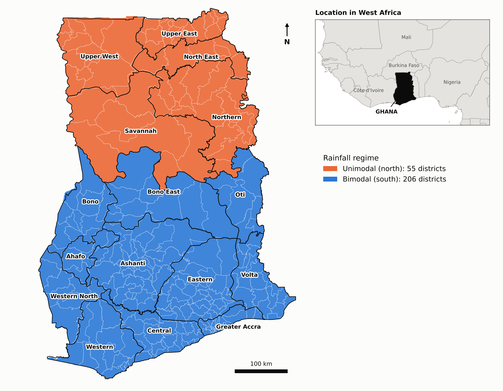
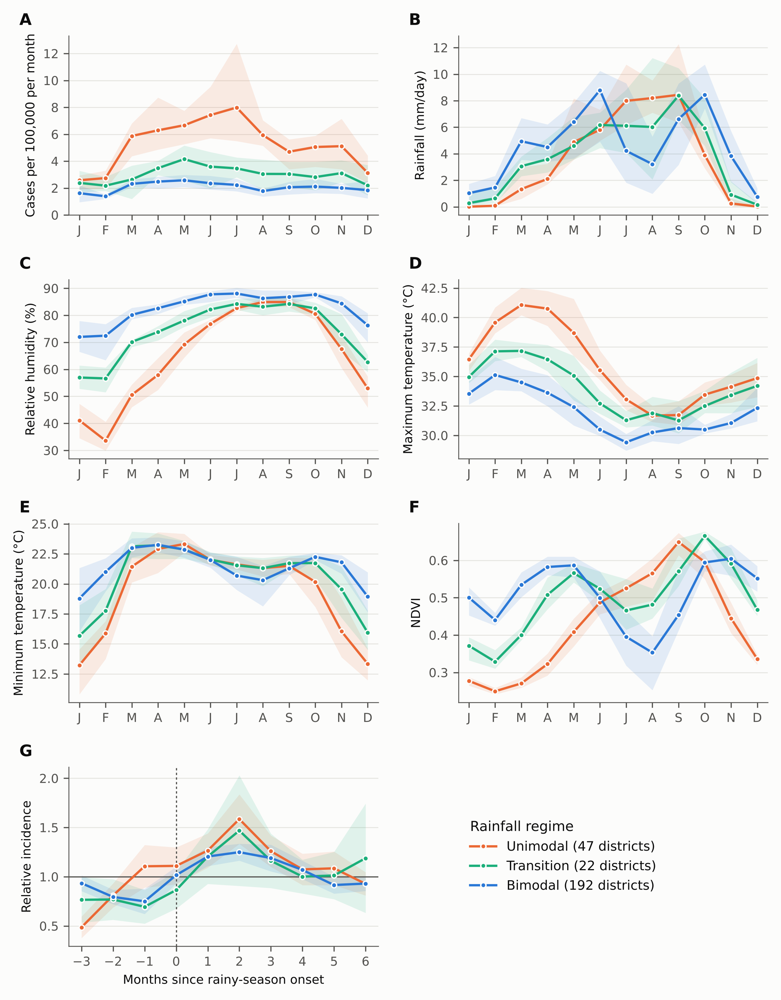

# MANUSCRIPT DRAFT

> **Draft v0.2, 23 October 2026.** v0.2 reframes the central gap as "is snakebite seasonality climate?" (see the box under the title).
> * Target journal: *PLoS Neglected Tropical Diseases*, research article.
> * Reporting guideline: RECORD (STROBE extension for routinely collected health data). The checklist is uploaded as the journal's required reporting file.
> * **No supplementary material:** every analysis, table and figure is in the main text (8 figures, 8 tables).
> * Companion document: `REVIEW_DRAFT.md` (literature review, gap analysis, methods rationale, references).
> * **[RESULT]** = fill from the final models.
> * Citations are numbered [n] (Vancouver). Only verified sources are used; see the References.
> * **[AUTHOR]** = author decision or information needed.
> * Descriptive numbers already computed from `data_snake.csv` are filled in.

---

## Title

**Is snakebite seasonality climate? Lagged local climate explains the seasonal cycle of snakebite across 261 districts of Ghana, 2020–2025**

*Alternative:* Seasonality is not a confounder: lagged climate, rainfall regime and the seasonal cycle of snakebite in Ghana — a nationwide distributed-lag mixed-model study

> **Central gap (v0.2).** The two most recent analyses of snakebite and climate treated seasonality as something separate from climate, adjusting for it with month terms, harmonics or temporal random effects:
> * India: "seasonality rather than precipitation or temperature" drives deaths [12].
> * Ghana: no rainfall effect [13].
>
> If the seasonal cycle is *itself* produced by lagged climate, that adjustment absorbs the climate effect (over-adjustment), and "seasonality not climate" becomes a modelling artefact. No study has tested whether snakebite seasonality is explained by lagged local climate.
>
> **A screening analysis supports the hypothesis.** Lagged local climate reproduced the full seasonal signal of zone-specific month terms. It outperformed all 100 placebo climate series taken from districts in a different rainfall regime (permutation p ≈ 0.01). About 11% of the seasonal signal remained unexplained by climate (`analysis/seasonality_climate_placebo.py`).

**Running title:** Lagged climate effects on snakebite in Ghana

**Authors:** Pascal Antwi¹, [AUTHOR: co-authors] · ¹[AUTHOR: affiliation] · Corresponding author: [AUTHOR: email]

---

## Abstract

**Background.**
* Snakebite envenoming is a climate-sensitive neglected tropical disease. Sub-Saharan Africa bears nearly half of its global burden.
* Snakebite is consistently seasonal. Yet recent studies in India and Ghana concluded that seasonality, rather than rainfall or temperature, drives risk.
* Those models adjusted for seasonality separately from climate. If the seasonal cycle is itself generated by lagged climate, such adjustment removes the climate effect.
* Whether snakebite seasonality *is* lagged climate has never been tested.

**Methodology.**
* We analysed 60,515 snakebite cases reported through Ghana's District Health Information Management System (DHIMS-2) from 261 districts, January 2020 – November 2025.
* Climate inputs were monthly district-level rainfall, relative humidity and temperature (NASA POWER) and vegetation (NDVI).
* Model: negative-binomial generalized linear mixed models with a population offset and district-within-region random effects.
* Distributed-lag non-linear models estimated exposure–lag–response associations over 0–[RESULT: L] months, with a pre-specified lag-selection strategy.
* We tested whether lagged local climate reproduces the seasonal cycle captured by month terms, using a placebo test: climate series reassigned from districts in a different rainfall regime, 100 permutations.
* We separated each climate variable into its seasonal climatology and its anomaly.
* We compared unimodal, transition and bimodal districts, classified from each district's own rainfall.
* We estimated climate-attributable cases and evaluated out-of-sample predictive skill for 2025.

**Principal findings.**
* The crude incidence was 32.4 per 100,000 per year: 65.8 in unimodal districts, 35.1 in the transition zone and 25.7 in bimodal districts.
* Lagged local climate reproduced [RESULT: ≈100%] of the seasonal signal and outperformed every placebo climate series (p [RESULT: <0.01]). Only [RESULT: ≈11%] of seasonal variation was unexplained by climate.
* Rainfall was associated with risk only after a delay, peaking at lag [RESULT] months in unimodal districts and lag [RESULT] in bimodal districts (cumulative RR [RESULT]).
* Humidity and minimum temperature acted within 0–1 months (RR [RESULT]). High maximum temperatures were associated with lower same-month risk.
* Incidence peaked 1–2 months after rainy-season onset, at [RESULT]% above baseline in unimodal and transition districts.
* An estimated [RESULT]% of cases were attributable to non-optimal climate.
* Adding lagged climate improved one-month-ahead prediction (CRPS reduced by [RESULT]%).

**Conclusions/Significance.**
* The seasonality of snakebite in Ghana is largely lagged local climate. Treating seasonality as a confounder hides the climate effect.
* Climate acts with measurable, regime-specific delays of one to three months.
* These delays provide usable lead time for climate-informed antivenom pre-positioning and community alerts in Ghana and similar West African settings.

**Keywords:** snakebite envenoming; climate; distributed lag non-linear model; generalized linear mixed model; rainfall onset; early warning; Ghana; West Africa

---

## Author summary

Snakebite kills and disables tens of thousands of people in Africa every year, mostly poor farmers in rural areas. People often say bites rise "in the rainy season". However, nobody had measured *how long after* rain, humidity or heat the risk goes up. That delay matters, because it tells health services how much warning they have to move antivenom to where it will be needed.

We used six years of monthly snakebite reports from every district in Ghana together with satellite climate data. Earlier studies concluded that snakebite follows "the season" rather than the weather. We show that, in Ghana, the season largely *is* the weather of previous months: each district's own past climate reproduced its snakebite season, while climate borrowed from the other half of the country could not. Rain does not raise snakebite risk in the same month. Risk rises one to three months later, and the delay is longer in the dry savanna north than in the wetter south. Bites surged in the one to two months after the rains started, when farmers clear and plant their fields. Humid and warm nights were linked to more bites almost immediately, while very hot days were linked to fewer. Using past climate improved forecasts of the next month's snakebite cases.

These findings could help Ghana and neighbouring countries plan antivenom supplies and warn communities ahead of high-risk periods.

---

## 1. Introduction

Snakebite envenoming is one of the most neglected causes of death and disability in the tropics. Recent geostatistical estimates suggest that at least 2.1 million, and possibly up to 7 million, envenomings occur each year. After adjustment for under-reporting, these cause between 274,000 and 513,000 deaths, and sub-Saharan Africa accounts for about 45% of both [[1](https://journals.plos.org/plosmedicine/article?id=10.1371/journal.pmed.1005201)]. These figures are far higher than the earlier global estimate of at least 421,000 envenomings and 20,000 deaths per year [[2](https://doi.org/10.1371/journal.pmed.0050218)]. In 2017 the World Health Organization re-listed snakebite as a category A neglected tropical disease. Its 2019 strategy aims to halve snakebite deaths and disability by 2030, a goal that depends on getting antivenom, trained staff and community awareness to the right places at the right times [[3](https://www.who.int/publications/i/item/9789241515641)]. In Ghana, snakebites are recorded through the District Health Information Management System (DHIMS-2) of public health facilities, and analyses of these data have shown that outbreaks can go undetected [[4](https://doi.org/10.11604/pamj.2021.40.131.28217)]. Across West Africa, many victims turn first to traditional medicine, so facility-based figures underestimate the true burden [[5](https://doi.org/10.1155/2024/8357312)]. In the savanna north, the West African carpet viper (*Echis ocellatus*) causes most severe envenoming, and bites occur mostly on farmland among men of working age [[6](https://doi.org/10.1371/journal.pntd.0007221)].

Snakebite is widely described as seasonal, and there are good biological and social reasons to expect its seasonality to be driven by climate. Snakes are ectotherms whose surface activity, foraging and dispersal depend on ambient temperature and moisture. Rainfall triggers vegetation growth, followed over weeks to months by pulses of seeds, insects and rodents, the principal prey of many medically important vipers [[7](https://doi.org/10.1007/s13364-018-0377-x)]. Human exposure follows the same clock. In rain-fed farming systems, land clearing, planting and weeding begin with the onset of the rains and bring barefoot or poorly protected farmers into contact with snakes [[5](https://doi.org/10.1155/2024/8357312),[6](https://doi.org/10.1371/journal.pntd.0007221)]. Heavy rain and humidity extremes may also drive snakes into houses and compounds. Each of these pathways implies a different delay between a climatic event and a bite, ranging from days for snake activity to months for prey dynamics, and the pathways may act in opposite directions at different lags. Any analysis that relates snakebite only to same-month climate is therefore likely to miss, or even reverse the sign of, real climatic effects.

The empirical evidence is limited and inconsistent. A 2025 systematic review of 35 spatial and temporal analyses found that temperature and humidity were mostly positively associated with snakebite risk and drought negatively. Some studies reported negative associations, however, and very few came from sub-Saharan Africa [[8](https://doi.org/10.1093/trstmh/trae131)]. Delayed effects have been examined only occasionally. In Costa Rica, incidence rose by about 24% per degree Celsius above average temperature. It was positively associated with temperature one month earlier and negatively with rainfall eleven months earlier, and it increased during both phases of the El Niño–Southern Oscillation [[9](https://doi.org/10.1126/sciadv.1500249)]. In California, bites declined after drought and increased after wet 18-month periods [[10](https://doi.org/10.1080/15563650.2018.1508690)]. In Colombia, rainfall drove incidence only where the dry season was marked [[11](https://doi.org/10.1371/journal.pntd.0010270)]. Most recently, a spatial case-crossover analysis of lagged precipitation and temperature in India concluded that snakebite deaths were "primarily influenced by seasonality rather than precipitation or temperature" [[12](https://doi.org/10.1016/j.sste.2025.100738)].

These studies share an important design choice. Seasonality is treated as a confounder: it is removed through calendar-month terms, harmonic functions, case-crossover time strata or temporal random effects, and only then is the effect of climate assessed. This is appropriate when seasonal variation in snakebite arises from causes unrelated to climate. In a rain-fed, ectotherm-driven system, however, the seasonal cycle of snakebite may itself be generated by lagged climate, directly through snake ecology and indirectly through the rain-timed agricultural calendar. Adjusting for seasonality then removes most of the effect it is meant to isolate, and estimates of climate effects are biased towards the null by over-adjustment. On this view, a conclusion that snakebite is driven by "seasonality rather than climate" may describe the model rather than the disease. To our knowledge, no study has tested whether the seasonality of snakebite is itself explained by lagged local climate.

Ghana illustrates the problem and offers an unusually good setting to test it. Regional analyses of surveillance and community data show that bites peak in the rainy and farming seasons [[4](https://doi.org/10.11604/pamj.2021.40.131.28217),[6](https://doi.org/10.1371/journal.pntd.0007221)]. Yet a recent nationwide Bayesian spatio-temporal analysis of district-level surveillance data for 2020–2025 included temporal and space–time random effects. It found humidity and temperature, but not rainfall, to be associated with risk [[13](https://www.medrxiv.org/content/10.64898/2026.07.12.26357875v1.full)]. A strongly rain-seasonal disease with no detectable rainfall effect is consistent with over-adjustment. Ghana also contains contrasting rainfall regimes within a single national surveillance system. The Guinea and Sudan savanna of the north has one rainy season followed by a long dry season, whereas the forest and coastal zones of the south have two rainy seasons, with a transition belt between them [[14](https://ugspace.ug.edu.gh/items/88e8caf1-cdc8-4d5d-9135-697dd61c6932)]. If snakebite seasonality is climatic, each district's seasonal cycle should be reproduced by its own lagged climate but not by the climate of a district in a different regime, and this contrast provides a natural falsification test.

In this study we used 72 months of surveillance data, from January 2020 to December 2025, from all 261 districts of Ghana for two purposes: to test whether the seasonality of snakebite is explained by lagged local climate, and to quantify the delayed and non-linear effects of rainfall, humidity, temperature and vegetation. Using negative-binomial generalized linear mixed models with a population offset and sex as a covariate, our primary aim was to test whether lagged local climate reproduces the seasonal cycle captured by conventional calendar-month adjustment. We used climate reassigned from a different rainfall regime as a placebo, and quantified the share of seasonality that is climatic. We further estimated exposure–lag–response associations with distributed-lag non-linear models and separated the effects of normal seasonal climate from those of unusual weather. We compared lag structures between unimodal, transition and bimodal districts, and estimated the number of snakebites attributable to climate. Finally, we evaluated whether lagged climate improves out-of-sample prediction and so provides lead time for antivenom planning.

---

## 2. Methods

### 2.1 Study setting

Ghana, with a population of about 34 million in 2025, is divided into 16 regions and 261 metropolitan, municipal and district assemblies. Ghana's rainfall changes from two rainy seasons in the south to one in the north [[14](https://ugspace.ug.edu.gh/items/88e8caf1-cdc8-4d5d-9135-697dd61c6932)]. The Guinea and Sudan savanna of the north has a single rainy season, mainly from May to October, followed by a long dry season during which the dry Harmattan wind blows. The forest and coastal zones of the south have a major and a minor rainy season. Because this change is gradual and does not follow administrative boundaries, we classified each district by its own rainfall rather than by its region. For each year from 2020 to 2024, we counted a district as having two rainy seasons when its lowest monthly rainfall in July–August fell below 80% of both its first peak (April–June) and its second peak (September–October). We classed districts with two rainy seasons in four or five of the five years as bimodal (192 districts), those with two seasons in no more than one year as unimodal (47 districts), and those with two seasons in two or three years as a transition zone (22 districts), because their pattern varies from year to year. To test the stability of this classification, we varied the 80% threshold between 75% and 90%, which reclassified between 3 and 15 districts. Unimodal districts lie in the Upper East, Upper West, North East and most of the Northern Region; the transition zone runs through the Savannah, northern Bono East and Oti Regions, with a few districts in Northern, Volta and Bono; and bimodal districts make up the rest of the south. In bimodal districts the major season peaks around June and the minor season around October (Fig 2). The West African carpet viper (*Echis ocellatus*) causes most severe envenoming in the northern savanna [[6](https://doi.org/10.1371/journal.pntd.0007221)]. A national compendium describes the other medically important snakes of Ghana, their venom activity and the clinical presentations they cause. It also notes that health-facility records rarely characterise the venom or the species responsible [[15](https://doi.org/10.1371/journal.pntd.0011050)]. [Fig 1](#fig1) shows the study area, with the districts shaded by rainfall regime, the 16 regions named and the location of Ghana in West Africa. We took district boundaries from the geoBoundaries database [[16](https://doi.org/10.1371/journal.pone.0231866)], whose Ghana file, sourced from the Ghana Statistical Service, contains 260 districts. We matched the boundaries to the surveillance districts by name, reconciling 30 spellings by hand, and deposited the crosswalk in the public repository. We drew the maps in Python with the matplotlib library [[17](https://doi.org/10.1109/MCSE.2007.55)] and the shapely geometry package (https://shapely.readthedocs.io), using the script `analysis/fig1_map.py`.

<a name="fig1"></a>



**Fig 1. Study area and rainfall regimes of Ghana.** The 261 districts are shaded by rainfall regime, classified from each district's own monthly rainfall in 2020–2024 (Section 2.1): unimodal, one rainy season (47 districts); transition, one or two rainy seasons depending on the year (22 districts); and bimodal, two rainy seasons (192 districts). Thin white lines mark district boundaries and black lines the 16 named regions. The inset shows the location of Ghana in West Africa. Rainfall is NASA POWER precipitation [[18](https://power.larc.nasa.gov/docs/methodology/meteorology/)]. District and regional boundaries are from geoBoundaries (gbOpen, Ghana ADM2 and ADM1; source USAID Ghana HPNO and Ghana Statistical Service; CC BY 4.0) [[16](https://doi.org/10.1371/journal.pone.0231866)]. Country outlines are from Natural Earth at 1:50 million scale (public domain; https://www.naturalearthdata.com). Map drawn in Python with matplotlib [[17](https://doi.org/10.1109/MCSE.2007.55)] and shapely (`analysis/fig1_map.py`).

### 2.2 Study design and data

We conducted a nationwide ecological panel study, with a time-series cross-sectional design, of monthly snakebite counts in every district of Ghana from January 2020 to December 2025, a period of 72 complete months.

**Health data.** We obtained snakebite cases from the District Health Information Management System (DHIMS-2) of the Ghana Health Service, the national electronic database through which health facilities report routine service data in aggregated form. Earlier regional analyses have also used it [[4](https://doi.org/10.11604/pamj.2021.40.131.28217),[19](https://doi.org/10.1093/trstmh/trae113)]. Within DHIMS-2, new outpatient snakebite cases are entered through the monthly outpatient department (OPD) morbidity form. Admitted cases are reported through the in-patient morbidity and mortality form, and snakebite deaths are held in a separate cause-of-death database [[19](https://doi.org/10.1093/trstmh/trae113)]. We extracted the monthly number of snakebite cases in each of the 261 districts, by sex, from January 2020 to December 2025, following the 2018 district boundaries [AUTHOR: confirm whether the extraction combined the OPD and in-patient forms or used the OPD form alone, and give the DHIMS-2 reporting rate for 2020–2025]. We defined a case as a new attendance at a reporting health facility that was recorded as snakebite. Because the data are aggregated, they carry no individual identifiers and record neither the snake species nor the presence or severity of envenoming [[15](https://doi.org/10.1371/journal.pntd.0011050)]. Bites treated only by traditional healers, or at facilities that do not report to DHIMS-2, are not captured [[5](https://doi.org/10.1155/2024/8357312)].

**Population data.** We used annual district population estimates for 2020–2025 as the offset, so that the models describe incidence rates rather than counts [AUTHOR: state the source, for example the Ghana Statistical Service projections from the 2021 Population and Housing Census]. For the sex-specific models, we divided each district's population between males and females using the national shares of the 2021 Population and Housing Census, 49.3% male and 50.7% female [[20](https://3news.com/wp-content/uploads/2021/09/2021-PHC-Provisional-Results-Press-Release_210921-1.pdf)].

**Climate and vegetation data.** We obtained monthly climate for each district from the NASA Prediction of Worldwide Energy Resources (POWER) project [[18](https://power.larc.nasa.gov/docs/methodology/meteorology/)], whose meteorological fields derive from the MERRA-2 reanalysis [[21](https://doi.org/10.1175/JCLI-D-16-0758.1)] on a grid of about 0.5° × 0.625°. We extracted precipitation (monthly mean, mm/day), relative humidity at 2 m (%), and mean, maximum and minimum air temperature at 2 m (°C) for January 2019 to November 2025, which gives a full lag history for cases in 2020 [AUTHOR: confirm the 2019 extraction and state whether values were extracted at district centroids or area-weighted]. Climate for December 2025 was not available, so we estimated it from each district's own December record for 2020–2024. We obtained vegetation greenness (NDVI) from [AUTHOR: product, for example MODIS MOD13A3, with a verified reference] and averaged it over each district for the same period. For sensitivity analyses at finer resolution, we also took rainfall from CHIRPS version 2.0 at 0.05° [[22](https://doi.org/10.1038/sdata.2015.66)], and temperature and humidity from ERA5-Land at 0.1° [[23](https://doi.org/10.5194/essd-13-4349-2021)].

### 2.3 Derived exposures

We derived several exposures from the monthly climate data to separate the regular seasonal cycle from unusual weather, to describe the timing of the rains and to capture the combined effect of heat and moisture.

For each climate variable $`x`$ in district $`i`$ and month $`t`$, with calendar month $`m(t)`$, we defined the climatology $`\bar{x}_{i,m(t)}`$ as the mean of that variable in that district and calendar month over the study period. It describes the conditions a district normally experiences at that time of year, and therefore carries both the seasonal cycle and the differences in climate between districts. We then calculated the anomaly, $`a_{it} = (x_{it} - \bar{x}_{i,m(t)})/s_x`$, where $`s_x`$ is the standard deviation of $`x_{it} - \bar{x}_{i,m(t)}`$ across all district-months, which measures how much wetter, more humid or hotter a given month was than usual for that district. Because the anomalies are centred within each district and calendar month, they are free of the seasonal cycle by construction. By comparing the effects of climatology and anomaly, we therefore distinguished the influence of the normal season from that of unusual weather.

We defined the onset of the rainy season, for each district and year, as the first month from February onwards in which mean rainfall reached at least 2 mm/day, roughly 60 mm in the month. We used February as the starting point so that rain falling late in the previous rainy season was not counted as a new onset. Because any threshold is to some extent arbitrary, we also defined onset with thresholds of 1.5 and 3 mm/day and with a cumulative-rainfall criterion in sensitivity analyses. We recorded a false start when onset was followed within two months by a month with less than 1 mm/day of rain, a pattern that can disrupt planting and prolong land preparation. We then indexed each district-month by the number of months since onset in that district and year, from three months before onset to six months after, so that we could align snakebite incidence to the start of the rains rather than to the calendar.

We derived two further variables for secondary analyses. The diurnal temperature range, the difference between the monthly mean maximum and minimum temperatures, describes how much a district cools at night relative to the heat of the day, which affects the hours during which snakes are active. The vapour-pressure deficit summarises the drying power of the air by combining temperature and humidity. We calculated it as $`\mathrm{VPD} = e_s(T)\,(1 - \mathrm{RH}/100)`$, where $`T`$ is the monthly mean temperature in °C, $`\mathrm{RH}`$ the relative humidity in per cent and $`e_s(T) = 0.6108\,\exp\lbrace 17.27\,T/(T + 237.3)\rbrace`$ the saturation vapour pressure in kPa [[24](https://www.fao.org/4/x0490e/x0490e00.htm)]. The vapour-pressure deficit also offers a single measure of heat and moisture, which is useful because relative humidity and maximum temperature are strongly correlated in these data and are difficult to separate in the same model.

### 2.4 Statistical analysis

#### 2.4.1 Descriptive analysis

We described the seasonal profiles of snakebite and climate separately for unimodal, transition and bimodal districts. For each rainfall regime, we summed the reported cases in each calendar month across districts and years and plotted them alongside the mean monthly rainfall, relative humidity and temperature of the same districts. This shows when snakebite peaks relative to the rainy seasons and whether the timing differs between regimes. To relate the snakebite season to the start of the rains rather than to the calendar, we also plotted incidence by months since rainy-season onset, expressed relative to each district's mean.

We examined the distribution of monthly counts to choose the count model. We calculated the mean and variance of district-month counts and their ratio. A ratio well above 1 indicates overdispersion, meaning more variation than a Poisson model allows, and supports a negative-binomial model. We also calculated the proportion of district-months with no reported cases, overall and for each district. A larger share of zeros than the negative-binomial model predicts would point to a zero-inflated or hurdle model, and we assessed these alternatives in the sensitivity analyses.

#### 2.4.2 Base model

We modelled the monthly number of snakebite cases $`Y_{it}`$ in district $`i`$ and month $`t`$ with a negative-binomial generalized linear mixed model with a log link:

```math
Y_{it} \sim \mathrm{NB}(\mu_{it}, \theta), \qquad \mathrm{Var}(Y_{it}) = \mu_{it} + \mu_{it}^2/\theta,
```

```math
\log \mu_{it} = \log(\text{Pop}_{it}) + \beta_0 + s_{g(i)}(m_t) + \gamma_{y(t)} + u_{r(i)} + v_i, \qquad u_r \sim N(0,\sigma_u^2), \quad v_i \sim N(0,\sigma_v^2).
```

We chose each component both for what the data showed and for its statistical properties.

*Negative-binomial distribution.* The counts were strongly overdispersed, with a variance 8.8 times the mean (Section 3.1). A Poisson model assumes that the variance equals the mean, and under overdispersion it understates standard errors and overstates the significance of every effect [[25](https://cameron.econ.ucdavis.edu/racd2/)]. The negative binomial arises as a Poisson model whose rate varies between observations according to a gamma distribution. This adds the term $`\mu_{it}^2/\theta`$ to the variance, and the model reduces to the Poisson as $`\theta \to \infty`$ [[25](https://cameron.econ.ucdavis.edu/racd2/)]. We preferred it to the quasi-Poisson model because it has a full likelihood, which we needed to compare models by AIC and to select lags. Its variance also grows with the square of the mean, which suits data in which large counts are rare but highly variable [[26](https://pubmed.ncbi.nlm.nih.gov/18051645/)]. Although 31% of district-months recorded no cases, the negative binomial already predicts many zeros at low means, $`P(Y_{it}=0) = \lbrace \theta/(\theta+\mu_{it})\rbrace^{\theta}`$, so zeros alone do not require a different model. We fitted zero-inflated [[27](https://doi.org/10.2307/1269547)], hurdle [[25](https://cameron.econ.ucdavis.edu/racd2/)] and NB1 alternatives in sensitivity analyses, and compared the observed zeros with zeros simulated from the fitted model [[28](https://CRAN.R-project.org/package=DHARMa)].

*Population offset.* District populations differed 16-fold, so we entered $`\log(\text{Pop}_{it})`$ as an offset. Then $`\mu_{it}/\text{Pop}_{it} = \exp(\eta_{it})`$, where $`\eta_{it}`$ is the rest of the linear predictor. The model therefore describes incidence rates, and $`\exp(\beta)`$ is the incidence rate ratio for a covariate with coefficient $`\beta`$ [[25](https://cameron.econ.ucdavis.edu/racd2/)].

*Seasonality and year effects.* Unimodal districts peaked in July, whereas bimodal districts peaked in May with a second rise in September–October (Section 3.2), so we allowed the calendar-month effects $`s_{g(i)}(m_t)`$ to differ by rainfall regime. This is the conventional adjustment for seasonality in time-series studies of environment and health [[29](https://doi.org/10.1093/ije/dyt092)]. We also used it as the reference against which the primary analysis tests whether lagged climate can reproduce the seasonal cycle (Section 2.4.5). We included year effects $`\gamma_{y(t)}`$ to absorb national changes in reporting, care-seeking and long-term trends that could otherwise be confounded with climate [[29](https://doi.org/10.1093/ije/dyt092)]. These include the disruption of 2020, when outpatient attendance in Ghana fell during the COVID-19 pandemic [[30](https://doi.org/10.1136/bmjopen-2022-061608)].

*District and region random intercepts.* District incidence ranged from 0 to 277.5 per 100,000 per year and regional incidence from 5.4 to 111.9 (Section 3.1). These differences reflect persistent, unmeasured characteristics such as snake fauna, land use, access to care and completeness of reporting. We included district and region random intercepts to account for these differences and for the repeated measurement of each district [[31](https://experts.mcmaster.ca/scholarly-works/1146888)], and they borrow strength across districts so that districts with few cases are not estimated in isolation [[32](https://assets.cambridge.org/97805218/67061/copyright/9780521867061_copyright_info.pdf)]. With 72 months per district, the climate effects are identified mainly from changes over time within districts, which protects them against confounding by stable district characteristics [[33](https://eprints.ncrm.ac.uk/id/eprint/3317/)].

*Autocorrelation.* We found that monthly counts were correlated within districts (lag-1 correlation 0.20). Where residual autocorrelation remained, we added a district-level first-order autoregressive term, with $`\mathrm{Corr}(\varepsilon_{it}, \varepsilon_{i,t+k}) = \rho^{|k|}`$ [[34](https://doi.org/10.32614/RJ-2017-066)]. We examined spatial correlation in the residuals and addressed it in a sensitivity analysis with a spatial model [[35](https://arxiv.org/abs/1601.01180)] (Section 2.4.11).

*Sex.* Males accounted for 58% of cases, consistent with greater exposure during farm work [[6](https://doi.org/10.1371/journal.pntd.0007221)]. For the analyses by sex, we arranged the data with one row per district, month and sex $`k`$ and extended the model to

```math
\log \mu_{ikt} = \log(\text{Pop}_{ikt}) + \beta_0 + \delta\,\text{male}_k + s_{g(i)}(m_t) + \gamma_{y(t)} + u_{r(i)} + v_i,
```

so that $`\exp(\delta)`$ is the male-to-female incidence rate ratio. We added interactions between sex and the climate terms to test whether climate effects differ between the sexes.

*Data and estimation.* We fitted the models to 18,636 district-months, after excluding district-months in which reporting appeared to have failed rather than cases to have been absent. We excluded one district with no reports in any month, one with no reports after 2023 and five district-years with no reports in districts that otherwise averaged at least 10 cases a year. We estimated the parameters by maximum likelihood, integrating out the random effects with the Laplace approximation [[31](https://experts.mcmaster.ca/scholarly-works/1146888),[34](https://doi.org/10.32614/RJ-2017-066)].

#### 2.4.3 Distributed-lag non-linear models

To estimate how snakebite risk depends on climate in the current and preceding months, we added each climate variable to the base model as a cross-basis, the core of a distributed-lag non-linear model (DLNM) [[36](https://www.ncbi.nlm.nih.gov/pmc/articles/PMC2998707/)]. We chose this approach for two reasons. *Descriptive:* snakebite rose one to two months after the onset of the rains and returned to its usual level four to five months after onset (Section 3.2), so the effect of rainfall is spread over several months rather than confined to one. *Theoretical:* the mechanisms linking climate to snakebite act over different delays, from days for snake activity to weeks for land clearing and planting [[5](https://doi.org/10.1155/2024/8357312),[6](https://doi.org/10.1371/journal.pntd.0007221)] and months for vegetation and rodent prey [[7](https://doi.org/10.1007/s13364-018-0377-x)]. A model of same-month climate, or of a single chosen lag, would miss or misplace such effects. A DLNM estimates the whole pattern of effects across lags at once, and it also allows the effect to be non-linear in the size of the exposure [[36](https://www.ncbi.nlm.nih.gov/pmc/articles/PMC2998707/)].

For an exposure $`x`$, the DLNM describes the contribution of $`x`$ measured $`\ell`$ months earlier through a bi-dimensional function $`f\cdot w(x,\ell)`$, built as the tensor product of a basis for the exposure, $`b_j(x)`$, and a basis for the lag, $`c_k(\ell)`$ [[36](https://www.ncbi.nlm.nih.gov/pmc/articles/PMC2998707/)]:

```math
f\cdot w(x,\ell) = \sum_{j=1}^{v_x}\sum_{k=1}^{v_\ell} b_j(x)\,c_k(\ell)\,\eta_{jk}, \qquad \sum_{\ell=0}^{L} f\cdot w(x_{i,t-\ell},\ell) = \mathbf{w}_{it}^{\top}\mathbf{h},
```

where $`\mathbf{w}_{it}`$ is the vector of cross-basis variables computed from the district's climate history and $`\mathbf{h}`$ the vector of coefficients $`\eta_{jk}`$ estimated with the rest of the model. For $`b_j(x)`$ we used a natural cubic spline, which can capture curved relationships but is linear beyond the extreme knots, avoiding implausible behaviour at rare extreme values. A curved relationship is plausible for both rainfall, whose association with snakebite was hump-shaped in northern Ghana [[6](https://doi.org/10.1371/journal.pntd.0007221)], and temperature, since snake activity falls when conditions exceed the species' optimum [[8](https://doi.org/10.1093/trstmh/trae131)]. For $`c_k(\ell)`$ we used a natural cubic spline with knots equally spaced on the logarithmic scale, which allows more flexibility at short lags, where effects are expected to change fastest, and smoother curves at long lags [[36](https://www.ncbi.nlm.nih.gov/pmc/articles/PMC2998707/)]. We computed lags within each district and across year boundaries. Because the climate series start in January 2019, every month from January 2020 has a complete history of up to 12 months.

From the fitted cross-basis we report the relative risk (RR) at exposure $`x`$ and lag $`\ell`$ compared with a reference value $`x_0`$, and the cumulative RR over all lags:

```math
\mathrm{RR}(x,\ell) = \exp\lbrace f\cdot w(x,\ell) - f\cdot w(x_0,\ell)\rbrace, \qquad \mathrm{RR}_{\text{cum}}(x) = \exp\Big\lbrace \sum_{\ell=0}^{L} \big[f\cdot w(x,\ell) - f\cdot w(x_0,\ell)\big]\Big\rbrace.
```

We set $`x_0`$ to the median of each exposure, or to the value of minimum risk where the exposure–response curve had a clear minimum, and report RRs at the 90th and 99th percentiles together with the full exposure–lag–response surface.

The climate variables were correlated. *Descriptive:* relative humidity and maximum temperature had a correlation of −0.80, and rainfall and humidity 0.59, while the other pairs were weaker. *Theoretical:* strongly correlated exposures entered together inflate the variance of their coefficients and make their separate effects difficult to interpret. We therefore included rainfall, maximum and minimum temperature and NDVI in the main model and assessed relative humidity in an alternative model in which it replaced maximum temperature, and we report variance inflation factors. In the primary analysis of seasonality (Section 2.4.5), where the aim is to reproduce the seasonal cycle jointly rather than to separate the effects of single variables, all five variables were entered together.

#### 2.4.4 Lag selection strategy (pre-specified)

We pre-specified how the maximum lag and the flexibility of the cross-basis would be chosen. *Theoretical:* climate and snakebite share a strong seasonal cycle, so the correlation between snakebite and climate several months earlier partly reflects the season itself. Choosing lags by cross-correlation, or by testing many single lags and keeping the significant ones, would therefore select lags that mirror the seasonal cycle and would inflate false-positive findings through multiple testing [[29](https://doi.org/10.1093/ije/dyt092)].

We set the main maximum lag at $`L = 6`$ months from the mechanisms above, which act within zero to four months. *Descriptive:* the post-onset rise in snakebite had subsided by five months after onset (Section 3.2). Because longer delays have been reported elsewhere, with rainfall effects at 11 months in Costa Rica [[9](https://doi.org/10.1126/sciadv.1500249)] and 18 months in California [[10](https://doi.org/10.1080/15563650.2018.1508690)], we repeated the analysis with $`L`$ = 3, 9 and 12 months.

We estimated all lags jointly in the cross-basis and chose $`L`$ and the degrees of freedom of the exposure and lag splines from a pre-specified grid: $`L \in \lbrace 3, 6, 9, 12\rbrace`$, with 2, 3 or 4 degrees of freedom for each spline (36 candidate models). We compared the candidates with two criteria. The first was the Akaike information criterion, $`\mathrm{AIC} = -2\log \hat{L} + 2p`$, where $`\hat{L}`$ is the maximised likelihood and $`p`$ the number of parameters; all candidates were fitted to the same observations so that their AIC values are comparable. The second was predictive performance in leave-one-year-out cross-validation. Leaving out whole years rather than random months keeps the temporal dependence of the data out of the validation set, which random cross-validation would ignore and so overstate performance [[37](https://doi.org/10.1111/ecog.02881)]. We scored the held-out predictions with two strictly proper scoring rules, the logarithmic score and the continuous ranked probability score [[38](https://doi.org/10.1198/016214506000001437)]:

```math
\mathrm{LogS} = -\log p(y_{it} \mid \hat{\psi}_{-y}), \qquad \mathrm{CRPS}(F_{it}, y_{it}) = \sum_{k=0}^{\infty} \big\lbrace F_{it}(k) - \mathbf{1}(y_{it} \le k)\big\rbrace^2,
```

where $`p`$ and $`F_{it}`$ are the predictive probability and cumulative distribution function from the model fitted without year $`y`$, with parameters $`\hat{\psi}_{-y}`$. Lower values of both scores indicate better predictions. We retained the most parsimonious model within 2 AIC units of the best, or within one standard error of the best cross-validated score.

As a check on the lag shape that does not depend on the grid, we fitted a penalized DLNM with $`L`$ = 12, in which a smoothing penalty estimated by restricted maximum likelihood shrinks unsupported lags towards zero [[39](https://doi.org/10.1111/biom.12645)]. We applied the same $`L`$ and degrees of freedom to all climate variables and rainfall regimes, so that their lag curves are directly comparable. Finally, as a falsification test, we added future climate (lags of −1 and −2 months) to the final model. Climate in the following month cannot cause snakebite in the current month, so any association with future climate would indicate residual seasonal confounding; such future exposures serve as negative control exposures [[40](https://doi.org/10.1097/EDE.0b013e3181d61eeb)]. We report the full lag curves and cumulative effects rather than a single selected lag.

#### 2.4.5 Primary analysis: is seasonality lagged climate?

The primary analysis tested whether the seasonal cycle of snakebite is itself explained by lagged local climate. *Theoretical:* when an exposure generates the seasonal pattern of an outcome, adjusting for season removes part of the exposure's effect. The same holds when the pathway runs through behaviour timed by the exposure, such as rain-fed farming [[5](https://doi.org/10.1155/2024/8357312),[6](https://doi.org/10.1371/journal.pntd.0007221)]. This is over-adjustment, which biases the estimated effect towards the null [[41](https://doi.org/10.1097/EDE.0b013e3181a819a1)], and it may explain why recent analyses that adjusted for season found weak or null effects of rainfall and temperature [[12](https://doi.org/10.1016/j.sste.2025.100738),[13](https://www.medrxiv.org/content/10.64898/2026.07.12.26357875v1.full)]. *Descriptive:* snakebite and climate shared a strong seasonal cycle, whose shape differed between rainfall regimes (Section 3.2). This made it possible to test whether each district's season follows its own climate.

We fitted four nested negative-binomial mixed models to the same observations, each with the district and region random intercepts, year effects and population offset of the base model. Model M0 had no seasonal terms. M1 added the calendar-month effects by rainfall regime, the conventional adjustment [[29](https://doi.org/10.1093/ije/dyt092)]. M2 replaced them with cross-bases of the district's own lagged rainfall, relative humidity, maximum and minimum temperature and NDVI. M3 contained both. With $`D_k`$ the deviance of model $`k`$, we measured the share of the seasonal signal reproduced by climate, $`S_{\text{clim}}`$, and the share of seasonality not explained by climate, $`S_{\text{res}}`$:

```math
S_{\text{clim}} = \frac{D_{M0} - D_{M2}}{D_{M0} - D_{M1}}, \qquad S_{\text{res}} = \frac{D_{M2} - D_{M3}}{D_{M0} - D_{M1}}.
```

$`S_{\text{res}}`$ captures seasonal influences unrelated to climate, such as school holidays, market and harvest events and reporting cycles. Because M1 and M2 differ in their number of parameters, we also compared them with AIC and leave-one-year-out cross-validated scores [[37](https://doi.org/10.1111/ecog.02881),[38](https://doi.org/10.1198/016214506000001437)].

A good fit of M2 could arise simply because any smooth seasonal series resembles the snakebite season. To exclude this, we used a placebo test. We replaced each district's climate series with that of a randomly chosen district from a different rainfall regime, keeping calendar months aligned, refitted M2, and repeated this $`m`$ = 1,000 times. If climate explains snakebite only through its general seasonality, placebo climate should fit as well as the district's own climate. With $`b`$ the number of placebo fits whose deviance was no greater than that of the own-climate fit, we calculated the permutation p-value as $`p = (b+1)/(m+1)`$, which avoids reporting a p-value of zero [[42](https://doi.org/10.2202/1544-6115.1585)]. In a temporal placebo, we replaced each district's climate with its own climate from a different year. This keeps the seasonal shape but breaks the alignment between years, and tests whether year-to-year variation in climate explains snakebite beyond the average seasonal cycle.

Because the farming calendar lies on the causal pathway from rainfall to snakebite, it is a mediator rather than a confounder, so we did not adjust for it. The climate effects estimated here are therefore total effects, including human behavioural responses to climate.

#### 2.4.6 Climatology versus anomaly decomposition

To separate the influence of the normal season from that of unusual weather, we split each climate variable into its climatology $`\bar{x}_{i,m(t)}`$ and its standardised anomaly $`a_{it}`$ (Section 2.3) and entered both as separate cross-bases:

```math
\log \mu_{it} = \log(\text{Pop}_{it}) + \beta_0 + \sum_{\ell=0}^{L} f\cdot w_{\text{clim}}(\bar{x}_{i,m(t-\ell)},\ell) + \sum_{\ell=0}^{L} f\cdot w_{\text{anom}}(a_{i,t-\ell},\ell) + \gamma_{y(t)} + u_{r(i)} + v_i.
```

*Theoretical:* this is a within–between decomposition. A variable that varies both between and within units is split into a component that is constant within units and a deviation from it, so that the two effects are estimated separately rather than as one blended coefficient [[43](https://www.jstor.org/stable/1913646),[33](https://eprints.ncrm.ac.uk/id/eprint/3317/)]. Here the climatology carries the expected seasonal and spatial climate signal, and the anomaly carries weather that departs from it. The anomaly effects are free of seasonal confounding by construction, so they estimate the delayed effect of unusual weather, which is the effect relevant to early warning. *Descriptive:* anomalies were also less strongly correlated with one another than the raw variables; for example, the correlation of relative humidity with maximum temperature fell from −0.80 to −0.66. This eases the collinearity that limited the raw-variable models.

#### 2.4.7 Heterogeneity by rainfall regime

We tested whether the lag structure differs between unimodal, transition and bimodal districts. *Descriptive:* the three regimes differed in the number and timing of rainy seasons and in incidence, at 65.8, 35.1 and 25.7 cases per 100,000 per year (Section 3.1). *Theoretical:* the delays between rain and snakebite may also differ, for example if the vegetation and prey response after a single long dry season is slower than in areas with two rainy seasons.

We used a two-stage approach. In the first stage, we fitted the DLNM separately in each regime. We reduced each fit to two sets of coefficients, those of the overall cumulative exposure–response curve and those of the lag curve at a fixed exposure (the 90th percentile), together with their covariance matrices. In the second stage, we pooled these coefficient vectors with multivariate meta-analysis [[44](https://doi.org/10.1002/sim.5471)], implemented in the mixmeta package [[45](https://doi.org/10.1002/sim.8362)]. This gave pooled curves and tested whether the regime-specific curves differ more than expected by chance. We summarised heterogeneity with Cochran's $`Q`$ statistic and with

```math
I^2 = \max\left\lbrace 0,\; \frac{Q - \mathrm{df}}{Q}\right\rbrace \times 100\%,
```

the percentage of variation between regimes that is due to true differences rather than chance [[46](https://doi.org/10.1002/sim.1186)]. As a complementary one-stage test, we compared the pooled model with a model in which each cross-basis interacted with regime, using a likelihood-ratio test. The transition zone contains only 22 districts, so its curves are estimated less precisely; in a sensitivity analysis we merged it with the neighbouring regime.

#### 2.4.8 Rainy-season onset

We examined how snakebite incidence changes relative to the start of the rains with an event-study model, fitted separately for each regime. In this model, indicators of the number of months since onset replaced the calendar-month effects:

```math
\log \mu_{it} = \log(\text{Pop}_{it}) + \beta_0 + \sum_{k=-2}^{6} \tau_k\, \mathbf{1}(t - O_{i,y(t)} = k) + \gamma_{y(t)} + u_{r(i)} + v_i,
```

where $`O_{i,y}`$ is the onset month in district $`i`$ and year $`y`$, and the reference period is three months before onset, so that $`\exp(\tau_k)`$ is the rate ratio $`k`$ months after onset. Months outside the window from −3 to +6 were grouped with the reference period. *Descriptive:* incidence relative to the district mean rose to between 1.25 and 1.59 two months after onset, depending on the regime (Section 3.2). *Theoretical:* aligning the data to onset rather than the calendar allows for onset falling in different months in different districts and years, and links the timing of bites to the agricultural activities that start with the rains [[5](https://doi.org/10.1155/2024/8357312),[6](https://doi.org/10.1371/journal.pntd.0007221)]. Because onset varied little from year to year within districts, this analysis describes the timing of risk around onset and is secondary to the DLNM.

In further secondary analyses, we related the onset month and the occurrence of a false start to the month of the annual snakebite peak, using a linear mixed model with a district random intercept. We also related them to the total number of cases in the rainy season, using a negative-binomial mixed model.

#### 2.4.9 Attributable burden

To express the climate effects as numbers of snakebites, we estimated the cases attributable to non-optimal climate from the final DLNM [[47](https://doi.org/10.1186/1471-2288-14-55)]. *Theoretical:* relative risks describe how strongly risk changes with exposure, but planning needs the number of cases involved, which also depends on how often each exposure level occurs. *Descriptive:* about 10,000 snakebites were reported each year, so even a modest attributable fraction implies a substantial number of cases. With the backward perspective, which attributes the cases in month $`t`$ to the exposures in the preceding $`L`$ months, the attributable fraction and number for district-month $`(i,t)`$ are

```math
\mathrm{AF}_{it} = 1 - \exp\Big\lbrace -\sum_{\ell=0}^{L} \big[f\cdot w(x_{i,t-\ell},\ell) - f\cdot w(x_0,\ell)\big]\Big\rbrace, \qquad \mathrm{AN}_{it} = \mathrm{AF}_{it}\, n_{it},
```

where $`x_0`$ is the minimum-risk value and $`n_{it}`$ the observed number of cases [[47](https://doi.org/10.1186/1471-2288-14-55)]. The total attributable number is $`\sum_{i,t} \mathrm{AN}_{it}`$, and the attributable fraction is this total divided by the total number of cases. We report results by exposure, rainfall regime, region and year. We obtained 95% empirical confidence intervals from 1,000 Monte Carlo samples of the cross-basis coefficients drawn from their estimated multivariate normal distribution [[47](https://doi.org/10.1186/1471-2288-14-55)].

#### 2.4.10 Predictive validation

We assessed whether lagged climate improves the prediction of snakebite in data not used to fit the model, which is the test relevant to early warning and the timely distribution of antivenom [[3](https://www.who.int/publications/i/item/9789241515641)]. *Descriptive:* routine surveillance in Ghana has missed snakebite outbreaks [[4](https://doi.org/10.11604/pamj.2021.40.131.28217)], and the seasonal peak varies in size and timing between years and districts (Section 3.2). *Theoretical:* a model can fit past data well yet predict poorly, so predictive skill must be judged on held-out data. With temporally dependent data, the held-out set should be separated in time rather than chosen at random [[37](https://doi.org/10.1111/ecog.02881)].

We trained the models on January 2020 to December 2024 and predicted January to December 2025. We also used rolling-origin validation, in which each year from 2022 onwards was predicted from all earlier years. We compared three nested models. Model A contained the seasonal terms and random effects of the base model. Model B added lagged climate restricted to lags of one month or more, so that every prediction uses only climate already observed, as in real-time use. Model C added the onset terms. Because December 2025 climate was estimated rather than observed (Section 2.2), we repeated the evaluation excluding that month.

We assessed the predictions with the mean absolute error and the continuous ranked probability score (Section 2.4.4) [[38](https://doi.org/10.1198/016214506000001437)], and the calibration of the predictive distributions with the coverage of 90% prediction intervals and non-randomised probability integral transform (PIT) histograms for count data [[48](https://doi.org/10.1111/j.1541-0420.2009.01191.x)]. A flat PIT histogram indicates a well-calibrated model. To judge usefulness for early warning, we defined a high-incidence month as one in which a district exceeded its own 75th percentile of monthly cases. We calculated the sensitivity and specificity with which each model, predicting one month ahead, identified such months.

#### 2.4.11 Sensitivity analyses

We repeated the main analyses under alternative choices of exposure, data and model. For each alternative we report the cumulative rate ratios and the share of seasonality explained by climate, $`S_{\text{clim}}`$. *Theoretical:* every analysis rests on choices that could reasonably have been made differently, and a finding is credible only if it does not depend on them. *Descriptive:* we grouped the alternatives by the source of uncertainty that each addresses.

*Lag structure.* We refitted the final model with maximum lags of 3, 9 and 12 months and with the neighbouring degrees of freedom from the selection grid (Section 2.4.4). This showed whether the conclusions rested on a single point of that grid.

*Count distribution.* We replaced the quadratic NB2 variance with the linear NB1 form, $`\mathrm{Var}(Y_{it}) = \mu_{it}(1+\phi)`$ [[25](https://cameron.econ.ucdavis.edu/racd2/)], and fitted zero-inflated [[27](https://doi.org/10.2307/1269547)] and hurdle negative-binomial models [[25](https://cameron.econ.ucdavis.edu/racd2/)] in glmmTMB [[34](https://doi.org/10.32614/RJ-2017-066)]. Because 31% of district-months had no cases, these models test whether some zeros arise from a separate process, such as a month in which a facility did not report, rather than from low risk.

*Unusual observations and periods.* Twenty-four district-months had more than 20 cases and more than ten times the district's median; the largest was 234 cases in Bawku West in July 2020. These may be true clusters or reporting errors, so we refitted the models without them. We also excluded 2020, when outpatient attendance in Ghana fell during the COVID-19 pandemic [[30](https://doi.org/10.1136/bmjopen-2022-061608)], and December 2025, whose climate was estimated (Section 2.2).

*Seasonal adjustment.* Because $`S_{\text{clim}}`$ depends on how seasonality is represented in M1 and M3, we replaced the calendar-month effects with Fourier terms, $`\sum_{k=1}^{2}\lbrace \alpha_{gk}\sin(2\pi k m_t/12) + \beta_{gk}\cos(2\pi k m_t/12)\rbrace`$, for each regime $`g`$ [[29](https://doi.org/10.1093/ije/dyt092)]. Two harmonics allow either one or two peaks a year, as observed in the unimodal and bimodal regimes, with fewer parameters than twelve month effects.

*Climate data.* NASA POWER is coarse, and the 261 districts drew on only 72 distinct climate series, so neighbouring districts often had identical exposures. We therefore repeated the analysis with rainfall from CHIRPS, at about 0.05° [[22](https://doi.org/10.1038/sdata.2015.66)], and with climate from ERA5-Land, at about 0.1° [[23](https://doi.org/10.5194/essd-13-4349-2021)], which distinguish neighbouring districts. Districts that share a grid cell do not contribute independent climate information, and treating them as independent makes the standard errors too small [[49](https://doi.org/10.3368/jhr.50.2.317)]. We therefore added a random intercept for the grid cell and, separately, calculated standard errors clustered by grid cell [[49](https://doi.org/10.3368/jhr.50.2.317)].

*Population, classification and definitions.* Annual population figures change in steps from December to January, so we interpolated them linearly to monthly values. We changed the threshold of the rainfall-regime classification from 0.8 to 0.75 and 0.9, which reclassified between 3 and 15 districts. We also merged the transition zone with the neighbouring regime (Section 2.4.7) and used the alternative onset definitions (Section 2.3).

*Spatial dependence.* Neighbouring districts share habitats, snake fauna and health services, so their residual risks may be correlated, and ignoring this overstates precision. We therefore fitted a Bayesian model in which the district random effect followed the BYM2 model [[35](https://arxiv.org/abs/1601.01180)]:

```math
v_i = \sigma\left(\sqrt{1-\varphi}\,\theta_i + \sqrt{\varphi}\,u_i^{\ast}\right),
```

where $`\theta_i`$ is an unstructured effect, $`u_i^{\ast}`$ an intrinsic conditional autoregressive effect over neighbouring districts scaled to unit variance, $`\sigma`$ the total standard deviation and $`\varphi`$ the proportion of that variance that is spatially structured. The scaling gives $`\sigma`$ and $`\varphi`$ the same meaning in any map, so their priors are interpretable [[35](https://arxiv.org/abs/1601.01180)]. We fitted this model with integrated nested Laplace approximations (INLA) [[50](https://doi.org/10.1111/j.1467-9868.2008.00700.x)].

#### 2.4.12 Diagnostics and software

We checked the fit of each final model with simulation-based quantile residuals, using the DHARMa package [[28](https://CRAN.R-project.org/package=DHARMa)]. *Theoretical:* for count data, Pearson and deviance residuals are not normally distributed even when the model is correct, which makes them hard to interpret. Quantile residuals are uniformly distributed under a correct model, whatever the distribution of the outcome [[51](https://doi.org/10.1080/10618600.1996.10474708)]. For each district-month we simulated $`S`$ = 1,000 counts $`y^{\ast}_{s}`$ from the fitted model and calculated

```math
r_{it} = \frac{1}{S}\sum_{s=1}^{S}\mathbf{1}(y^{\ast}_{s} < y_{it}) + U_{it}\,\frac{1}{S}\sum_{s=1}^{S}\mathbf{1}(y^{\ast}_{s} = y_{it}), \qquad U_{it}\sim \mathrm{Uniform}(0,1),
```

where the random term $`U_{it}`$ spreads ties between equal counts [[51](https://doi.org/10.1080/10618600.1996.10474708)]. We tested the residuals for uniformity, for remaining overdispersion and for excess zeros, comparing the observed share of zeros (31%) with the simulated share. *Descriptive:* monthly counts were correlated within districts (lag-1 correlation 0.20), and neighbouring districts shared climate series, so we also tested the residuals for temporal and spatial autocorrelation. For temporal autocorrelation, we examined the autocorrelation function of the residuals within each district. For spatial autocorrelation, we averaged the residuals over time in each district, giving $`\bar{r}_i`$, and calculated Moran's $`I`$ [[52](https://doi.org/10.1093/biomet/37.1-2.17)],

```math
I = \frac{n}{\sum_{i}\sum_{j} w_{ij}}\;\frac{\sum_{i}\sum_{j} w_{ij}\,(\bar{r}_i - \bar{r})(\bar{r}_j - \bar{r})}{\sum_{i}(\bar{r}_i - \bar{r})^2},
```

where $`n`$ is the number of districts, $`\bar{r}`$ the mean of the $`\bar{r}_i`$, and $`w_{ij} = 1`$ if districts $`i`$ and $`j`$ share a boundary and 0 otherwise. We derived the neighbours from the geoBoundaries district boundaries [[16](https://doi.org/10.1371/journal.pone.0231866)]. A value of $`I`$ near zero indicates no remaining spatial pattern. If spatial autocorrelation remained, the BYM2 model (Section 2.4.11) became the preferred model.

We carried out the analyses in R [AUTHOR: version] [[53](https://www.R-project.org/)]. We used glmmTMB [[34](https://doi.org/10.32614/RJ-2017-066)] because it fits negative-binomial, zero-inflated and hurdle mixed models with autoregressive terms in one framework, so the main and sensitivity models differ only in the feature being tested. We used dlnm for the cross-bases [[36](https://www.ncbi.nlm.nih.gov/pmc/articles/PMC2998707/),[39](https://doi.org/10.1111/biom.12645)], mgcv for the penalized DLNM [[54](https://doi.org/10.1111/j.1467-9868.2010.00749.x)], mixmeta for the meta-analysis [[45](https://doi.org/10.1002/sim.8362)], DHARMa for the residual checks [[28](https://CRAN.R-project.org/package=DHARMa)], sf for spatial data [[55](https://doi.org/10.32614/RJ-2018-009)] and R-INLA for the spatial model [[50](https://doi.org/10.1111/j.1467-9868.2008.00700.x)]. We prepared the dataset and drew Fig 1 in Python with matplotlib [[17](https://doi.org/10.1109/MCSE.2007.55)]. The code is available at [AUTHOR: GitHub/Zenodo DOI].

### 2.5 Evidence search (novelty check)

* **Databases:** PubMed, Scopus, Web of Science, medRxiv, bioRxiv, SSRN and African Journals Online.
* **Search string:** `(snakebite OR "snake bite" OR envenom* OR ophidism) AND (lag* OR "distributed lag" OR DLNM OR delay* OR "time series" OR seasonal*) AND (rain* OR precipitation OR humidity OR temperature OR climat* OR weather)`.
* **Date of search:** [AUTHOR: date].
* **Inclusion:** studies relating climate to snakebite incidence or mortality over time.
* **Report:** records identified, screened and included in one sentence, with the included studies summarised in the Introduction.
* [AUTHOR: n identified / n screened / n included.]

### 2.6 Ethics

We used anonymised routine surveillance data aggregated to monthly counts by district and sex, with no personal identifiers and no contact with patients. The Ghana Health Service granted permission to use the DHIMS-2 data [AUTHOR: reference], and its Ethics Review Committee [AUTHOR: approved or exempted] the study [AUTHOR: number]. Because the data were secondary and anonymous, individual consent was not required. We followed the Declaration of Helsinki [[56](https://doi.org/10.1001/jama.2024.21972)]. The climate, vegetation and boundary data are publicly available [[16](https://doi.org/10.1371/journal.pone.0231866),[18](https://power.larc.nasa.gov/docs/methodology/meteorology/)].

---

## 3. Results

### 3.1 Descriptive epidemiology

* **Totals.** From January 2020 to November 2025, 60,515 snakebite cases were reported from 261 districts (18,485 district-months).
* **Annual rates.** The national crude rate for 2020–2024 was 32.4 per 100,000 per year, declining from 35.2 in 2020 to 31.1 in 2024. The annualised rate for 2025 (11 months) was 24.1 (Table 1).
* **Rainfall regime.** Incidence fell from 65.8 per 100,000 in unimodal districts (47 districts) to 35.1 in the transition zone (22 districts) and 25.7 in bimodal districts (192 districts); the unimodal rate was 2.6 times the bimodal rate.
* **Regional range.** Rates ranged from 5.4 per 100,000 (Greater Accra) to 111.9 (Upper West) and 108.7 (Savannah) (Table 2).
* **District range.** The median district rate was 26.2 per 100,000 (IQR 12.0–50.7). The highest was 277.5, in Mamprugu Moagduri.
* **Count distribution.** Monthly counts were overdispersed (mean 3.27, variance 29.1), and 31.9% of district-months had zero cases.

**Table 1. Snakebite cases and incidence, Ghana, 2020–2025**

| | Cases | Population (sum of districts) | Rate per 100,000 per year |
|---|---|---|---|
| 2020 | 11,084 | 31.4 M | 35.2 |
| 2021 | 10,783 | 32.1 M | 33.6 |
| 2022 | 10,054 | 32.7 M | 30.7 |
| 2023 | 10,545 | 33.3 M | 31.6 |
| 2024 | 10,463 | 33.7 M | 31.1 |
| 2025 (Jan–Nov) | 7,586 | 34.3 M | 24.1 (annualised) |
| Unimodal districts (47), 2020–24 | 16,192 | — | 65.8 |
| Transition districts (22), 2020–24 | 4,269 | — | 35.1 |
| Bimodal districts (192), 2020–24 | 32,468 | — | 25.7 |
| **Total** | **60,515** | — | **32.4 (2020–24)** |

Climate summary (mean ± SD across district-months):
* rainfall: 4.34 ± 3.34 mm/day
* RH: 78.8 ± 12.9%
* Tmax: 32.8 ± 3.2 °C
* Tmin: 21.0 ± 2.9 °C
* NDVI: 0.49 ± 0.17

[AUTHOR: add a by-zone climate column.]

**Table 2. Snakebite cases and incidence by region, Ghana**

Cases are for January 2020 – November 2025. Rates are per 100,000 per year for 2020–2024. Regions are ordered by rate.

| Region | Districts (unimodal / transition / bimodal) | Districts | Cases | Rate |
|---|---|---|---|---|
| Upper West | 11 / 0 / 0 | 11 | 5,977 | 111.9 |
| Savannah | 2 / 4 / 1 | 7 | 4,428 | 108.7 |
| North East | 6 / 0 / 0 | 6 | 2,884 | 73.0 |
| Western North | 0 / 0 / 9 | 9 | 3,422 | 61.7 |
| Upper East | 15 / 0 / 0 | 15 | 3,729 | 47.1 |
| Western | 0 / 0 / 14 | 14 | 5,228 | 41.9 |
| Oti | 1 / 8 / 0 | 9 | 1,969 | 41.0 |
| Ahafo | 0 / 0 / 6 | 6 | 1,299 | 37.8 |
| Bono | 0 / 1 / 11 | 12 | 2,665 | 37.3 |
| Eastern | 0 / 0 / 33 | 33 | 5,944 | 34.0 |
| Northern | 12 / 4 / 0 | 16 | 4,862 | 33.3 |
| Central | 0 / 0 / 22 | 22 | 4,611 | 27.4 |
| Bono East | 0 / 2 / 9 | 11 | 1,982 | 27.2 |
| Ashanti | 0 / 0 / 43 | 43 | 8,351 | 25.3 |
| Volta | 0 / 3 / 15 | 18 | 1,440 | 14.8 |
| Greater Accra | 0 / 0 / 29 | 29 | 1,724 | 5.4 |
| **Ghana** | **47 / 22 / 192** | **261** | **60,515** | **32.4** |

Regime is assigned by region here. [AUTHOR: refine by agro-ecological zone at district level; Oti and Bono East are transitional.] The full 261-district list with zone assignment is in the public repository.

### 3.2 Seasonality

Snakebite incidence and climate followed distinct seasonal patterns in the three rainfall regimes ([Fig 2](#fig2)). In unimodal districts, incidence was lowest in January (2.58 cases per 100,000 per month), more than doubled between February (2.74) and March (5.87) and peaked in July (7.98), while rainfall peaked in September (8.44 mm/day) and was below 0.1 mm/day from December to February ([Fig 2A, 2B](#fig2)). In bimodal districts, incidence was lowest in February (1.39) and peaked in May (2.58), fell to 1.77 in August and rose again to 2.06–2.11 in September–October. Rainfall in these districts peaked in June (8.79 mm/day) and October (8.45 mm/day), with a dip in August (3.22 mm/day). In the transition zone, incidence peaked in May (4.15) and rainfall exceeded 6 mm/day from June to September. Maximum temperature was highest in March in unimodal districts (41.1 °C), and relative humidity ranged from 33.6% in February to 84.9% in September; vegetation greenness was greatest in September in unimodal districts and in May and November in bimodal districts ([Fig 2C–F](#fig2)).

The median month of rainy-season onset was April in unimodal districts (interquartile range April–May) and March in transition and bimodal districts (March–March). Within districts, the onset month varied from year to year with a mean standard deviation of 0.58 months in unimodal, 0.50 in transition and 0.38 in bimodal districts. False starts occurred in 4 of 281 unimodal district-years (1.4%) and in none elsewhere. Three months before onset, incidence relative to the district mean was 0.49 in unimodal, 0.77 in transition and 0.93 in bimodal districts. Two months after onset it reached 1.59 (95% CI 1.33–1.84), 1.47 (0.91–2.03) and 1.25 (1.16–1.34), respectively, and four months after onset it was 1.07, 1.00 and 1.07 ([Fig 2G](#fig2)).

<a name="fig2"></a>



**Fig 2. Seasonal patterns of snakebite incidence and climate by rainfall regime, Ghana, January 2020 to December 2025.** (A) Snakebite incidence per 100,000 population per month, (B) rainfall, (C) relative humidity, (D) maximum temperature, (E) minimum temperature and (F) NDVI, by calendar month. Lines show the mean over the six years of each regime's monthly value, and shaded bands the range across years. (G) Incidence relative to the district mean by months since rainy-season onset, defined as the first month from February with mean rainfall of at least 2 mm/day (Section 2.3). Lines show the mean over district-years and shaded bands the 95% confidence interval; the dotted vertical line marks onset and the horizontal line a relative incidence of 1. Data are the 18,636 analysed district-months from 260 districts; district numbers in the key are those classified in each regime ([Fig 1](#fig1)). Climate for December 2025 was estimated (Section 2.2). Climate data from NASA POWER [[18](https://power.larc.nasa.gov/docs/methodology/meteorology/)]; figure drawn with Matplotlib [[17](https://doi.org/10.1109/MCSE.2007.55)].

### 3.3 Seasonality is largely lagged local climate (primary result)

* [RESULT: final NB GLMM values for M0–M3: deviance, AIC, CV scores; share of seasonality reproduced by own climate; residual non-climatic share; placebo distribution and permutation p-value; temporal placebo (**Table 4**). **Fig 3**: observed seasonal cycle by zone, overlaid with fits from month terms, own climate and placebo climate, plus a histogram of placebo deviances with the own-climate value marked.]

<!-- Screening result (Poisson GLM, district-rate offset, lags 0-3 quadratic; analysis/seasonality_climate_placebo.py):
     seasonal deviance (M0-M1) 2,736; own lagged climate reproduced 108% of it (scaled deviance gain over month terms 88 on 17 extra df);
     placebo climate from a different regime reproduced 79%; own climate beat all 100 placebo series
     (own deviance 44,982 vs placebo min 45,644, median 45,913; permutation p = 0.0099);
     month terms added 298 deviance beyond climate (~11% of seasonal deviance) -> residual non-climatic seasonality.
     Climate added 521 deviance beyond month terms (inter-annual signal). -->

### 3.4 Lag selection

* [RESULT: grid of AIC and CV scores (Table 3); selected L and df; agreement of penalized DLNM; falsification test (future lags) RR ≈ 1 (Fig 8B).]

### 3.5 Exposure–lag–response associations

* [RESULT: for each exposure, the lag at which RR peaks, the duration of the effect (lags with 95% CI excluding 1) and the cumulative RR at the 90th/99th percentile versus reference. Describe the shape: e.g. hump-shaped for rainfall; threshold for Tmax. Fig 4; Table 5.]

<!-- Preliminary single-lag anomaly screen (REVIEW_DRAFT.md §6.4), for orientation only:
     RH lag0 RR 1.033/SD; Tmin lag0–1 1.031, 1.025; Tmax lag0 south 0.979;
     rainfall lag3 north 1.056, lag1 south 1.019; NDVI lag1 0.981, lag3 1.027 -->

### 3.6 Seasonal climatology versus weather anomalies

* [RESULT: proportion of the climate effect explained by climatology vs anomaly; anomaly lag curves (Fig 5A); comparison with the concurrent-only model to show why rainfall appears null contemporaneously.]

### 3.7 Differences between rainfall regimes

* [RESULT: regime-specific lag curves (Fig 5B); peak lag in unimodal, transition and bimodal districts; Cochran Q, I²; LRT p-value.]

### 3.8 Rainy-season onset

* [RESULT: event-study RRs by months since onset (Fig 6); effect of earlier/later onset on peak timing and seasonal total; false-start effect.]

### 3.9 Climate-attributable burden

* [RESULT: attributable number and fraction (95% eCI) by exposure, zone and region (Table 6).]

### 3.10 Predictive performance

* [RESULT: MAE/CRPS/coverage for models A–C on 2025 (Fig 7; Table 7); gain from lagged climate; detection of high-incidence months; lead time.]

### 3.11 Sensitivity analyses

* [RESULT: robustness of the cumulative RRs and the seasonality share across all alternatives (Table 8); residual diagnostics (Fig 8A); sensitivity to the climate product (Fig 8C).]

---

## 4. Discussion

**¶1 Principal findings.** [RESULT-driven summary answering each objective in order. Lead with the headline: the seasonal cycle of snakebite in Ghana is largely reproduced by each district's own lagged climate. Placebo climate from a different rainfall regime cannot reproduce it, and only about a tenth of seasonality is non-climatic. Then: rainfall acts with a delay of 1–3 months that is longer in unimodal districts; humidity and night temperature act immediately.]

**¶1b Seasonality is not a confounder of climate here.**
* The conclusion that snakebite is driven by "seasonality rather than precipitation or temperature" [12] and the null rainfall effect in Ghana [13] both come from models that remove seasonality before assessing climate.
* Our results show that, in Ghana, most of that seasonality *is* lagged climate.
* Seasonal adjustment is necessary when seasonality reflects non-climatic drivers. Where climate generates the season, it is over-adjustment that biases climate effects towards the null.
* We recommend that climate–snakebite studies report models with and without seasonal adjustment, together with a placebo-climate test, before concluding that climate is unimportant.

**¶2 Mechanisms.**
* Short-lag effects of humidity and minimum temperature are consistent with increased nocturnal snake activity and refuge-seeking in humid, warm conditions.
* The negative same-month association with high Tmax suggests thermal avoidance at temperatures above the species' optimum, as the systematic review anticipated [8].
* The 1–2-month post-onset surge matches the agricultural calendar: land preparation, planting and weeding.
* The longer rainfall lag in unimodal districts fits a delayed vegetation–rodent prey pulse after a single prolonged dry season [7].
* [Discuss the NDVI lag pattern: cover vs prey resource.]

**¶3 Comparison with previous studies.**
* *Costa Rica:* temperature at lag 1 agrees; the long rainfall lag (11 months) is outside our window [9].
* *Sri Lanka:* low humidity was associated with more bites, opposite in sign to our finding; this may reflect wet-zone saturation [57].
* *Colombia:* rainfall mattered where dry seasons are marked; Ghana's unimodal districts are the analogue [11].
* *California:* precipitation acted at long lags [10].
* *Ghana nationwide analysis:* our results reconcile its null rainfall finding with descriptive rainy-season peaks [13]. Rainfall's effect is delayed and seasonal, and temporal and space–time random effects can absorb it.
* *India:* "seasonality rather than climate" [12]. Within case-crossover time strata, the seasonal climate signal is removed by design, leaving only short-term anomalies, which we also find to have small effects. The two results are consistent once the climatic origin of seasonality is recognised.

**¶4 Methodological contribution.**
* To our knowledge, this is the first study to test whether snakebite seasonality is itself explained by lagged climate, using a placebo-climate falsification design. This moves "seasonality" from a nuisance term to an estimand.
* It is also, to our knowledge, the first nationwide exposure–lag–response analysis of snakebite in sub-Saharan Africa. [AUTHOR: confirm from the full text of [12] whether a DLNM was used before claiming "first DLNM for snakebite".]
* It separates seasonal climatology from weather anomalies and compares lag structures between rainfall regimes.
* The pre-specified lag-selection strategy (joint estimation, information-criterion and cross-validated selection, penalized confirmation, falsification with future lags) avoids the seasonal-confounding artefacts of cross-correlation and single-lag testing. The same strategy is transferable to other envenomings and climate-sensitive NTDs.

**¶5 Public-health implications.**
* A lag of 1–3 months gives health services a practical window. Antivenom and health-worker training can be pre-positioned in northern districts about two months after onset, and in southern districts earlier, with a second, smaller window in September–October.
* Linking the model to Ghana Meteorological Agency seasonal and onset forecasts could create an operational early-warning system, in line with the WHO 2030 roadmap.
* High-burden districts with poor treatment access [13] should be prioritised.

**¶6 Strengths and limitations.**
* *Strengths:*
  * nationwide coverage of all 261 districts over 71 months;
  * a hierarchical count model with a population offset;
  * flexible exposure–lag–response estimation;
  * explicit control of seasonal confounding;
  * out-of-sample validation;
  * extensive sensitivity analyses.
* *Limitations:*
  * facility-based surveillance under-counts bites treated by traditional healers, and completeness may vary between districts. District random effects absorb stable differences, but not changing ones.
  * The ecological design cannot attribute exposure to individuals.
  * Climate data are coarse (districts share grid cells), although results were robust to finer products [RESULT].
  * Six years are too few to study inter-annual drivers such as ENSO, or long (> 12-month) population lags.
  * DHIMS-2 lacks species, envenomation severity and outcome data.
  * The COVID-19 period may have altered care-seeking.
  * Population denominators are projections.

**¶7 Future research.**
* Species- and severity-specific outcomes.
* Linkage with antivenom stock and distribution data.
* Longer series to capture ENSO and Atlantic teleconnections.
* Prospective piloting of a climate-informed early-warning tool.
* Extension to neighbouring West African countries with similar rainfall regimes.

---

## 5. Conclusions

* The seasonal cycle of snakebite in Ghana is largely lagged local climate, so treating seasonality as a confounder hides the effect of climate.
* Snakebite risk responds to climate with measurable, regime-specific delays.
* Rainfall acts one to three months ahead and through the onset of the rainy season. Humidity and warm nights act within the same month, and extreme daytime heat suppresses risk.
* Modelling these delays explains why concurrent rainfall appears unrelated to a strongly rain-seasonal disease. It also provides lead time that can be used for climate-informed snakebite preparedness.

---

## Declarations

* **Data availability:** DHIMS-2 data are available from the Ghana Health Service on request [AUTHOR]. Climate data are publicly available (NASA POWER, CHIRPS, ERA5-Land, MODIS). Analysis code: [AUTHOR: repository/DOI].
* **Funding:** [AUTHOR]
* **Competing interests:** [AUTHOR]
* **Author contributions (CRediT):** [AUTHOR]
* **Acknowledgements:** Ghana Health Service; district health information officers. [AUTHOR]

---

## Figures and tables (all in the main text, no supplementary material)

Every analysis is reported in the main paper. The only separate files are (a) the RECORD reporting checklist, which journals require as an upload for reviewers rather than as paper content, and (b) the code and district-level data in the public repository cited in Data availability.

PLoS NTD sets no limit on figures or tables. Eight figures and eight tables are acceptable there. Each figure is placed in the text directly after the paragraph that first cites it, as PLoS journals require, and in-text figure citations link to the figure. If the target journal changes (e.g. *Lancet Planet Health*), the journal may require some items to move to an appendix.

**Figures**

| Item | Content | Section |
|---|---|---|
| **[Fig 1](#fig1)** | Study area: districts shaded by rainfall regime (unimodal, transition, bimodal), regions named, West Africa locator. **Done:** `figures/Fig1.png`, placed in 2.1 | 2.1 |
| **[Fig 2](#fig2)** | Seasonal profiles of incidence, rainfall, relative humidity, maximum and minimum temperature and NDVI by rainfall regime, and relative incidence by months since onset. **Done:** `figures/Fig2.png`, placed in 3.2 | 3.2 |
| **Fig 3** | **Primary:** (A) observed seasonal cycle by zone with fits from month terms, own lagged climate and placebo climate; (B) histogram of the placebo-climate deviances with the own-climate value marked; (C) temporal placebo (same district, different year) | 3.3 |
| **Fig 4** | Exposure–lag–response: (A) contour plots; (B) overall cumulative curves (rainfall, RH or Tmax, Tmin); (C) exposure–lag–response surfaces by zone | 3.5 |
| **Fig 5** | (A) Anomaly lag curves; (B) lag curves by rainfall regime | 3.6–3.7 |
| **Fig 6** | Event-study RR by months since rainy-season onset, by zone | 3.8 |
| **Fig 7** | Predictive validation: (A) 2025 observed vs predicted for example districts; (B) skill of models A–C; (C) district-level observed vs predicted 2025 totals | 3.10 |
| **Fig 8** | Model checks and robustness: (A) DHARMa residual diagnostics (dispersion, zeros, temporal autocorrelation, Moran's I); (B) falsification test with future climate (lags −1, −2); (C) NASA POWER vs CHIRPS/ERA5-Land exposures and the resulting cumulative RRs | 3.4, 3.11 |

**Tables**

| Item | Content | Results section |
|---|---|---|
| **Table 1** | Cases and incidence by year and zone (filled in below) | 3.1 |
| **Table 2** | Regions: districts by rainfall regime (unimodal / transition / bimodal), number of districts, cases, rate per 100,000. Lists all 16 regions; the full 261-district list and zone assignments are in the public repository | 3.1 |
| **Table 3** | Lag-selection grid: ΔAIC and cross-validated score for every candidate (maximum lag 3/6/9/12 × exposure df 2–4 × lag df 2–4, as a compact 4 × 9 matrix), plus penalized DLNM agreement | 3.4 |
| **Table 4** | Seasonality models M0–M3: deviance, AIC, CV score, share of seasonality reproduced by climate, residual non-climatic share; placebo and temporal-placebo results with permutation p-values | 3.3 |
| **Table 5** | Lag-specific and cumulative RRs (90th and 99th percentiles vs reference), by exposure and zone | 3.5–3.7 |
| **Table 6** | Climate-attributable cases and fractions, by exposure, zone and region | 3.9 |
| **Table 7** | Predictive performance of models A–C on 2025: MAE, CRPS, 90% PI coverage, sensitivity/specificity for high-incidence months | 3.10 |
| **Table 8** | Sensitivity analyses: cumulative RRs and the seasonality share under each alternative (max lag; NB1/ZINB/hurdle; outliers excluded; 2020 excluded; Fourier seasonality; CHIRPS/ERA5-Land; grid-cell clustering; monthly population; BYM2 spatial model) | 3.11 |

## Writing order (suggested)

1. Finalise Methods 2.1–2.3 (data details, cleaning log).
2. Descriptive results → Tables 1–2 and Figs 1–2.
3. **Primary seasonality analysis (2.4.5) → Table 4 and Fig 3.**
4. Lag selection (2.4.4) → Table 3.
5. Main DLNM-GLMM → Fig 4 and Table 5.
6. Decomposition, regime and onset analyses → Figs 5–6.
7. Attribution and prediction → Tables 6–7 and Fig 7.
8. Sensitivity analyses and diagnostics → Table 8 and Fig 8.
9. Results text, then Discussion.
10. Evidence search (2.5) and a re-check of the Introduction against the full texts of Nyarko et al. 2026 and Huang et al. 2025.
11. Abstract, author summary and title last.

## References

Numbered in order of first citation (Vancouver style). **Only sources whose existence and bibliographic details were verified** (23 October 2026, against PubMed/PMC, publisher, DOAJ, journal or institutional repository records) are included. Notes in *italics* list details still to complete. Sources that could not be verified were removed from the text: a newspaper report of a national snakebite count, an SSRN preprint on Brazil, and the FAO/MoFA season dates.

1. Ediriweera DS, Kasturiratne A, et al. Estimates of global burden of snakebite: a literature review and geostatistical modelling study. PLoS Med. 2026;23(8):e1005201. *Complete the author list from the article page.*
2. Kasturiratne A, Wickremasinghe AR, de Silva N, Gunawardena NK, Pathmeswaran A, Premaratna R, et al. The global burden of snakebite: a literature analysis and modelling based on regional estimates of envenoming and deaths. PLoS Med. 2008;5(11):e218. doi:10.1371/journal.pmed.0050218
3. World Health Organization. Snakebite envenoming: a strategy for prevention and control. Geneva: World Health Organization; 2019. ISBN 978-92-4-151564-1.
4. Ceesay B, Taal A, Kalisa M, Odikro MA, Agbope D, Kenu E. Analysis of snakebite data in Volta and Oti Regions, Ghana, 2019. Pan Afr Med J. 2021;40:131. doi:10.11604/pamj.2021.40.131.28217
5. Dossou AJ, Fandohan AB, Omara T, Chippaux JP. Comprehensive review of epidemiology and treatment of snakebite envenomation in West Africa: case of Benin. J Trop Med. 2024;2024:8357312. doi:10.1155/2024/8357312
6. Musah Y, Ameade EPK, Attuquayefio DK, Holbech LH. Epidemiology, ecology and human perceptions of snakebites in a savanna community of northern Ghana. PLoS Negl Trop Dis. 2019;13(8):e0007221. doi:10.1371/journal.pntd.0007221
7. Barros MI, Brito JC, Campos JC, Mappes T, Qninba A, Sousa FV, Boratyński Z. The effect of rainfall on population dynamics in Sahara-Sahel rodents. Mammal Res. 2018;63(4):485–492. doi:10.1007/s13364-018-0377-x
8. Collinson S, Lamb T, Cardoso IA, Diggle PJ, Lalloo DG. A systematic review of variables associated with snakebite risk in spatial and temporal analyses. Trans R Soc Trop Med Hyg. 2025;119(9):1084–1099. doi:10.1093/trstmh/trae131
9. Chaves LF, Chuang TW, Sasa M, Gutiérrez JM. Snakebites are associated with poverty, weather fluctuations, and El Niño. Sci Adv. 2015;1(8):e1500249. doi:10.1126/sciadv.1500249
10. Phillips C, Lipman GS, Gugelmann H, Doering K, Lung D. Snakebites and climate change in California, 1997–2017. Clin Toxicol (Phila). 2019;57(3):168–174. doi:10.1080/15563650.2018.1508690
11. Bravo-Vega C, Santos-Vega M, Cordovez JM. Disentangling snakebite dynamics in Colombia: how does rainfall and temperature drive snakebite temporal patterns? PLoS Negl Trop Dis. 2022;16(3):e0010270. doi:10.1371/journal.pntd.0010270
12. Huang G, Brown PE, Blangiardo M. Investigating the impact of precipitation and temperature on snakebite mortality in India: a spatial case-crossover study. Spat Spatiotemporal Epidemiol. 2025;54:100738. doi:10.1016/j.sste.2025.100738
13. Nyarko E, et al. Temporal and spatial patterns of snakebite envenoming in Ghana, 2020–2025: a nationwide surveillance analysis [preprint]. medRxiv. 2026. doi:10.64898/2026.07.12.26357875. *Not peer reviewed; complete the author list from medRxiv.*
14. Owusu K, Waylen P. Trends in spatio-temporal variability in annual rainfall in Ghana (1951–2000). Weather. 2009. *Add volume, pages and DOI from the Royal Meteorological Society/Wiley record.*
15. Deikumah JP, Biney RP, Awoonor-Williams JK, Gyakobo MK. Compendium of medically important snakes, venom activity and clinical presentations in Ghana. PLoS Negl Trop Dis. 2023;17(7):e0011050. doi:10.1371/journal.pntd.0011050
16. Runfola D, et al. geoBoundaries: a global database of political administrative boundaries. PLoS One. 2020;15(4):e0231866. doi:10.1371/journal.pone.0231866 *Complete the author list.*
17. Hunter JD. Matplotlib: a 2D graphics environment. Comput Sci Eng. 2007;9(3):90–95. doi:10.1109/MCSE.2007.55
18. NASA Langley Research Center. Prediction of Worldwide Energy Resources (POWER) Project: meteorology methodology. https://power.larc.nasa.gov/docs/methodology/meteorology/
19. Bosoka SA, et al. Snakebites, a neglected public health concern: an analysis of distribution, trends and incidence of snakebite cases reported to health facilities in the Volta Region of Ghana, 2018–2023. Trans R Soc Trop Med Hyg. 2025;119:443–452. doi:10.1093/trstmh/trae113 *Complete the author list.*
20. Ghana Statistical Service. Ghana 2021 Population and Housing Census: provisional results [press release]. Accra: Ghana Statistical Service; 2021 Sep 21. Available from: https://3news.com/wp-content/uploads/2021/09/2021-PHC-Provisional-Results-Press-Release_210921-1.pdf
21. Gelaro R, et al. The Modern-Era Retrospective Analysis for Research and Applications, Version 2 (MERRA-2). J Clim. 2017;30:5419–5454. doi:10.1175/JCLI-D-16-0758.1 *Complete the author list.*
22. Funk C, Peterson P, Landsfeld M, Pedreros D, Verdin J, Shukla S, et al. The climate hazards infrared precipitation with stations—a new environmental record for monitoring extremes. Sci Data. 2015;2:150066. doi:10.1038/sdata.2015.66
23. Muñoz-Sabater J, et al. ERA5-Land: a state-of-the-art global reanalysis dataset for land applications. Earth Syst Sci Data. 2021;13(9):4349–4383. doi:10.5194/essd-13-4349-2021 *Complete the author list.*
24. Allen RG, Pereira LS, Raes D, Smith M. Crop evapotranspiration: guidelines for computing crop water requirements. FAO Irrigation and Drainage Paper 56. Rome: Food and Agriculture Organization of the United Nations; 1998.
25. Cameron AC, Trivedi PK. Regression analysis of count data. 2nd ed. Econometric Society Monographs 53. Cambridge: Cambridge University Press; 2013.
26. Ver Hoef JM, Boveng PL. Quasi-Poisson vs. negative binomial regression: how should we model overdispersed count data? Ecology. 2007;88(11):2766–2772. PubMed PMID: 18051645.
27. Lambert D. Zero-inflated Poisson regression, with an application to defects in manufacturing. Technometrics. 1992;34(1):1–14. doi:10.2307/1269547
28. Hartig F. DHARMa: residual diagnostics for hierarchical (multi-level/mixed) regression models. R package version 0.4.7. CRAN. *Use the output of `citation("DHARMa")` for the version you run.*
29. Bhaskaran K, Gasparrini A, Hajat S, Smeeth L, Armstrong B. Time series regression studies in environmental epidemiology. Int J Epidemiol. 2013;42(4):1187–1195. doi:10.1093/ije/dyt092
30. Debpuur C, Augusto O, Aiga H, Wagenaar B, Kawakatsu Y, Shetye M, et al. Effects of the COVID-19 pandemic on essential health and nutrition service utilisations in Ghana: interrupted time-series analyses from 2016 to 2020. BMJ Open. 2023;13(1):e061608. doi:10.1136/bmjopen-2022-061608
31. Bolker BM, Brooks ME, Clark CJ, Geange SW, Poulsen JR, Stevens MHH, White JSS. Generalized linear mixed models: a practical guide for ecology and evolution. Trends Ecol Evol. 2009;24(3):127–135.
32. Gelman A, Hill J. Data analysis using regression and multilevel/hierarchical models. Cambridge: Cambridge University Press; 2007.
33. Bell A, Jones K. Explaining fixed effects: random effects modeling of time-series cross-sectional and panel data. Political Sci Res Methods. 2015;3(1):133–153.
34. Brooks ME, Kristensen K, van Benthem KJ, Magnusson A, Berg CW, Nielsen A, et al. glmmTMB balances speed and flexibility among packages for zero-inflated generalized linear mixed modeling. R J. 2017;9(2):378–400. doi:10.32614/RJ-2017-066
35. Riebler A, Sørbye SH, Simpson D, Rue H. An intuitive Bayesian spatial model for disease mapping that accounts for scaling. Stat Methods Med Res. 2016;25(4):1145–1165. *Confirm the volume and issue.*
36. Gasparrini A, Armstrong B, Kenward MG. Distributed lag non-linear models. Stat Med. 2010;29(21):2224–2234.
37. Roberts DR, Bahn V, Ciuti S, Boyce MS, Elith J, Guillera-Arroita G, et al. Cross-validation strategies for data with temporal, spatial, hierarchical, or phylogenetic structure. Ecography. 2017;40(8):913–929. doi:10.1111/ecog.02881
38. Gneiting T, Raftery AE. Strictly proper scoring rules, prediction, and estimation. J Am Stat Assoc. 2007;102(477):359–378. doi:10.1198/016214506000001437
39. Gasparrini A, Scheipl F, Armstrong B, Kenward MG. A penalized framework for distributed lag non-linear models. Biometrics. 2017;73(3):938–948. doi:10.1111/biom.12645
40. Lipsitch M, Tchetgen Tchetgen E, Cohen T. Negative controls: a tool for detecting confounding and bias in observational studies. Epidemiology. 2010;21(3):383–388. doi:10.1097/EDE.0b013e3181d61eeb
41. Schisterman EF, Cole SR, Platt RW. Overadjustment bias and unnecessary adjustment in epidemiologic studies. Epidemiology. 2009;20(4):488–495. doi:10.1097/EDE.0b013e3181a819a1
42. Phipson B, Smyth GK. Permutation P-values should never be zero: calculating exact P-values when permutations are randomly drawn. Stat Appl Genet Mol Biol. 2010;9(1):Article 39. doi:10.2202/1544-6115.1585
43. Mundlak Y. On the pooling of time series and cross section data. Econometrica. 1978;46(1):69–85.
44. Gasparrini A, Armstrong B, Kenward MG. Multivariate meta-analysis for non-linear and other multi-parameter associations. Stat Med. 2012;31(29):3821–3839. doi:10.1002/sim.5471
45. Sera F, Armstrong B, Blangiardo M, Gasparrini A. An extended mixed-effects framework for meta-analysis. Stat Med. 2019;38(29):5429–5444. doi:10.1002/sim.8362
46. Higgins JPT, Thompson SG. Quantifying heterogeneity in a meta-analysis. Stat Med. 2002;21(11):1539–1558. doi:10.1002/sim.1186
47. Gasparrini A, Leone M. Attributable risk from distributed lag models. BMC Med Res Methodol. 2014;14:55. doi:10.1186/1471-2288-14-55
48. Czado C, Gneiting T, Held L. Predictive model assessment for count data. Biometrics. 2009;65(4):1254–1261. doi:10.1111/j.1541-0420.2009.01191.x
49. Cameron AC, Miller DL. A practitioner's guide to cluster-robust inference. J Hum Resour. 2015;50(2):317–372. doi:10.3368/jhr.50.2.317
50. Rue H, Martino S, Chopin N. Approximate Bayesian inference for latent Gaussian models by using integrated nested Laplace approximations. J R Stat Soc Series B Stat Methodol. 2009;71(2):319–392. doi:10.1111/j.1467-9868.2008.00700.x
51. Dunn PK, Smyth GK. Randomized quantile residuals. J Comput Graph Stat. 1996;5(3):236–244. doi:10.1080/10618600.1996.10474708
52. Moran PAP. Notes on continuous stochastic phenomena. Biometrika. 1950;37(1–2):17–23. doi:10.1093/biomet/37.1-2.17
53. R Core Team. R: a language and environment for statistical computing. Vienna: R Foundation for Statistical Computing; [AUTHOR: year of the version used]. https://www.R-project.org/
54. Wood SN. Fast stable restricted maximum likelihood and marginal likelihood estimation of semiparametric generalized linear models. J R Stat Soc Series B Stat Methodol. 2011;73(1):3–36. doi:10.1111/j.1467-9868.2010.00749.x
55. Pebesma E. Simple features for R: standardized support for spatial vector data. R J. 2018;10(1):439–446. doi:10.32614/RJ-2018-009
56. World Medical Association. World Medical Association Declaration of Helsinki: ethical principles for medical research involving human participants. JAMA. 2025;333(1):71–74. doi:10.1001/jama.2024.21972
57. Ediriweera DS, Diggle PJ, Kasturiratne A, Pathmeswaran A, Gunawardena NK, Jayamanne SF, et al. Evaluating temporal patterns of snakebite in Sri Lanka: the potential for higher snakebite burdens with climate change. Int J Epidemiol. 2018;47(6):2049–2058. doi:10.1093/ije/dyy188
